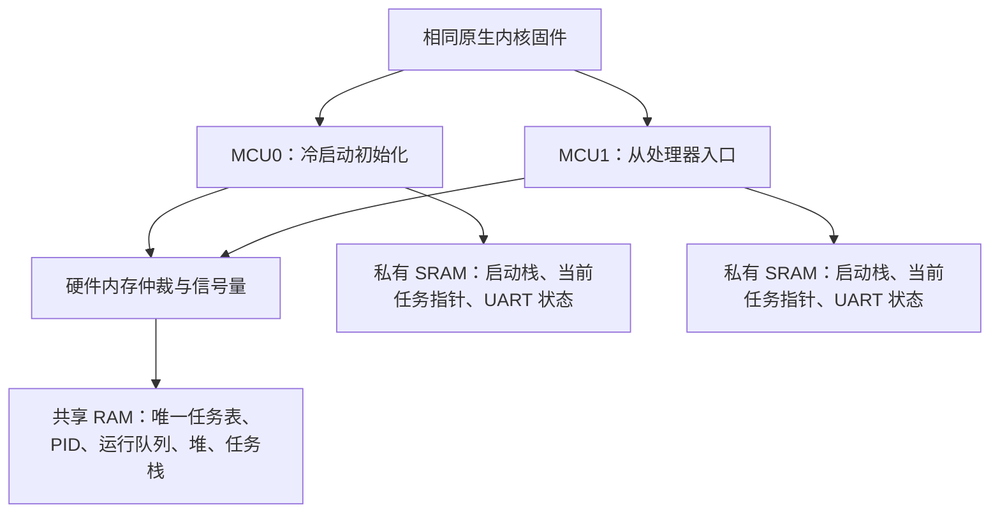

# 多物理 MCU 原生共享内存内核

本节设计基于“共享 RAM + 硬件总线仲裁”的多物理 MCU 原生内核方案，优先构建可运行的多核机制闭包，已有服务器 SMP、MCU 单机外设、UART 叶子和服务集群继续保留。

## 1. 目标和已实现边界

一个原生 A20OS 内核直接在多个物理处理器上执行。各 MCU 本地 Flash 中是**同一份固件**，共享 RAM 中只有一份任务表、PID 空间、运行队列、堆和普通任务栈。从 MCU 进入现有 `smp_secondary_init()`，不再运行一个独立的 `kernel_main()`。

现已实现可选的 ARMv7-M 共享内存端口，并用两个独立 Cortex-M3 指令引擎执行完整编译固件，验证一个 PID 的同一线程从 CPU1 迁到 CPU0，继续使用原来的栈和堆指针。引擎只模拟处理器及外设；固件运行时没有客户机内核、整机模拟器或 RPC 内存访问层。这个测试是开发阶段的指令模拟证据，**没有物理板运行证据**。

第一版是同 ISA、同端序、同固件、静态拓扑的协作式 SMP 内核。它复用服务器使用的 SMP 接口、任务生命周期和调度器；硬件适配不同。异构 MCU 的机器码和返回地址不能直接迁移。异构服务器/MCU 仍通过已有服务集群互操作，不能把不同 ISA 节点声明为这个共享内存内核的 CPU。



## 2. 内存与执行契约

| 区域 | 初始地址 | 初始化者 | 内容 |
|---|---|---|---|
| 本地 Flash | `0x08000000` | 各芯片烧写 | 完全相同的代码、只读数据、共享 data 初值 |
| 私有 SRAM | `0x20000000` | 每个 Reset_Handler | `.private.data/.private.bss`、8 KiB 启动/idle 栈 |
| 共享 RAM | `0x60000000` | 唯一冷启动主核 | 普通 `.data/.bss`、共享堆、8 KiB 普通任务栈 |
| 仲裁控制窗口 | `0x64000000` | 硬件整域复位 | 拓扑、启动权、释放位、信号量、IPI |

`kernel/arch/armv7m/boot/shared.ld` 是独立链接脚本。通常的 STM32 链接脚本不变。首个测试配置用 512 KiB Flash、64 KiB 私有 SRAM 和 1 MiB 共享 RAM。这是构建配置及模拟容量，不是对某块现有开发板的测量。当前地址引脚配置只允许 64/128/256/512/1024 KiB；更大容量需要补地址线或新板型，构建先拒绝，防止把地址镜像当成新增 RAM。共享容量必须由真实硬件保证；固件不在运行中的共享 RAM 上做破坏性容量探测。

每个 MCU 都执行本地 Flash 中的原生指令，直接加载/存储同一物理地址。共享对象不允许指向另一个芯片的私有 SRAM。私有设备描述符的地址只在当前 CPU 上有效，持有它时不得跨 CPU 迁移。普通任务栈来自共享堆；idle 栈始终绑定本 CPU，不能迁移。现有 `proc_sched_set()` 和 Park/Wake 协议负责迁移，不复制任务结构或栈，不创建第二个 PID。

最初里程碑只运行内核线程；后续已增加可选的 ARMv7-M 静态 PIE 应用、非特权 PSP 与可阻塞 Native SVC，见 [26-native-programs.md](26-native-programs.md)。公共 fabric 驱动已移到架构无关层，跨平台契约见[27-portable-domains.md](27-portable-domains.md)。完整用户环境、JVM 和图形输入仍未闭合；应用迁移通过不等于 Java 客户端已能启动。

## 3. 硬件必须提供什么

原型面向带 FSMC 的 STM32F103 大封装芯片，新增的 `shared_bus.c` 配置 NE1 共享 RAM 和 NE2 控制窗口、16 位异步总线，使用复位时 8 MHz HSI、保守 setup/turnaround 时序及 **PD6/NWAIT**。两个 bank 的 BCR 均为 `0x9011`， ASYNCWAIT=1、WAITPOL=0；PD6 配置为输入。它不是 Xuanwu 板现有 NE3 SRAM 接线；不能直接刷入并期待形成集群。NWAIT 在本模式中为必接线，旧版固定周期 `0x1011` 固件不能与这个可变等待桥组合。

已提供仲裁核心 `a20_fabric.sv`、独立每端口 FSMC 异步桥`a20_fsmc_bridge.sv`、可推导 FPGA RAM 后端 `a20_shared_ram.sv` 及顶层连接`a20_shared_top.sv`，路径均在 `hardware/shared-mcu/`。完整固件的共享访问已经与这些 RTL 联合仿真；尚无目标 FPGA 的综合/布局布线、容量与时序报告，也没有 PCB 或物理连线验证。RAM 后端是片上推导数组，不是已交付的外部 SRAM/SDRAM 控制器，1 MiB 参数不证明某块 FPGA 实际容纳得下它。

ASYNCWAIT 及异步等待时序参考 [ST RM0008 Rev21 §21.5.4/§21.5.6](https://www.st.com/resource/en/reference_manual/rm0008-stm32f101xx-stm32f102xx-stm32f103xx-advanced-arm-based-32-bit-mcus-stmicroelectronics.pdf)， PD6 映射参考 [ST STM32F103 高密度数据手册](https://www.st.com/resource/en/datasheet/stm32f103vd.pdf)。

硬件控制器必须：

1. 给每个物理端口提供唯一且稳定的稠密 CPU ID；ID0 是固定启动主核。
2. 将各端口的 RAM 窗口映射到同一真实存储，按总线访问仲裁。普通 RAM 不使用软件缓存；写完成后，其他端口的后续读必须看到它。
3. 提供真正跨端口互斥的原子信号量操作；普通 SRAM 的读写互斥不等于“读-改-写”原子性。两个芯片的本地 LDREX/STREX 和 IRQ 屏蔽不能代替它。
4. 访问期间先拉低 NWAIT，直到读数据稳定或写事务完成才释放，并保证公平仲裁。不能丢写、提前返回或只延长软件超时。固件保留 DATAST=15，实际板必须核对 NWAIT 断言延迟和手册的采样裕量；等待不是免除电气时序验证。
5. 整域复位同时清空启动权、attached、release、fault、IPI 和信号量所有权。仅复位一块 MCU 不清这些状态。上电必须先稳定 RAM 和仲裁器，再释放 MCU。

Infineon 的[双口 SRAM 数据手册](https://www.infineon.com/dgdl/Infineon-CY7C144AV_CY7C006AV_3.3_V_8_K_16_K_8_Asynchronous_Dual-Port_Static_RAM_Datasheet-AdditionalTechnicalInformation-v11_00-EN.pdf?fileId=8ac78c8c7d718a49017d71d00a720b29)给出了独立 semaphore latch、冲突仲裁和邮箱的实例，说明这些硬件机制有现成先例；该器件的容量、端口、引脚和寄存器布局**不匹配**这里的原型 ABI，不能直接当成兼容替代件。Cortex-M3 指令和屏障语义参考[ST PM0056](https://www.st.com/resource/en/programming_manual/pm0056-stm32f10xxx20xxx21xxxl1xxxx-cortex-m3-programming-manual-stmicroelectronics.pdf)。

## 4. A20 fabric ABI v1

这是新增控制器的接口规范，**不是现售 STM32 外设的寄存器**。除 MAGIC 外均使用 16 位访问，避免把一次有副作用的访问拆成两个总线周期。支持 2–16 个 CPU；普通服务器仍沿用已有的最多 32 位 CPU mask。保留地址不得触发隐式操作。错误不允许伪装为访问成功。

| 偏移 | 访问 | 语义 |
|---|---|---|
| `0x00` | 32 位只读 | MAGIC = `0x41323053`，由两个稳定的 16 位总线读组成 |
| `0x04` | 16 位只读 | 当前物理端口的 CPU ID |
| `0x08` | 16 位只读 | 本域 CPU 数，必须与 NR_CPUS 完全一致 |
| `0x0c` | 16 位读，有副作用 | CPU0 首次冷启动读返回 1 并独占初始化权；之后返回 0 |
| `0x10` | 16 位读/写 | RELEASE；CPU0 写 1 的位永久置位，读无副作用 |
| `0x14` | 16 位读/写 | FAULT；首次非零错误被锁存，不能软件清零 |
| `0x18` | 16 位读，有副作用 | 当前端口首次 attach 返回 1，后续返回 0，整域复位才清空 |
| `0x20` | 16 位写 | 将目标 CPU mask 的待处理 IPI 位置位 |
| `0x24` | 16 位读，有副作用 | 原子读并清除当前端口的待处理 IPI，返回 0/1 |
| `0x100` | 16 位读/写 | 原子操作门：未占用时读返回 1 并获取，否则返回 0；所有者写 1 释放 |
| `0x104` | 16 位读/写 | 共享堆门，获取/释放规则相同 |

获取门前控制器必须完成前一所有者发布的共享写；释放写完成前必须排空当前端口此前的共享写。错误所有者释放、非法端口或非法宽度访问应锁存 FAULT。RTL 核心在 FAULT 后不再发起 RAM 事务或授予新门，冻结该接口的写入；物理桥必须也遵守此行为。争用读返回 0，不排队拥有锁，也不允许同端口重复读被当成可重入获取。

桥使用三拍 strobe 同步和额外四拍 payload settling。主机须保持地址、选择、 byte lanes 及写数据直到响应；不是对每个 payload 位独立同步。NWAIT 在原始 strobe 上组合断言，响应后保持数据，NOE/选择撤销时立即关闭 DQ 输出。相邻事务的 active strobe 至少需六个 fabric clock 的空隙；当前固件保守的 setup/turnaround 覆盖该协议间隔，仍需目标时钟与布线约束证明。 FSMC A0 对应 CPU 字节地址 bit1，桥补低位零；未接的高地址输入必须固定为零。

非法双 CS/双读写 strobe、等待中 payload 改变或访问提前撤销会锁存桥错误`0x82`，经 `external_fault` 冻结全域。已受理的 RAM 事务排空一次，可能已产生写入；没有回滚。健康端口仍可读取 FAULT，坏端口保持等待，恢复需整域复位。核心错误 `0x80/0x81` 分别表示错误所有者释放/非法寄存器或 RAM 访问。

固件 FAULT 码：2 拓扑错误、3 不支持的 IPI、4 CPU ID/容量不匹配、5 重复 attach、6 冷启动权已使用。MAGIC 错误时不向未知设备写 FAULT，直接停机。共享初始化完成前的总线/异常故障也直接停机，不进入尚不存在的共享 console 锁。

## 5. 启动、原子操作和时间

所有 MCU 先只初始化自己的 SRAM，再连接总线。CPU0 获得 CLAIM 后复制共享`.data`、清共享 `.bss`，初始化一次堆、一次 `proc_init()`，通过公共 `smp_init()`发现 CPU。其他 MCU 不碰共享初始化，轮询硬件 RELEASE。

主核完成全局初始化后逐个 release。从核初始化本地 UART，进入公共`smp_secondary_init()`：绑定自己的 idle/current 槽、初始化本地异常向量和 SysTick，然后发布 online。只有所有配置的 CPU 均上线，才继续运行主核业务。启动等待仍复用公共 SMP 的有限循环，缺失从核明确失败，不宣称成功降级。

新模式使用 GCC `-fno-inline-atomics`，将 1/2/4/8 字节原子操作编译为调用`shared_atomics.c`。每个操作先保存并屏蔽本地 IRQ，再获取硬件原子门，完成读/写或 CAS，执行屏障并释放，最后恢复 IRQ。所有内存序先保守实现为完整序列化；64 位访问即使拆成多次总线传输也在门内完成。[GCC 文档](https://gcc.gnu.org/onlinedocs/gcc/Optimize-Options.html#index-finline-atomics)说明该选项控制原子操作的内联；测试同时检查最终固件没有 LDREX/STREX，避免误把芯片内 exclusive sequence 用到跨芯片数据。

共享堆用另一个硬件门；不退回芯片私有的外部堆。普通单 MCU 的 allocator 仍保持原行为。ARM 上下文切换在新模式中额外保存/恢复 PRIMASK，使新线程不会继承调度期间关闭 IRQ 的状态。新模式异常入口在调用 C hook 时保持 8 字节栈对齐；共享初始化前的异常不依赖共享 heap 或日志。

各 MCU 的 SysTick 都工作，CPU0 单独递增共享 64 位毫秒计数，从核启动不清零它。各核 SysTick 读取/确认硬件 IPI，并调用公共 reschedule handler。这是周期检查的 IPI，第一版没有专用外部 IPI IRQ 引脚。普通任务主动 yield 或阻塞，时间和 timer heap 来自同一时钟；第一版未启用强制抢占。CPU0 失效则时间不能继续推进，不能宣称具备容错时钟。

## 6. 复位和故障

共享内核的锁、栈和 current 槽不能像 RPC 作业一样自动重派。任意处理器可能持有内核锁或执行共享写，因此第一版不支持热加入、单芯片透明重启、锁抢占恢复或运行中拓扑改变。重复 attach 在接触共享初始化前被拒绝；测试确认单独重启任一 CPU 不会清共享任务/堆。FAULT 被本地 SysTick 或原子门的获取/释放检查检出后该 CPU 停机，但持锁停顿或失去时钟的 CPU 未必能处理它；恢复方式是整域复位。不可将这一机制描述成已经实现可靠的全域故障隔离或高可用。

物理部署需验证全部固件哈希相同、供电/上电顺序、仲裁时序和总线稳定性；当前尚无运行时固件哈希协商，也没有硬件 watchdog 联动复位实现。

## 7. 构建和复现

在独立 worktree 中执行，工具链需提供 `arm-none-eabi-gcc`：

```sh
make -j8 ARCH=armv7m ABI=native STM32_FLASH_KB=512 STM32_RAM_KB=64 \
  NR_CPUS=2 ALLOW_UNVERIFIED_SMP=1 MCU_SHARED_KERNEL=1 \
  MCU_SHARED_RAM_KB=1024 MCU_SHARED_TEST=1 kernel-only
python3 -m venv /tmp/a20-shared-test
/tmp/a20-shared-test/bin/pip install unicorn==2.1.4 pyelftools==0.33
/tmp/a20-shared-test/bin/python tools/check-mcu-shared-kernel.py \
  .kernel-build/armv7m-stm32f103-native-bringup-nommu-smp2-preempt-noxlator-stm32f103-f512k-r64k-shared1024k-selftest/kernel.elf \
  --report .kernel-build/cluster/shared-kernel/report.json
```

目录中的 `preempt` 来自现有通用构建选项命名；MCU profile 本身不启用通用内核抢占，此共享端口也暂不产生强制抢占 PendSV。未设置 MCU_SHARED_KERNEL 时沿用原固件目录。MCU_SHARED_TEST 也有独立后缀，正式共享固件不带测试线程。

测试先让从核到达 RELEASE 等待，确认被填入非零毒值的共享 RAM 完全未改，再启动主核。真实编译固件验证：

- 恰好一次 `kernel_main()`，其他 CPU 各一次从核入口。
- 1/2/4/8 字节原子操作、成功和失败 CAS、expected 回写、64 位进位。
- 两个 CPU 同时执行原子累加和堆分配/释放，有实际硬件门争用。
- CPU1 上创建的共享指针和线程栈在迁至 CPU0 后仍有效，同一 PID 连续执行。
- 无期限 Park/Wake 迁移、共同时钟唤醒迁移后的睡眠线程、实际 IPI 发送与确认、两个任务正常退出。
- 单独重启各 CPU 被 attach 锁存拒绝，保留共享内存字节不变。
- 不兼容 MAGIC、CPU 数不匹配、共享初始化前 HardFault 均在接触共享状态前停止。

测试器采用独立私有 SRAM 和同一 RAM backing，执行固件中真实启动汇编、 allocator、原子函数、scheduler 和 lifecycle。外设模型提供 UART、fabric 寄存器和 SysTick 异常入口/返回；不由宿主修改任务状态或调用迁移函数。 Unicorn 不实现的 Thumb YIELD 只作为执行让步提示处理，未替换实际内核指令。它不模拟 PCB 电气特性、总线时序、真实 NVIC 嵌套或故障注入，不能代替物理验收。

硬件事务核心可通过 `make check-mcu-shared-fabric` 复现，使用 Verilator 和三端口测试台。覆盖启动权、attached/release、IPI、并发信号量唯一所有者、 RAM 写完成之前禁止控制操作越过、字节通道、错误释放、故障后写屏蔽和整域复位。`make check-mcu-shared-bus` 进一步把三个异步物理端口模型接到真实桥/核心/RAM；包括长时间保持 strobe 不重复寄存器副作用、DQ 方向与保持、并发 RAM/门、字节通道、跨全域复位的 RAM 保留及撤销访问后的故障围栏。该测试将 RAM 响应故意延迟至 3 µs，超过原固定 DATAST，验证等待扩展。

`make PYTHON=/tmp/a20-shared-test/bin/python check-mcu-shared-rtl` 构建 C++引脚适配器，再执行双 Cortex-M3 的实际固件。**每一次**共享 RAM 读写与 fabric 访问均经过实际 RTL 桥、仲裁核心和推导 RAM；Python 的 RAM mirror 只向指令引擎交付 RTL 返回值，寄存器模型仅作为独立期望值断言。无宿主任务状态注入。门争用、同 PID/栈/堆迁移、正常退出及 CPU1 隔离复位拒绝均覆盖；联合测试因全域 FAULT 不可软件清零，只做一次隔离复位，原指令模型另覆盖逐 CPU 复位及早期启动拒绝。报告为 `report-rtl.json`。

Unicorn 2.1.4 安装 RAM hook 后在部分多指令步长边界跳过 Thumb 指令，空 hook 也复现；联合门禁限定逐条指令执行，默认五百万轮功能预算。总线事务由适配器依次完成，不证明多事务在途的时序；并发桥覆盖来自上面的独立总线测试。它也不证明真实 MCU 内部 FSMC/NVIC 或 FPGA CDC 的物理可靠性。接口和部署约束见 [hardware/shared-mcu/README.md](../../hardware/shared-mcu/README.md)。

## 8. 后续功能验收

当前里程碑：共享原生内核的启动、同步、堆、任务迁移已获指令模拟证据。接下来依次完成：

1. 仲裁控制器及真实总线连接，在至少两块物理 MCU 上复现同一固件的迁移测试。
2. 完整设备所有权/IRQ 路由、共享文件系统和完整用户程序执行；补齐抢占与异常路径验证，继续保持旧 MCU 外设和服务器 SMP 的回归检查。
3. 按真实 Java 客户端依赖选择更大共享 RAM 的 MCU 板型，完成 NOMMU 用户态、 Java 解释执行运行时及所需本地库、输入和软件图形栈。
4. 在 MCU 原生共享内核上显示真实客户端主菜单并响应一次输入，记录拓扑、固件/运行时/游戏哈希、串口日志和屏幕证据。性能不作为该验收的通过条件。

第 3–4 项的详细应用边界见 [24-single-system-minecraft.md](24-single-system-minecraft.md)。

无需真实 MCU 的另一个执行验证入口是[系统自带 QEMU 的双进程共享内核](54-stock-qemu-shared-kernel.md)：已验证真实内核任务跨进程迁移；当前为 x86_64/KVM bringup 后端，MCU 与完整客户端的验收要求仍按上述步骤推进。
