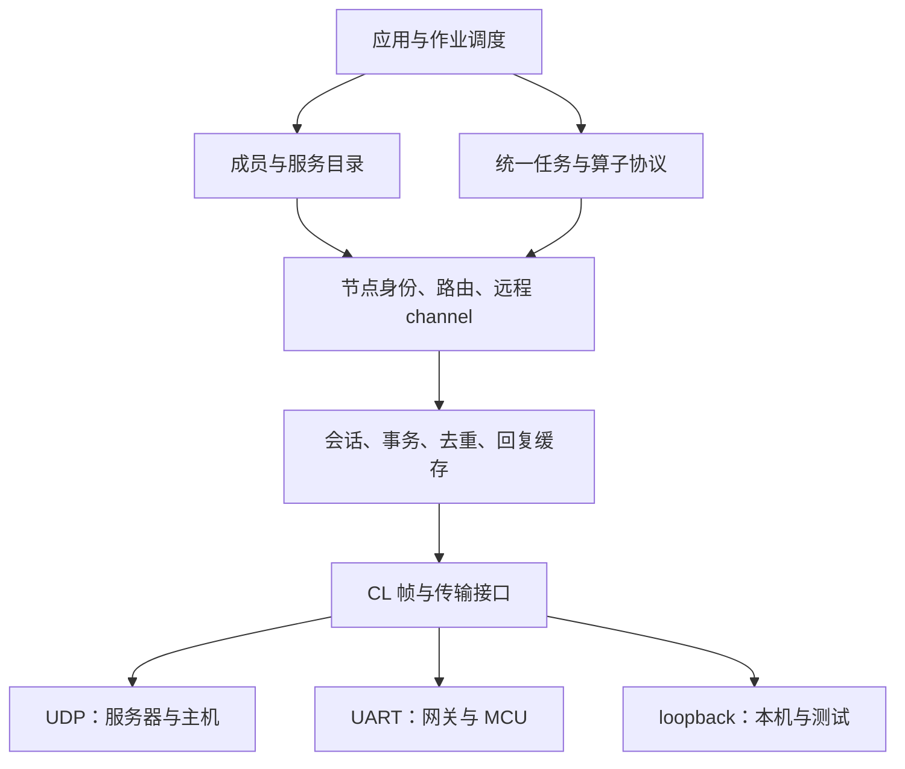

# A20OS 统一集群架构

本轮目标是让 STM32、树莓派、RISC-V 开发板/MCU 与 x86/ARM 服务器使用
同一套身份、寻址、调用、服务、作业与原生执行域接口。
资源档决定容量，节点能力决定可以执行什么。完整设计及验收约束见
[07-unified-runtime.md](07-unified-runtime.md)，实际证据见
[08-implementation-status.md](08-implementation-status.md)。

当前已实现独立内核 UDP、UART 主/叶、端到端会话、可靠调用与多跳 UDP 分片，
共用算子/能力协议，动态成员、服务目录、租约路由，持久部署配置与 Native
服务监管，以及分片重派和字节结果树归约。16 片词频已通过 8 主机和 6 主机+
2 leaf 两种配比的故障验证。物理板联调、完整生产故障矩阵、长期 soak 和性能
规模目标仍需独立验收，不能把仿真与构建等同于量产可用。

## 1. 分层

内核负责可寻址的数据面，成员策略、服务选择与作业重派由控制面和作业面负责。
MCU 没有进程加载能力时，使用静态缓冲和算子回调；主机可增加进程任务能力。
传输驱动不解释业务输入，网关不改写原调用者或事务身份。

## 2. 已落地的数据路径

1. 管理方设置非保留的 128 位 node_id，并安装目的节点路由。
2. 服务端导出 channel，取得不复用的 slot。
3. UDP/UART 完成 HELLO，绑定对端完整身份与链路地址，协商协议和能力。
4. 客户端连接 `(node_id, slot)`，得到普通 channel 句柄。
5. 代理线程将消息编码为 CALL；对端注入服务队列，回复按事务返回。
6. 可靠连接保留请求供有限重试；服务方先预留缓存，再执行请求，重复时重放回复。

本机 channel 快路径没有被改写。远程代理禁止传送本机 handle。
服务导出目前按 FIFO 配对请求与回复，要求服务按接收顺序回复；并行服务需要
后续显式事务服务接口，不能假装现有 FIFO 支持任意乱序完成。

## 3. 统一的边界

| 共用内容 | MCU | 主机/服务器 |
|---|---|---|
| 身份与服务寻址 | node_id、slot | 相同 |
| 帧与会话事务 | v0 基础帧、协商 v1 可靠事务 | 相同 |
| 内存管理 | 静态缓冲、单回复缓存 | 有界动态表与缓存预算 |
| 执行入口 | 预置算子/回调 | 算子与进程服务 |
| 控制策略 | 可交由网关代理 | 可运行成员与调度服务 |

具备共享 RAM 的 MCU 已复用服务器的原生调度器；资源有限的独立节点可使用
静态服务适配。两者共用业务协议，任务分配检查实际能力和消息预算。
CPU/板级接口和跨 ISA 的边界见 [27-portable-domains.md](27-portable-domains.md)；执行能力契约见 [28-execution-capabilities.md](28-execution-capabilities.md)。

## 4. 故障与信任

身份哈希冲突在路由安装时拒绝。可靠请求携带双方会话，重启后的旧请求不能
在新会话执行。节点重启或下一跳断链会取消旧代理，应用必须重新连接。

ACK 只表示接收方已接纳事务，不表示服务执行成功。调用完成依赖回复。
重试和等待均有上限；资源耗尽或超 MTU 不得静默丢弃并让调用永久挂起。
现有 channel ABI 以 `A20_ERR_CANCELED` 表达远程失败，精确错误在协议层保留。

CRC 是损坏检测，地址绑定不是密码学认证。当前部署范围为受控局域网或专用
串口；开放网络需要认证隧道或后续认证协议。

## 5. 使用与验证入口

- [01-abi.md](01-abi.md)：七个 Native syscall、句柄所有权与错误语义。
- [02-wire-protocol.md](02-wire-protocol.md)：v0 与协商 v1 事务扩展。
- [03-kernel-impl.md](03-kernel-impl.md)：线程、锁、缓存与生命周期。
- [04-transports.md](04-transports.md)：UDP/UART/loopback 接入与预算。
- [02-udp-demo.md](02-udp-demo.md)：真实双内核验收及故障注入。
- [05-userspace.md](05-userspace.md)：控制面与作业面目标，未落地项保留标注。
- [06-production.md](06-production.md)：生产验收要求。
- [17-deployment-supervision.md](17-deployment-supervision.md)：持久配置、服务监管与恢复。
- [18-wordcount.md](18-wordcount.md)：文件 CLI、通用结果与 16 片/8 节点演示。
- [10-operator-guide.md](10-operator-guide.md)：部署、拓扑、恢复、排障和信任边界。
- [20-hardening.md](20-hardening.md)：随机丢包、延迟、CRC、身份洪泛、分区、慢服务与 CI。
- [11-api-tutorial.md](11-api-tutorial.md)：从导出到 any 算子调用与自定义图。
- [19-routed-fragmentation.md](19-routed-fragmentation.md)：多跳分片协商与资源降级。
- [24-single-system-minecraft.md](24-single-system-minecraft.md)：多 MCU 原生单内核与 Java 客户端目标，客户端尚未实现。

- [25-native-shared-kernel.md](25-native-shared-kernel.md)：共享 RAM 与硬件仲裁的原生内核端口、功能证据及物理验收边界。
- [26-native-programs.md](26-native-programs.md)：静态 PIE、非特权 PSP、阻塞 Native SVC 与应用迁移证据。
- [../platforms/raspberrypi4.md](../platforms/raspberrypi4.md)：树莓派原生启动与公共 SMP 功能验收、设备和实物缺口。
- [27-portable-domains.md](27-portable-domains.md)：公共 fabric 驱动、跨架构接口、平台矩阵与缺口。
- [28-execution-capabilities.md](28-execution-capabilities.md)：统一执行信息、镜像初筛、Native/CW 查询与验收边界。

- [29-native-sync.md](29-native-sync.md)：公共用户原子操作、futex、MMU/flat 地址适配与验收边界。

历史轨道文件 `impl-prompts.md` 保留实施背景；当前进展以 08 文档为准。

统一运行实例与当前原生执行域状态接口见 [31-runtime-instance.md](31-runtime-instance.md)。

统一 Native 用户线程与生命周期扩展见 [32-native-threads.md](32-native-threads.md)。

同一内核中的稳定任务引用、PID 复用与关闭语义见
[33-task-object-lifetime.md](33-task-object-lifetime.md)。

运行实例的公共身份、不可变启动绑定与指针无关对象名见
[34-runtime-namespace.md](34-runtime-namespace.md)。同一接口用于共享 MCU 内核与服务器域。

运行实例的公共成员准入、跨 ISA 发现证明与兼容策略见
[35-instance-membership.md](35-instance-membership.md)。

对象目录已继续接入：按所属域解析全局对象名、租约发布和实际能力生命周期，
当前接口与验证边界见 [36-object-directory.md](36-object-directory.md)。
