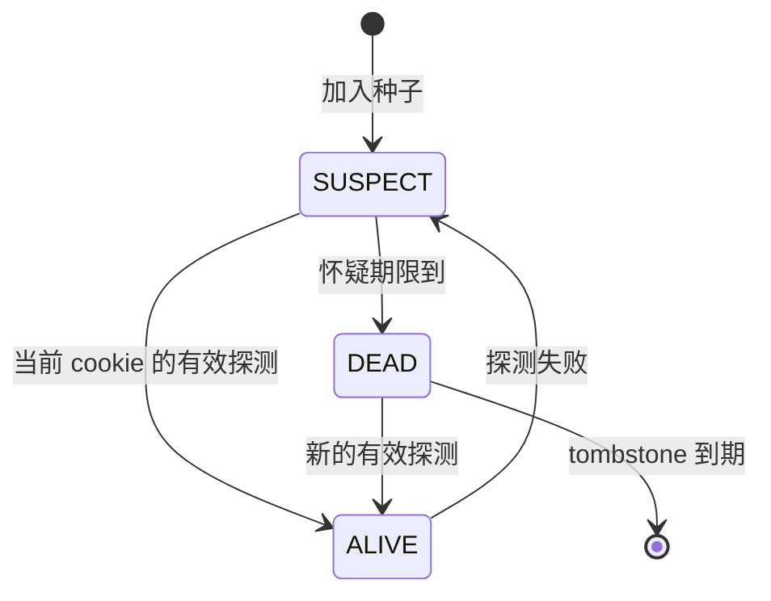

# 成员、目录与服务选择

实现入口：`user/svc/clusterd.c`；跨架构状态机：
`kernel/include/uapi/a20/cluster_membership.h`；Native 客户端：
`user/liba20rt/a20_cluster_client.h`。这些路径是实际代码，不是拟议模块。

## 1. 启动与配置

```sh
/bin/cluster-agent-rv 101112131415161718191a1b1c1d1e1f
/bin/clusterd-rv 101112131415161718191a1b1c1d1e1f \
  202122232425262728292a2b2c2d2e2f 10.0.3.3:44020
```

两个命令需作为独立进程运行。也可使用持久配置文件与 Native 监管者统一启动，
详见 [17-deployment-supervision.md](17-deployment-supervision.md)。以下参数不是
TOML 解析器。身份已经设置时可不带参数启动 clusterd，带身份
参数则必须与内核现存身份相同；种子为成对的 nodehex 与 IPv4:port。
其他架构使用其 Native 构建后缀，协议完全相同。

clusterd 读 SELF 快照、安装种子路由，再枚举已有内核路由并加入成员。自己也进入
成员表，因此 `any` 可选择本机 agent。默认成员表 32 项、服务表 64 项、每次目录
快照最多 8 个工作服务；可编译修改 `A20_CLUSTERD_MEMBERS`。不声称支持超出这个
控制面预算的成员规模。路由数量超过预算时计入 overflow 并跳过新增项，继续维护已跟踪成员；不能报告完整集群视图。

## 2. 存活与会话

每个成员维护 node_id、boot_epoch、incarnation、状态、探测 cookie 和期限。
boot_epoch 是不透明身份，不比较大小；cookie 在守护进程生命期单调、不回绕。
新种子从 SUSPECT 开始，不直接参与调度。



直接探测使用固定目录端点；成功后才能发布服务。探测周期约 1 s，总探测期限
1500 ms，直接阶段 700 ms；失败时最多委托一个存活 helper，450 ms 内接收结果。
helper 必须实际查询目标固定目录，不能把自己的缓存当成存活证明。
间接应答必须回显当前 cookie，只能确认已知的同一 boot_epoch，不能代替直接
握手认定一次重启。SUSPECT 期限 3 s，DEAD tombstone 30 s；重复怀疑不能延长期限。

直接发现新 epoch 时立即清除该成员旧服务。成员槽位复用同时清理旧探测 endpoint
和 helper 槽位。删除路由不会立即删除成员，后续探测使其进入 SUSPECT/DEAD。
CM/1 GOSSIP 已连接种子邻居间的有界增量传播，可发现未知目的并安装租约路由；
传闻只提供可达性提示，必须直接确认目的会话、目录和能力后才能调度。
跳数优先、同距 provider ID 决胜、split horizon 和过期回收见
[16-gossip-routes.md](16-gossip-routes.md)。这不是全局一致的最短路协议。

## 3. 目录发布

内核固定目录给出服务名、槽位、节点启动身份和 generation。clusterd 异步分页，
仅对声明 A20_EXPORT_WORK 的候选服务发 CW QUERY 获取算子及输入、输出、并发上限。完整枚举到 END 后才
原子替换旧目录。CHANGED 清空临时快照重试；目录半途失败不能发布半张表。
`cluster.control` 单独作为 helper 服务记录。未声明工作协议的服务不会被发送 CW，
因此无关服务不答复不会把健康成员误判为失联。LOCAL_ONLY 服务不进入远端目录。

服务租约 5 s；过期、节点 DEAD 或启动会话变化都会使服务不可选择。临时目录或
本地服务表容量不足保留上一完整快照至租约到期，不把本地容量不足误报为节点故障。
helper 槽位只在完整枚举成功后发布，重启后旧槽位立即失效。

## 4. CM/1 与 Native 客户端

控制服务导出名 `cluster.control`，请求固定 96 B，回复 80 B，小端且无 C 结构体
直接序列化。定义和字段偏移见 `kernel/include/uapi/a20/cluster_control.h`。
RESOLVE 按服务名、工作种类、算子 ID 与输入长度筛选；MEMBER 按物理表索引查询；
INDIRECT 用请求 cookie 关联 helper 的目标查询；GOSSIP 按游标分页传播节点提示，
同样回显 cookie，保留现有请求/回复尺寸。

`service://any/work` 采用轮询，排除 SUSPECT/DEAD、过期服务和能力不匹配的节点。
进程任务只匹配支持 PROCESS 的 agent，当前显式清单 ID 为 1、输入为空。
`service://<32hex>/name` 通过固定目录解析指定节点；该路径目前只查服务名，
不做与 any 相同的能力筛选，调用者仍需 CW QUERY/业务错误处理。
本机目标映射到 LOCAL channel；远端采用 reliable proxy。

客户端连接使用 cluster_connect v2 附带 expected_boot_epoch。内核创建代理时
核对当前协商会话，失败返回 NODE_UNREACHABLE；不能跨一次节点重启沿用旧解析。
已创建代理继续绑定原会话，链路重启会取消它。v1 ABI 的结构体和语义保持不变。

## 5. 故障与恢复

内核身份、路由、固定目录不依赖 clusterd。杀死并重启 clusterd 时，已建立业务
channel 继续工作；新进程重建成员和能力目录。服务退出由导出撤销和下一轮目录
更新反映，客户端任何失败后应关闭旧 endpoint，不能用下一调用接收迟到回复。
控制服务没有密码学认证，只能部署于受控网络/串口或经过认证的网络隧道。

验证：`make smoke-native-cluster` 覆盖真实 Native 服务解析、能力拒绝、守护进程
替换、服务退出与数据面连续性。`tools/check-cluster-mesh.py` 是三独立内核验证器，
包含间接探测、成员死亡/重启和跨节点作业；当前运行结果以实现状态表为准。

种子地址也接受 `uart:1`，将对应 node_id 安装为 UART 下一跳 1。当前生产头
绑定为 `ARCH=x86_64 CLUSTER_UART_COM2=1` 的独立 COM2；UART node_id 必须与
实际 leaf 身份一致，不能用短地址代替持久身份。配置示例见
[13-uart-head.md](13-uart-head.md)。

显式绑定运行实例时使用 CD/2 准入，旧 CM/1 的 any 解析也执行实例过滤；
CM/2 证明与启动代次限制见 [35](35-instance-membership.md)。
