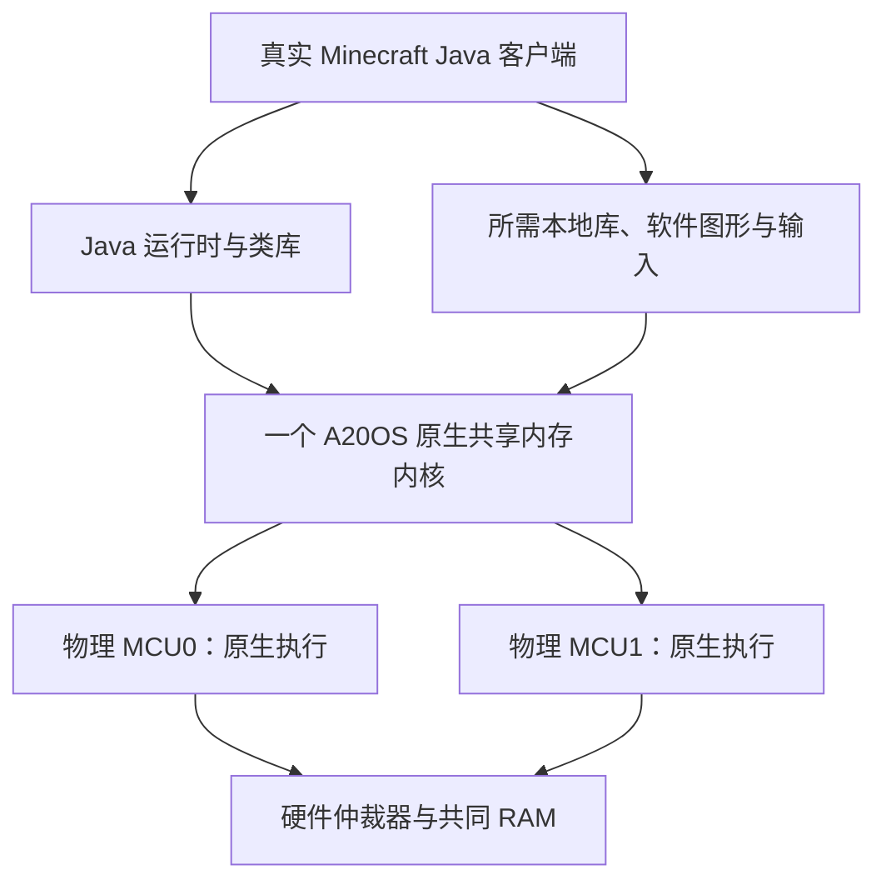

# 多 MCU 原生单内核与 Minecraft Java 客户端

2026-10-12。用户明确要求一个 A20OS 原生内核直接跨多个物理 MCU 运行，
允许增加共享 RAM 和硬件仲裁。先实现功能，不要求帧率、运行速度或可玩性，
保留现有功能。此前“每 MCU 运行独立承载内核，再共同模拟一台客户机”的
候选方案已被此目标取代。

## 1. 当前判断

允许共享 RAM 后，可以把多个 MCU 作为同一原生内核的多个处理器：本地
Flash 执行相同固件，共享 RAM 提供唯一的内核对象、任务栈和堆，仲裁器提供
跨芯片同步。实现契约、构建方法及证据见
[25-native-shared-kernel.md](25-native-shared-kernel.md)。

现已通过两个 Cortex-M3 指令执行环境运行实际 ARM 固件，完成主从启动、
共享 allocator、原子操作及同一线程跨 CPU 迁移。这是原生共享内核端口的
功能原型；尚未在物理 MCU 上运行，也未执行 JVM 或 Minecraft。

Minecraft Java 客户端最终是否能启动，仍需实际完成并验证运行时闭包。
放弃性能要求可以采用 Java 字节码解释执行、软件渲染，但不会消除 Java
类库、本地库、内存、文件、输入和图形接口的要求。JVM 是 Java 应用运行时，
这里不再用整机模拟或客户机 OS 替代原生内核。

## 2. 应用设计

第一步选择同 ISA、同 ABI 的 MCU，避免把任意机器码跨 ISA 迁移作为前提。
最小演示使用 STM32F103 类芯片是为了验证内核机制，不意味着默认 20 KiB
SRAM、Xuanwu 的 1 MiB 外部 SRAM或原型的 1 MiB 共享 RAM足以启动客户端。
普通单端口外部 SRAM不能靠连接第二块 MCU 自动变成符合同步契约的共享内存。

完整应用的 MCU 型号、数量、共享 RAM 容量和版本还未锁定。用户允许旧版，
应先在普通 A20OS 上固定一个真实客户端、JVM、本地库及资源，显示主菜单并
测内存和存储需求，再据此选择能直接寻址足够 RAM 的 MCU/控制器。不可仅把
各 MCU 的内部 SRAM 容量相加宣称形成应用堆；新的硬件内存窗口也必须反映在
链接、allocator、用户态内存布局和驱动中。

## 3. 需要补齐的实现

现有 MCU trim 只运行内核线程；它没有完整 Java 用户态环境。需要补齐：

1. 物理共享总线和仲裁器，主从固件启动及任务迁移的板上验收。
2. NOMMU 用户态入口、系统调用、可执行文件/动态库装载或明确的原生运行时
   装载方式；文件系统、时间、线程同步、共享 heap 和本地内存访问语义。
3. 能在所选 MCU ISA/ABI 上原生运行的 Java 解释器、相应类库和本地依赖。
   已有 x86_64 JVM/LWJGL 二进制不能直接在 Cortex-M 上运行。
4. 所选版本要求的真实软件图形路径、显示设备和输入事件。声音可关闭。

仓库已有 `tools/fetch-minecraft.sh` 和桌面包材料，默认载荷为 1.21.11。
组件依赖见 [Minecraft 组件记录](../distro/minecraft-components.md)，呈现路线见
[GPU 路线](../graphics/gpu-3d-roadmap.md)。这些材料可复用，但不证明当前
共享内核端口已有游戏运行能力。按
[Minecraft 1.20.5 官方说明](https://www.minecraft.net/en-us/article/minecraft-java-edition-1-20-5)，
该版本要求 Java 21 和 64 位 OS；因此不能把现代桌面载荷直接作为当前
32 位 Cortex-M 原型的默认运行目标。旧版依赖需逐项实际验证。

## 4. 完成标准

- 至少两块物理 MCU 运行同一原生 A20OS 内核，使用同一个 PID 空间和共享 RAM。
- MCU 侧原生运行真实 Java 客户端，显示主菜单并响应一次真实输入。
- 保留硬件拓扑/容量、固件与运行时/游戏哈希、串口日志和实际屏幕证据。
- 不设 FPS、启动时限或创建世界要求；如实记录耗时。
- 主机可以构建和调试；最终演示中的 JVM、渲染和应用内存均由已声明 MCU
  硬件承载。独立 OS 的 RPC 算子、服务器版、方块演示、宿主游戏串流或测试
  日志中的菜单文字，不能替代这个验收。

这个目标尚未完成。当前已把路线落实为可编译、可验证线程迁移的原生
共享内核端口，后续必须以物理硬件和完整客户端启动证据继续推进。
