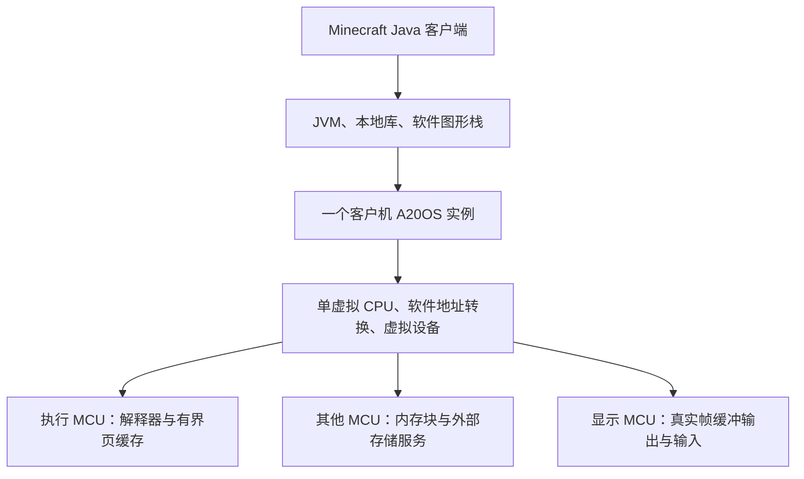

# 多 MCU 单系统与 Minecraft Java 客户端可行性

日期：2026-10-12。本文是应用目标与候选设计，**尚未实现或验证**。
用户允许选择 MCU 和游戏版本，要求启动真实 Java 客户端，不要求速度或可玩性。
现有集群的交付目标和未完成验收继续由
[07-unified-runtime.md](07-unified-runtime.md) 与
[08-implementation-status.md](08-implementation-status.md) 约束。

## 1. 判断与当前边界

放弃速度要求后，软件模拟 CPU、地址空间和设备提供了一条可以研究的路线。
这不是已经证明可启动 Minecraft 的方案，也不能由现有跨节点 CALL 推导出来。
任意增加 MCU 数量不会自动扩大单个进程的可寻址内存。

当前每块 MCU 运行自己的内核，静态 leaf 执行预置算子；主机通过相同协议执行
算子或进程服务。现有实现没有单进程跨节点地址空间、远程缺页、共享堆、
分布式线程同步或可启动桌面客户机的虚拟机。共享 node_id 也不会合并内核，
反而破坏现有唯一身份与会话契约。

STM32 默认 20 KiB SRAM 档无法直接容纳现有桌面运行环境。Xuanwu 档有
64 KiB 内部 SRAM 和可探测的 1 MiB 外部 SRAM，详见
[STM32 移植手册](../platforms/stm32f103-port.md)；这些容量仍不能证明游戏可启动。
小内存节点适合参与有界存储或设备服务，不适合作为第一版复杂模拟器的执行节点。

## 2. 两种“同一个实例”

| 解释 | 所需机制 | 当前状态 |
|---|---|---|
| 多节点提供统一服务和作业入口 | 唯一节点身份、RPC、目录、任务调度 | 已有实现，仍有性能及长期验收缺口 |
| 多块物理 MCU 共同承载一个逻辑 A20OS 机器 | 虚拟 CPU、统一客户机地址空间、远程内存/存储和设备 | 候选路线，未实现 |
| 单个原生 A20OS 内核直接跨物理 MCU 运行任意线程 | 分布式调度、地址空间、原子操作、内核锁与故障语义 | 独立的大规模内核设计，未实现 |

为了尽早检验游戏目标，候选路线是第二种：物理节点各自运行 A20OS 的
MCU 资源档作为承载层；集群共同呈现一台虚拟机器，在里面启动一个客户机
A20OS 实例。应用看到一个内核和一个进程地址空间。若要求物理层也只能有
一个原生内核，第二种路线不满足该要求，需要第三种路线。

## 3. 最小候选机制

第一版只提供一个虚拟 CPU。客户机线程由这个 CPU 轮流执行；增加物理节点
首先扩大存储与设备能力，不承诺加速。采用单一执行所有者和串行设备完成，
避免第一步就引入分布式缓存一致性与多个执行者之间的原子指令实现。

虚拟 ISA 必须根据 A20OS 客户机、完整 JVM 和图形本地库的可用性一起选择。
不能因为某个 RV32 模拟器能启动 Linux，就认为它能执行当前 x86_64 的 JVM
和 LWJGL 文件。保留现有二进制意味着需要兼容其 ISA 和系统环境；改用另一
ISA 则要构建并验证整套运行时及本地库。

客户机内存用固定大小的块定位到唯一存储所有者。执行节点用有界缓存取块，
脏块写回确认后才能释放或迁移。跨块访问、端序、异常和原子操作都必须有
明确定义；客户机页大小不必等于线协议消息大小。MCU 单帧预算小，可把块
传输拆成有界事务，不能直接向静态 leaf 发送主机的 64 KiB 分片消息。

外部 RAM、SD 卡或其他块设备可提供容量，内部 SRAM 只保留模拟器状态和
工作缓存。逻辑内存容量不能只声明一个大数字，必须有真实后备空间并覆盖
脏数据写回失败。存储不足返回明确错误，不能伪造读取成功。

最初节点失联就停止客户机并报告具体节点/块；不把 RPC 重试或作业重派等同
于共享内存恢复。进程状态恢复需要单独的检查点和一致性设计。

图形使用适配所选游戏版本的真实软件渲染路径，通过虚拟显示设备输出到 MCU
显示器或可验证帧缓冲。不要求独立 GPU；单纯创建 GL 上下文或打印菜单日志
不足以证明客户端主菜单已显示。声音可关闭，真实输入事件至少能到达客户机。

## 4. 已有桌面工作能复用什么

仓库已有 `tools/fetch-minecraft.sh`、桌面启动脚本和 OpenJDK 包配置。
默认载荷为 1.21.11；其组件审计见
[Minecraft 组件记录](../distro/minecraft-components.md)，桌面呈现路线见
[GPU 路线记录](../graphics/gpu-3d-roadmap.md)。这些是主机桌面工作的材料，
不是多 MCU 或当前提交的游戏运行验收。组件记录中 JVM/音频推进日志也不
等于看到了主菜单；不能把历史记录合并成一次不存在的成功运行。

用户允许旧版本，因此先比较旧版客户端与已有 1.21.11 载荷的运行时闭包和
实测峰值内存，再固定版本及哈希。不要把官方面向流畅游戏的最低配置当作
“一帧也不要求”的数学下限，也不要把减少帧率当成取消 JVM 和图形依赖。

## 5. 逐级验收

1. **客户端基线**：固定版本、JVM、本地库、资源文件和参数，在普通 A20OS
   实例中显示真实主菜单；测峰值内存、磁盘使用和实际图形入口。先得到完整
   依赖闭包，再依据测量选择 MCU、外部存储和虚拟地址空间预算。
2. **远程存储原语**：独立节点间真实读写，覆盖跨块、脏块驱逐、重复请求、
   断链、重启旧 epoch、容量耗尽；记录操作编号、校验和、内存与消息预算。
3. **单机器语义**：先在主机模拟物理节点，启动一个客户机 A20OS；客户机
   程序读写跨节点后备的地址，线程同步及文件/显示设备行为正确。
4. **MCU 承载**：在物理 MCU 上推进相同客户机；至少两个 MCU 承担执行期间
   不可省略的内存或设备工作。移除服务节点应产生预期故障，证明不是空闲陪跑。
5. **客户端启动**：真实 Java 客户端显示主菜单并响应一次输入。保留固件、
   游戏/运行时哈希、拓扑、串口日志和画面证据；不设 FPS 目标，记录实际耗时。

第 5 项不要求创建世界；进入世界可以作为后续里程碑。服务器启动、方块演示、
兼容协议的 C 程序或主机远程串流不能代替 Java 客户端验收。
普通主机可用于构建和调试；最终声称“全 MCU 承载”时不能由主机执行游戏、
JVM、渲染或提供未声明的客户机内存。

## 6. 外部依据与证据限度

- [Minecraft 1.20.5 官方发布说明](https://www.minecraft.net/en-us/article/minecraft-java-edition-1-20-5)
  明确该版本要求 Java 21 和 64 位操作系统；这是该版本的依赖，不代表所有旧版本。
- [mini-rv32ima 上游](https://github.com/cnlohr/mini-rv32ima) 提供可嵌入的
  RV32 模拟器和 Linux 演示，说明软件模拟路线有现实基础；它不证明 Minecraft、
  完整桌面运行时、分布式内存或本设计已经可运行。

可行性结论是：在允许外部存储、选择合适 MCU 和版本、增加完整模拟层的条件下，
值得做分阶段原型；现有代码不能直接完成目标，真实启动结果须由上述验收给出。
