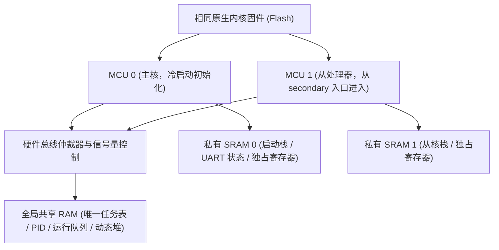

# 多物理 MCU 原生共享内存内核规范

在无 MMU（NOMMU）的嵌入式多核环境中，A20OS 支持通过“**共享 RAM + 硬件仲裁器**”机制，让多个物理 MCU 对称执行同一个内核固件。多个微控制器共享同一套全局任务表、PID 命名空间与内存堆，形成紧耦合的嵌入式对称多处理（SMP）系统。

---

## 1. 硬件拓扑与内存契约

### 内存布局划分

| 内存区间 | 映射基址 | 初始化方 | 存储内容 |
|---|---|---|---|
| **本地 Flash** | `0x08000000` | 静态烧写 | 完全相同的代码段（`.text`）、只读数据（`.rodata`）与初始化初值 |
| **私有 SRAM** | `0x20000000` | 各核 Reset Handler | `.private.data`、`.private.bss`、8 KiB 专属启动栈 |
| **共享 RAM** | `0x60000000` | 唯一冷启动主核 | 全局 `.data/.bss`、共享动态堆、8 KiB 普通任务栈 |
| **硬件仲裁窗口** | `0x64000000` | 硬件复位状态 | 核心拓扑、总线锁状态、跨核 IPI 中断寄存器 |

---

## 2. 跨芯片任务调度与迁移

1. **主从初始化**：主核 MCU 0 负责初始化共享堆与调度就绪队列，随后通过仲裁寄存器释放从核复位线；MCU 1 跳过通用内核主函数，直接进入 `smp_secondary_init()`。
2. **上下文切换与迁移**：
   * 线程在非特权 Thread 模式（使用 PSP 栈）执行用户程序；
   * `svc #0` 触发系统调用时，汇编处理器保存寄存器帧并进入特权 Thread 模式；
   * 阻塞或主动 yield 时，任务上下文保存在共享 RAM 的任务控制块中，唤醒后可由任意空闲的从核或主核拾取执行，实现跨芯片的透明线程迁移。

---

## 3. 同步原语与总线互斥

在没有硬件 Cache Coherency 的物理 MCU 间，互斥锁通过硬件仲裁控制窗口的原子测试并置位（TAS）寄存器或互斥门（`core/shared_fabric.c`）实现，严格禁止使用普通的非总线锁变量进行跨核同步。
