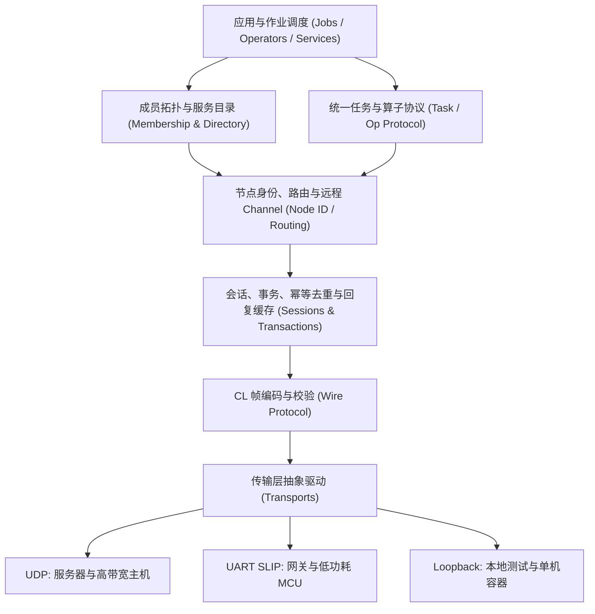

# 集群架构、节点角色与拓扑设计

A20OS 统一集群机制致力于消除传统嵌入式系统与服务器集群之间的协议割裂。无论运行在 20 KiB 内存的微控制器（MCU）、多核嵌入式开发板，还是数十核的 x86/ARM 服务器上，所有节点在**身份标识、寻址空间、帧协议、调用事务与服务发现**层面均遵循一致的设计规范。

---

## 1. 核心架构分层

系统在职责上严格解耦：
- **内核数据面**：只负责寻址、帧编解码、路由表查找与 Channel 传输代理，禁止在中断/快路径中执行动态内存分配。
- **用户态控制面**：负责心跳保活、拓扑收敛、租约管理、服务注册与跨节点算子匹配。
- **传输层**：只负责字节搬运与链路 Framing，不解释上层业务数据，亦不改写发送方身份。

---

## 2. 节点角色与能力分级

集群节点根据硬件规格与系统能力分为三种标准角色，但对外暴露相同的协议接口：

| 角色 | 硬件特征 | 内存管理策略 | 支持的执行能力 | 典型平台 |
|---|---|---|---|---|
| **叶子节点 (Leaf)** | Cortex-M / RV32 NOMMU，资源受限 | 全静态缓冲、单回复缓存 | 预置算子回调、静态数据流 | STM32F103、Hi3861 |
| **网关节点 (Gateway)** | 双网络接口 (UART + Ethernet) | 动态会话缓冲、有界转发队列 | 跨介质包转发、协议代理 | 树莓派、边缘路由 |
| **计算主机 (Compute Host)** | 多核 64 位、带 MMU、完整用户态 | 动态内存堆、完整 VMO/VMAR | 动态 ELF 装载、多线程任务、JVM | RISC-V 64、x86_64、AArch64 |

---

## 3. 寻址与路由拓扑

1. **节点标识符 (`node_id`)**：全局唯一的 128 位数字标识，高位保留用于广播与组播，低位为节点物理/逻辑身份。
2. **服务槽位 (`slot`)**：单节点内导出的服务通道索引（16 位）。客户端连接 `(node_id, slot)` 即可获得标准 A20 Native Channel 句柄。
3. **拓扑组织**：支持直连拓扑、星型拓扑（网关汇总）以及网状拓扑（通过 Gossip 交换路由状态）。

---

## 4. 1.0 语义边界与保证

按照 A20OS 1.0 发布范围定义，A20OS 集群提供**当前 Owner、当前会话内至多一次可见执行**的事务保证：
- 重复 START 返回相同根任务结果，不重复执行。
- 节点重启导致 Epoch 失效，旧凭证返回 `EXPIRED`，不作跨重启持久重放。
- 在线进程不支持跨异构架构的动态内存热迁移；故障恢复以“明确失败并安全清理资源”为契约。

详细技术实现请进一步参阅：
- 线缆帧格式与传输：[02-wire-protocol.md](02-wire-protocol.md)
- 运行时与单系统映像：[runtime-ssi.md](runtime-ssi.md)
- 多 MCU 共享内存内核：[mcu-shared-kernel.md](mcu-shared-kernel.md)
- 应用服务与批处理作业：[cluster-apps.md](cluster-apps.md)
