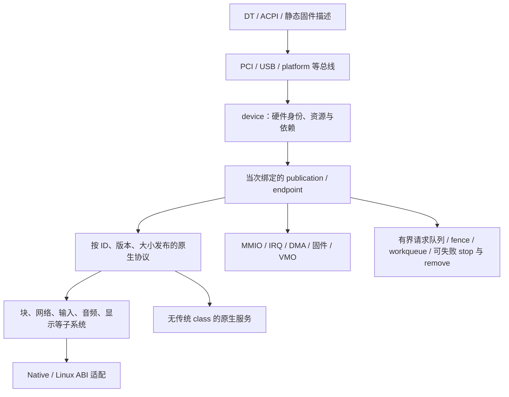

# 核心设备与驱动模型

`device_t`、`driver_t`、`bus_type_t` 三个对象如何配合，probe/remove 的完整回滚流程，以及一份可直接编译的 PCI 网络驱动骨架。具体声明以 `kernel/drivers/core/driver_core.h`、`driver_class.h`、`driver_register.h` 为准。

开发具体设备的路线见[第一个驱动](getting-started.md)，修改公共机制的路线见[框架维护与扩展](framework-development.md)。本页集中说明对象、生命周期和同步 PCI 骨架；异步后端使用[请求与队列](request-queues.md)。

## 架构与开发入口

驱动框架分成发现、绑定、协议、资源、执行和部署六部分。它们服务于字符、块、网络、输入、音频、显示和没有传统设备节点的控制器/服务。硬件协议留在具体驱动，Linux 文件/ioctl 和 Native handle 是上层适配，不定义内核对象的所有权。



| 部分 | 驱动作者依赖的接口 | 框架保证与作者责任 |
|---|---|---|
| 发现与归属 | firmware node、bus match、device_register、dependency | 一个硬件实例由一个枚举者发布；驱动不重新扫描/配置已归属硬件 |
| 绑定与服务 | device_add_protocol、device_endpoint_get、driver_protocol_begin/end | 每次绑定有独立不可变协议快照；离线拒绝新调用，排空后才能回收实例/代码 |
| 传统设备类 | class_ops、原生 primary protocol、class adapter | 六类既有驱动自动提供协议；扩展能力无需修改所有类的公共 vtable |
| CPU/设备资源 | checked MMIO/port claim、IRQ、DMA domain/mapping、原生 buffer/VMO | 地址空间、访问许可、缓存交接、存储引用和硬件停止分别管理；错误不得静默退化成裸物理 DMA |
| 执行与完成 | queue/request、IRQ、fence、watch、共享 workqueue | 有界 admission 与并行 active、FIFO 依赖、排队取消；IRQ complete 后任务退休成功才 signal fence，stop 失败保留绑定与请求 |
| 部署与用户边界 | 同一 driver_t、.a20drv、用户态服务代理 | 内建和模块同一生命周期；用户服务还要经过 Native 权限/资源仲裁，协议 ID 本身不授权硬件访问 |

四类所有权不能混用：device 引用保留硬件元数据；endpoint 引用保留当次绑定的服务身份；access 保留一次正在执行的调用；VMO/buffer/mapping 保留存储与地址。前三者都不自动保留方法返回的缓冲区。引用计数、DMA 失效、producer 停止和用户权限各自有明确条件。

## 原生协议：组合能力而非扩大全局 vtable

公共入口是 `drivers/core/protocol.h`。endpoint 是现有 publication 的原生服务角色，不另建对象目录或一套设备注册表。一个驱动可发布多个协议，协议描述符复制进现有 devres，在 probe 成功后形成排序的不可变快照；不属于传统 class 的服务同样可取得 endpoint，而不伪造 `/dev` 节点。MCU 复用同一发布/调用核心，不依赖 devfs/sysfs。

协议以 ID、语义版本、实际 ops 大小和 capabilities 描述。版本必须相等，结构允许同一版本下追加兼容尾部，consumer 声明自己需要的前缀大小及能力位。未知 ID、短表或缺少能力返回 EOPNOTSUPP，版本不符返回 EPROTONOSUPPORT，旧绑定离线返回 ENODEV，失败清空 access。元数据可在 offline 后读取；operation table 只能在成功 access 内使用。

字符、块、网络、输入、显示、音频的既有 class_ops 自动发布为相应 `DRIVER_PROTOCOL_*`，版本为 1，大小为实际传统表大小。新增独立扩展协议不改变 device_t/driver_t 布局，也不要求所有驱动同步扩展公共表；旧 class ABI 的布局变更仍按模块 ABI 规则处理。ID 是类型标识，不是用户 capability。内核保留 A20 命名空间，实验/设备私有协议应选择不冲突的私有 ID；同一绑定的重复 ID（含自动 primary）被拒绝。

登记必须发生在本设备的 probe 内，推荐在启动硬件前登记，失败即可按普通 probe 回滚。描述符被复制，但 ops 及其代码必须在绑定停止前有效，不能指向 probe 栈。调用准入/结束不分配，不调用最终析构，也不获取全局生命周期 mutex；每 endpoint 准入锁加本地二分查找构成调用路径。caller 的 endpoint 引用必须覆盖整个 access；结束只交还 active call，随后由 caller put endpoint。方法是否可从 IRQ 调用由协议本身规定，不因通用准入 IRQ-safe 就允许任意方法阻塞。

例如，无需增加新的 class enum，温度服务可发布一个私有协议：

```c
struct temperature_ops {
    int (*read_millicelsius)(struct device *, int32_t *out);
};
static const struct temperature_ops temperature = { read_temperature };
static int sensor_probe(device_t *dev) {
    const struct driver_protocol_descriptor service = {
        .info = { 0x8000000000000001ULL, 1, sizeof(temperature), 0 },
        .ops = &temperature,
    };
    int ret = device_add_protocol(dev, &service);
    if (ret) return ret;
    /* map declared resources, initialize per-device state, then start hardware */
    return sensor_start(dev);
}
```

consumer 从自己已拥有引用的 device 取得 endpoint；旧 endpoint 永远不会转到重绑后的新驱动：

```c
driver_endpoint_t *endpoint = device_endpoint_get(dev);
if (!endpoint) return -ENODEV;
const struct driver_protocol_requirement need = {
    0x8000000000000001ULL, 1, sizeof(struct temperature_ops), 0,
};
struct driver_protocol_access access;
int ret = driver_protocol_begin(endpoint, &need, &access);
if (!ret) {
    const struct temperature_ops *ops = access.ops;
    ret = ops->read_millicelsius(access.device, &temperature_value);
    driver_protocol_end(&access);
}
driver_endpoint_put(endpoint);
return ret;
```

网络统计是实际扩展协议：VirtIO-net、RTL8139 通过 NET_STATS 提供非阻塞计数快照，class_net_read_stats 隐藏版本/大小检查；lwIP 消费者不依赖具体驱动符号。模块与内建走相同查找与离线保护。它说明了扩展标准方式；队列、设备专属能力和其他类也应在这一模型上组合，而不是新增架构专有 getter 或重复注册表。

## 完整开发流程

1. 选择已有总线/固件描述和设备类；列出公开协议、必需资源、数据单位、错误与执行上下文。独立服务可只发布原生协议。
2. probe 在硬件启动前建立失败清理所有权、协议元数据和实例；所有可失败分配预先完成，再申请 MMIO/IRQ/DMA 并启动 producer。
3. 控制面使用有界同步操作；数据面围绕每设备/队列组织，批处理与 SG 由对应协议显式协商，不在每包路径分配框架对象。硬件队列格式属于驱动。
4. 对异步 DMA，请求保留 owning backing/mapping 和 producer fence，IRQ 只发布已确认的完成并调度任务工作；超时不提前交还硬件仍可访问的存储。
5. 退出遵循可选 prepare → consumer/child → offline → execution stop → quiesce → active call drain → remove → devres。remove 无法确认停止/失效时返回错误并保留实例/队列/代码，显式重试；不能通过释放资源制造“成功”。
6. 将驱动打包为内建、模块或已有受支持的用户服务形态；ABI 适配检查用户权限，不能把内核协议描述符直接暴露成不受约束的用户调用。
7. 验证正常 I/O、多实例、进程/消费者退出、并发调用与解绑，以及初始化/停止失败。测试匹配实际改动范围；硬件或平台未验证的能力保持明确的支持边界。

通用协议与生命周期可服务不同驱动，但不替具体设备实现复位、IOMMU 后端、GPUVM 或固件协议；这些能力按后端声明支持。异步驱动以[原生请求与队列](request-queues.md)统一 admission、完成、退休和停止；硬件专有调度、主动 abort 与恢复策略仍通过设备协议实现。

## 三个核心对象

`device_t` 代表一个硬件实例，由总线或板级枚举器创建。创建者拥有设备名、资源数组和 `plat_data` 的存储。注册表、父子关系、依赖和进度快照会持有设备引用；动态对象通过 `release()` 在最终 `device_put()` 时回收，不能在 `device_unregister()` 返回时直接释放。不要在枚举函数栈上分配设备描述。

`driver_t` 代表一种驱动实现，通常是一个文件内的静态对象。一份驱动可以绑定多个设备。`class_type` 和 `class_ops` 向块层、网络栈、输入层、显示层或音频层提供稳定接口。

`bus_type_t` 决定某个 `device_t` 是否匹配某个 `driver_t`。PCI、VirtIO-MMIO 和 platform bus 已有公共实现。固件设备通过统一 `fw_node_t` 枚举器发布；没有 DT/ACPI 的固定硬件使用静态 provider。原生总线负责自身子设备，不应为每个设备定义私有 bus。启动与完整发现契约见 [启动模型](../../dev/boot-model.md)。

## 四层边界

设备支持按以下四层组织。上层只能依赖下层公开的能力，不能跨层读取板级常量：

| 层 | 负责内容 | 不负责内容 |
|---|---|---|
| CPU 架构层 | MMIO/port I/O 原语、内存屏障、cache sync、虚实地址转换、异常与中断入口 | PCI class、NVMe queue、HDA widget 等设备协议 |
| 平台/board 层 | RAM 与设备窗口、ECAM 地址和 bus 范围、IRQ controller/路由、固定 platform device 资源 | 解析通用 PCI function 或实现协议 I/O |
| 总线层 | 枚举 function、读取 ID、BAR sizing/assignment、资源发布和第一阶段 ID 匹配 | 控制器复位、命令队列和 class 语义 |
| 协议驱动层 | 通过公共 PCI/MMIO/DMA/IRQ API 实现寄存器协议、probe/remove 和 class ops | 硬编码 ECAM、物理 BAR 窗口、页表偏移或 CPU 指令 |

因此 NVMe 和 HDA 属于 PCI 协议驱动：源码不应由 `CONFIG_X86_64` 包围。它们能否在某个平台实际工作，取决于该平台是否已经提供可访问的 ECAM、BAR 资源、DMA 地址转换和必要的 cache 一致性。PC Speaker 消费端口 I/O 能力和 PIT 协议；端口指令由架构后端实现，设备可用性由 ACPI 或静态硬件描述决定。

“架构无关”不等于“所有平台已可运行”。驱动在某架构成功编译，只证明没有静态架构依赖；必须在该平台观察到枚举、绑定和真实 DMA/I/O 完成后，才能标记运行验证。

probe 成功后，核心自动创建一个 `class_device_t`。该对象负责稳定 class 编号、devt、devfs/sysfs 发布和断开状态。驱动不得自行创建硬件节点。当前 char、block、audio 分别自动发布为 `/dev/charN`、`/dev/diskN`、`/dev/audioN`；所有 class 都出现在 `/sys/class/<class>/`。

绑定后的关系如下：

```text
device_t                         driver_t
name                             name
bus ---------------------------> bus
drv ---------------------------> driver
drv_priv ----> per-device state  class_ops ----> typed ops table
plat_data ---> bus-owned data
res[] ------> MMIO/IRQ/DMA/MEM resources
matched_id --> matched id_table entry
```

`plat_data` 属于总线或板级代码，驱动不得释放。`drv_priv` 属于驱动，probe 时创建或选定，remove 时清理。类操作只接收 `device_t *`，通过 `dev->drv_priv` 找到实例。解除绑定时，核心先标记 class device offline，执行可选的 `quiesce` 停止新提交并结束软件请求，再等待已进入驱动的 class 调用退出，最后调用可失败的 `remove`：仅返回 0 后才释放受管存储、依赖和绑定；非零保留 `REMOVING` 绑定及注册引用，旧 class 句柄保持离线，调用者显式重试。经该 publication 准入的后续调用返回 `-ENODEV`；仍绕过 class 的旧消费者须单独迁移。原生异步请求的完整契约见 [原生驱动运行时](native-runtime.md)。

持有旧 class publication 的消费者，可用 `class_device_binding_stopped()` 区分离线与旧绑定已经成功停止。该凭据仅在显式 remove 成功进入核心 devres 回收时成立，重绑不改变旧凭据，没有 remove 则不成立。它不延长存储或证明全部资源已经析构；调用者必须保留 publication 引用。完整条件和局部 devres 回滚见 [原生停止凭据](native-runtime.md#原生-publication-的绑定停止凭据)。

DISPLAY provider 通过 ABI 12 `get_capabilities` 声明原生 SCANOUT/RENDER/RAM_SCANOUT/BOOT_SCANOUT。默认输出排除 headless，先比较渲染能力，同级优先原生管理输出，等分保持；不再从 virgl 表推断。能力快照是元数据，不固定 backing 或授予硬件访问；consumer 在 scoped access 内查询，见 [原生能力与默认选择](native-runtime.md#原生-gpu-能力与默认选择)。

固定 RAM 的 DMA 请求可用 `driver_dma_map_owned_vmo` 保留原生 VMO 的整个 backing 与原始预算 owner；设备只获得选定页视图。映射、存储引用与硬件停止仍分别管理。buffer/VMO 最终 put 在 domain 锁外，失败失效保留句柄供重试，见 [VMO owner](native-runtime.md#持有-vmo-的-dma-视图与锁外-owner-退休)。

驱动使用原生 fence watch 通知时，登记仅保留 fence，不保留模块代码/context。quiesce/remove 必须先停止通知/工作 producer；watch try_remove 返回 EBUSY 时保留 owner 并重试，成功后仍需排空已调度的工作才能回收上下文。不能以 fence terminal 或 class offline 推断 callback 已返回，见 [一次性通知](native-runtime.md#一次性通知与显式撤销)。

## 数据结构字段

### `device_id_t`

```c
typedef struct device_id {
    uint32_t vendor;
    uint32_t device;
    uint32_t subvendor;
    uint32_t subdevice;
    uint64_t driver_data;
} device_id_t;
```

ID 表以 `{ 0 }` 结束。PCI 驱动对不限制的子系统字段必须写 `VENDOR_ANY` 和 `DEVICE_ANY`，不能省略为零。匹配成功后，总线把 `dev->matched_id` 指向对应项，驱动可以读取 `driver_data` 选择硬件变体。

### `resource_t`

资源类型包括 `RES_IRQ`、`RES_MMIO`、`RES_IOPORT`、`RES_DMA`、`RES_MEM`。`RES_MMIO` 始终存 CPU 物理地址，通过 `device_map_mmio()`、`device_map_resource()` 或 `pci_map_bar()` 取得映射；禁止直接解引用 `start`。`start` 和 `end` 都包含在范围内，所以长度计算为：

```c
uint64_t size = res->end - res->start + 1;
```

先验证 `end >= start`，再计算长度。通过 `device_get_resource(dev, type, index)` 按类型取资源；PCI 的物理 BAR 编号必须用 `pci_get_bar_resource(dev, bar)`，因为 64 位 BAR 会让资源数组压缩，不能假定 BAR2 等于 `RES_MMIO` 索引 2。

受管 MMIO 映射现在同时申请设备独占的地址区间；`device_map_mmio()`、`device_map_resource()` 和 `pci_map_bar()` 使用同一路径。不同设备的重叠申请失败，同一设备可重复申请，各自保留独立生命周期。需要区分冲突与分配错误时用 `device_map_resource_exclusive(dev, res, &mapping)`，失败清空输出；资源必须属于 `dev->res`。映射回收先执行 architecture unmap，再释放区间占用。

`device_claim_resource(dev, res)` 可仅申请受管 MMIO/port I/O 占用；`driver_resource_request()` / `driver_resource_release()` 则提供显式句柄，适合需要跨 unbind 保留资源的恢复路径。显式句柄保留设备引用但不保留绑定，须由调用者管理 stopping 状态和释放时机。占用登记只覆盖使用这些 API 的访问者。hosted 启动还以独立存储对象保护受管 RAM 与 ACPI 表页；其余固件/RAM 和 PCI window 预留尚未完整导入；完整契约见 [原生驱动运行时](native-runtime.md)。

物理存储使用独立的 `driver_memory_reserve()` / `driver_memory_release()` 句柄，复制区间并跨设备解绑保留。它阻止基本/checked MMIO claim、受管映射和冲突设备发布，不能通过同 owner 绕过；不为 PFA 分配或预留页面，也不承担 DMA 隔离。详细语义见 [物理存储保留对象](native-runtime.md#物理存储保留对象)。

需要核对未绑定设备的地址声明时，使用 `driver_resource_request_checked()`：owner 必须已注册，核心在生命周期锁内核对其他已发布设备的 MMIO/`RES_MEM`/port 声明及 active claims，再建立句柄。句柄存续时，新设备不能发布冲突声明；owner 注销后保留的句柄仍然生效。此接口不推断 parent/window 的共享例外，资源归属歧义须显式解决。

`device_is_registered(dev)` 仅观察核心注册表成员关系，不增加引用，也不表示驱动在线。失败解绑仍保留注册关系，但 class 已离线；持有 device 引用只保护对象存储，不能绕过注销；需要把检查与后续操作协调时，调用者须持有生命周期事务。

`class_device_get_by_type/get_nth` 按在线 publication 稠密枚举；离线但尚未撤销的条目不占 rank。`class_device_get_by_index` 查询稳定 publication index，离线项返回 NULL，不随 rank 压缩改指其他对象。

CPU 物理视图通过 MM 的 `mm_mmap_physical()` 统一安装/回滚；它借用物理存储，不增加 device/resource 或 backing 引用。fbdev 和用户驱动 adapter 仍须各自核对可映射范围、保留存储或在回收前撤销映射，见 [原生物理视图](native-runtime.md#驱动-cpu-物理映射事务)。

DISPLAY 默认选择复用 class publication：选择保留 device 元数据，消费者用 `gpu_device_default_begin/end()` 捕获一个绑定的 device/ops 和 active call；离线旧 publication 不会跟随重绑。active call 本身不保留返回内存；RAM scanout 另交出 owning VMO，由 fbdev 普通 VMA 保留。DRM 文件已固定 publication，GEM/CRTC/EDID/事件按 publication 分区；失败清理保留至成功或旧绑定停止。每文件 GEM/FB owner 与 close 回收已接入，PRIME/GEM_OPEN 显式共享；GEM backing 已由原生固定 resident RAM VMO 预分配，分配任务的 cgroup charge 随 VMO 保留；旧 get_fb 物理视图、厂商 BO/GPUVM、完整 master/auth 与共享访问权仍待实现，见 [GPU 调用所有权](native-runtime.md#gpu-publication-与作用域调用)。

PCI 作用域通过 `pci_device_scope_get()` 返回带引用的 client/上游桥观察结果，不另建 Linux group 或隐式修改设备 parent。身份替换、窗口重叠、缺失桥和循环不会被当成有效路径；device 引用不固定硬件或绑定。详见 [PCI 桥路径与 AMD Range 补充查询](native-runtime.md#pci-桥路径与-amd-range-补充查询)。

PCI 的 `pci_requester_reserve/release` 显式复制并原子占用 requester 集合，同 owner 无共享例外；owner 注销或 BDF 替换后仍保留，直至显式释放。它不推断 alias 或证明隔离，见 [requester 集合占用](native-runtime.md#pci-requester-集合占用)。

AMD-Vi 保留路由通过 `amd_iommu_route_acquire/validate/requesters/reserve/memory/release` 显式组合固件策略、PCI 路径与控制器上下文租约。仅 acquire 是观察，显式 requesters 查询完整固件声明集合，reserve 才在全部成员已发布、路径有效、内核所有且 BME 关闭后原子占用，并保留各成员身份/anchor。成员失效不自动释放占用；各驱动停止 DMA 仍由调用者协调。解绑使旧路由失效，占用随 reserve 的句柄保留，控制器资源保留到最后一份路由释放。它不改变 parent/dependency，也不授予 DMA。详见 [保留路由对象](native-runtime.md#保留路由对象与控制器生命周期)。

RISC-V 的原生和用户 DMA domain 已共同接入上述 PCI requester 登记，在发布硬件上下文前取得占用；失效失败保留设备、页表和占用。原生 shutdown 确认 detach 后，占用仍随 managed context 保留至最后 put，在映射锁之外释放。该后端只声明一个 RID，不推断 alias。

DMA 内存约束使用独立的 `driver_dma_policy` 不可变对象，不借用 IVRS 或设备上下文。带 policy 的 managed domain 在整批 frame pin/provider 调用前检查物理权限，并将 Unity 地址违规纳入可失败回滚；引用随清理和 shutdown 保留。AMD 的 route policy 转换不授予硬件启用权限。见 [物理约束](native-runtime.md#不可变物理约束与映射入口检查)。

总线修改地址前，须在 `driver_discovery_begin/end` 事务内查询资源并完成硬件和元数据更新。PCI BAR 分配已接入该事务：分配新地址跳过声明和占用区间，已有 BAR 在 reachability/mapping hook 前检查 active claims 与受保护存储；全部 BAR 规划通过后才写入新地址。调用者仍须先停止设备，配置写入失败/硬件消失的恢复不由此接口保证。

### `driver_t`

platform 驱动通过 `firmware_ids` 匹配 DT compatible、ACPI HID/CID 或静态 hardware-id，匹配项保存在 `firmware_match`；总线私有数字 ID 保存在 `matched_id`。`class_ops` 的真实类型由 `class_type` 决定，内建驱动的 `module` 为 NULL，该字段由核心维护。

新驱动在硬件初始化前选择 `device_probe_use_remove()`，让部分初始化也进入受管退出。`device_add_execution_action()` 和 native queue 自动选择这条路径；停止失败保留实例、IRQ、DMA、依赖和原 probe_error。prepare、execution stop、quiesce、call drain、remove 的阶段与重试规则见下文，不把可失败停止藏在 void quiesce 中。USB 借用 endpoint 存储等需要更早冻结时使用 [remove prepare](native-runtime.md#在-consumer-解绑前准备退出)。

DMA buffer、固定 RAM VMO 和 mapping 各自保留存储/地址所有权；device 引用、绑定 access 和 backing 引用不互相替代。原生 queue 在安全退休后才发布 fence；具体 GPU 的上下文/驻留和外部 backing 使用仍由子系统管理。详见[存储与完成契约](request-queues.md#存储与用户边界)。

总线私有拓扑使用 `driver_lifecycle_begin/end` 与核心绑定协调，进度入口可用 try-begin 避免阻塞；该协调不代替对象引用。USB endpoint 退出、GPU 能力与模块 ABI 的当前支持范围见[原生运行时](native-runtime.md)和[模块接口](kernel-modules.md#模块接口)。

匹配分两阶段完成：总线 `bus_type_t.match(dev, drv)` 先按 transport identity 匹配并设置 `dev->matched_id`；可选的 `driver_t.match(dev)` 再按协议字段缩小范围。例如 HDA 检查 `04:03:00`，NVMe 检查 `01:08:02`。第二阶段只能读取已经枚举的身份信息，不得访问设备寄存器、分配 BAR/DMA 或改变硬件；拒绝时核心清除 `matched_id`，不会调用 probe。

宽泛 PCI class 驱动使用 ANY ID 表加 `.match`，不能把 class 检查只放在 probe 中。精确 vendor/device 驱动通常不需要 `.match`。

## 注册与链接

驱动文件必须包含：

```c
#include "drivers/core/driver_core.h"
#include "drivers/core/driver_class.h"
#include "drivers/core/driver_hwapi.h"
#include "drivers/core/driver_register.h"
```

然后在文件末尾使用：

```c
DRIVER_REGISTER(example_driver);
```

宏把 `driver_t *` 放进 `.driver_init` 链接段。各架构/平台链接脚本以 `KEEP(*(.driver_init))` 保留它，`driver_core_init()` 启动时遍历并注册。不要手动从 `kernel_main` 调用 probe，也不要自行修改链接表。

Makefile 不通配收集 full profile 的设备驱动。新增源码必须进入 `tools/mk/driver-sources.mk` 的适用显式账本；generic 包还必须在 `tools/mk/driver-modules.mk` 增加模块包装规则和适用架构的 `DRVMOD_MODULES` 项。MCU 的 `BOARD_DRIVER_DIR` 仍按板目录通配，是独立例外。

## 生命周期的精确语义

```text
UNINIT/DEFERRED -> match -> probe -> PROBED + publication online

退出：可选 pre-consumer prepare -> consumer/child 解绑
    -> offline -> execution stop -> quiesce -> active-call drain
    -> remove=0 -> devres/依赖回收 -> 清空绑定 -> REMOVED
```

| 场景 | 核心行为 |
|---|---|
| probe 成功 | 发布 class/已登记的 native protocols；没有任何服务的绑定可以不生成 endpoint |
| 已选择 managed rollback 的 probe 失败 | 进入 PROBE_CLEANUP，执行同一可失败退出；成功清空绑定，失败保留部分实例与原 probe_error |
| 未选择 managed rollback 的旧 probe 失败 | 驱动先自行停止并撤回硬件访问，核心随后回收 devres 并清空绑定；核心不推断硬件状态 |
| probe 成功但 publication 失败 | 进入可失败退出；清理未成功时不能换另一驱动覆盖实例 |
| remove prepare / execution stop 失败 | publication offline，保留 PREPARING（失败 probe 保持 PROBE_CLEANUP）；不继续到 call drain，显式重试未成功动作 |
| remove 失败 | 保留 REMOVING、实例和资源；此前成功 stop/quiesce 不重复，重试 remove |
| `-EPROBE_DEFER` | 表示 provider 尚未就绪；成功清理后保持 deferred，依赖就绪时由核心重试 |

`device_unregister()`/`driver_unregister()` 的错误必须传播；失败不是事务回滚，部分 child/consumer 可能已停止。正常注销成功之前，设备仍可能处于 registry 中，但成员关系不授予在线调用许可。

### 推荐 probe 顺序

1. 核对总线身份和资源需求，在硬件初始化前选择 managed failed-probe 清理。
2. 分配每实例对象，初始化锁/状态，交给 devres 或明确的 remove owner；把部分实例保存到 `drv_priv`，以便失败清理查到它。
3. 登记原生协议和 execution stop（native queue 自动登记），均在启动生产者之前完成。
4. 通过总线公共入口取得资源；MMIO 先映射，DMA 显式选择地址能力、存储 owner、mapping 和 cache 交接。
5. 按设备协议完成 reset、能力检查、ring/IRQ 或受支持的 polling，最后启动并做健康检查。
6. 如需 GPU 默认选择等子系统登记，在本次 probe 所有权下完成；ready 仅在设备可用后设置，返回 0 后由核心发布服务。

`drv_priv` 早保存不等于服务已公开。managed 路径的失败由同一退出管线清理，probe 错误标签不能再释放同一 owner。MMIO 自动 devres、显式 DMA mapping 和普通实例内存各自按其所有权释放。

### 推荐 quiesce 与 remove 顺序

1. consumer 仍借用硬件可达存储时，显式 pre-consumer prepare 先冻结硬件；普通执行队列不额外要求此阶段。
2. consumer/child 退出后拒绝新调用；execution stop 关闭生产者、确认硬件/IRQ/后台工作已停并安全退休请求。失败返回且保留资源，成功项 checkpoint。
3. 可选 void quiesce 只作兼容或剩余软件封闭。已有 CPU 调用仍可使用实例，不能提前释放 context。
4. 核心排空在途调用，再进入 remove；remove 交还剩余非受管资源/子系统登记，失败仍保留绑定供重试。
5. remove=0 后核心逆序回收 devres 和依赖并清空绑定。devres-owned 实例不再手动 free。

所有阶段的回调都不持 registry spinlock，但在 lifecycle 串行化下执行；不能等待需要同一 lifecycle mutex 的完成工作。纯同步有界设备可以没有 execution action/quiesce；会等待异步完成的调用不能把唯一唤醒入口留在 remove。

不要从 `kernel_main` 手动调用 probe、在枚举函数栈上创建 device/resource，或在 consumer 中重新扫描 PCI/改 BAR；硬件由唯一枚举者发布。

## 可编译的 PCI 网络驱动骨架

以下骨架展示 managed probe、独立 execution stop、受管实例和精确 PCI 匹配，不包含具体寄存器协议。示例 ID 必须替换为已实现的硬件；send/recv 在补齐硬件协议前返回 EOPNOTSUPP，不作为可收发的网卡使用。异步硬件不要另造一套请求寿命，见[异步骨架](request-queues.md#接入骨架)。

```c
#include "drivers/bus/pci_bus.h"
#include "drivers/core/driver_class.h"
#include "drivers/core/driver_core.h"
#include "drivers/core/driver_hwapi.h"
#include "drivers/core/driver_register.h"
#include "core/errno.h"
#include "core/lock.h"
#include "core/string.h"
#include "mm/slab.h"

typedef struct {
    uintptr_t regs;
    spinlock_t lock;
    uint8_t mac[6];
    int ready;
} example_priv_t;

static int example_send(device_t *dev, const void *data, size_t len) {
    example_priv_t *p = dev ? dev->drv_priv : NULL;
    if (!p || !__atomic_load_n(&p->ready, __ATOMIC_ACQUIRE))
        return -ENODEV;
    if (!data || !len) return -EINVAL;
    /* 实现后：提交成功返回 len，队列满返回 -EAGAIN。*/
    return -EOPNOTSUPP;
}

static int example_recv(device_t *dev, void *data, size_t capacity) {
    example_priv_t *p = dev ? dev->drv_priv : NULL;
    if (!p || !__atomic_load_n(&p->ready, __ATOMIC_ACQUIRE))
        return -ENODEV;
    if (!data || !capacity) return -EINVAL;
    return -EOPNOTSUPP; /* 实现后：无包返回 0，有包返回一帧字节数。*/
}

static const uint8_t *example_mac(device_t *dev) {
    example_priv_t *p = dev ? dev->drv_priv : NULL;
    return p && __atomic_load_n(&p->ready, __ATOMIC_ACQUIRE) ? p->mac : NULL;
}

static const net_dev_ops_t example_ops = {
    .send = example_send,
    .recv = example_recv,
    .mac = example_mac,
};

static int example_stop(void *context) {
    example_priv_t *p = context;
    __atomic_store_n(&p->ready, 0, __ATOMIC_RELEASE);
    /* 此骨架没有启动硬件；真实实现确认 DMA/IRQ/工作已停后才返回 0。
     * 停止失败返回 errno 并保留实例与所有硬件可达存储。 */
    return 0;
}

static int example_probe(device_t *dev) {
    int ret = device_probe_use_remove(dev);
    if (ret) return ret;
    example_priv_t *p = kcalloc(1, sizeof(*p));
    if (!p) return -ENOMEM;
    ret = device_add_resource_action(dev, kfree, p);
    if (ret) { kfree(p); return ret; }
    dev->drv_priv = p; /* Partial cleanup can find this device's own instance. */
    spin_init(&p->lock);
    ret = device_add_execution_action(dev, example_stop, NULL, p);
    if (ret) return ret;
    ret = pci_enable_and_assign_bars(dev);
    if (ret < 0) return ret;
    resource_t *bar0 = pci_get_bar_resource(dev, 0);
    if (!bar0 || bar0->end < bar0->start || bar0->end - bar0->start + 1 < 0x1000)
        return -ENODEV;
    p->regs = (uintptr_t)pci_map_bar(dev, 0);
    if (!p->regs) return -ENODEV;
    /* reset, identify, allocate DMA, initialize rings */
    __atomic_store_n(&p->ready, 1, __ATOMIC_RELEASE);
    return 0;
}

static int example_remove(device_t *dev) {
    example_priv_t *p = dev ? dev->drv_priv : NULL;
    if (!p)
        return 0;
    /* execution stop 和 active-call drain 已完成。
     * 此处交还未托管资源/子系统登记；不能提前释放后再报错。 */
    dev->drv_priv = NULL;
    /* p is devres-owned: core frees it only after confirmed remove success. */
    return 0;
}

static const device_id_t example_ids[] = {
    { .vendor = 0x1234U, .device = 0x5678U, /* 示例，替换为真实支持的 ID */
      .subvendor = VENDOR_ANY, .subdevice = DEVICE_ANY },
    { 0 },
};

static int example_match(device_t *dev) {
    return pci_class_code(dev) == 0x020000U;
}

static driver_t example_driver = {
    .name = "example-net",
    .id_table = example_ids,
    .bus = &pci_bus,
    .match = example_match,
    .probe = example_probe,
    .remove = example_remove,
    .class_ops = &example_ops,
    .class_type = DEV_CLASS_NET,
};

DRIVER_REGISTER(example_driver);
```

## 返回错误

驱动内部包含 `core/errno.h`，返回负 errno。常用值为 `-EINVAL`（参数或范围）、`-ENODEV`（硬件/资源不匹配）、`-ENOMEM`（分配失败）、`-EAGAIN`（暂时无资源）、`-ETIMEDOUT`（有界等待到期）、`-EIO`（硬件或协议错误）、`-EOPNOTSUPP`（协商能力不支持）。新驱动不得用裸 `-1` 覆盖所有错误。

生命周期操作成功返回 `0`。I/O 操作的成功返回值由设备类规定，不得自行选择。块类 `read/write` 成功返回 `0`，表示请求中的全部扇区已经完成；它们不是返回完成扇区数。

注册函数会拒绝不完整对象（`-EINVAL`）和同一指针的重复注册（`-EEXIST`）。注册 driver/device 可能同步执行 `probe`，注销可能同步执行 `remove`，所以调用者在函数返回前必须保持对象及其资源有效。核心以可睡眠操作锁串行化注册、probe、remove 和注销；总线/HCD 按既有拓扑协调协议发布子对象；递归退出同一对象返回 EBUSY。普通 active call 不得等待需要自己排空的生命周期操作，注册/注销也不得从中断上下文调用。registry spinlock 只保护数组元数据，不跨任何驱动回调。

运行期发现或拔除设备时，bus/平台必须调用 `device_hotplug(dev, BUS_EVENT_ADD)` 或 `device_hotplug(dev, BUS_EVENT_REMOVE)`，不能绕过核心直接调用驱动回调。它把设备事件接入上述同一套注册、匹配、class offline 和 remove 路径；详情见[热插拔与即插即用](hotplug-and-pnp.md)。

## 唯一枚举所有权

每个硬件 function 只能由一个 bus enumerator 创建并配置一次。路径是：

`firmware_device_enumerate / board.enumerate_buses -> device_register -> driver probe`

class 消费者只能通过 `device_find_get_by_class()` 或类适配层使用已绑定设备。禁止在 mount、network init、devfs open 或兼容 getter 中再次调用架构私有扫描器。

尤其禁止“统一 PCI 枚举已完成，但 `arch_virtio_*_probe()` 又扫描 PCI 并重新分配 BAR”的双路径。重新写 BAR 会使已绑定驱动保存的 MMIO/notify 地址失效，表现为设备 status 归零、queue 停止。当前活跃平台已移除这些 arch probe hook，设备统一由固件与原生总线枚举器发布。

## 模块化驱动注册

可加载驱动模块（drvmod）复用同一套统一核心：模块的 `DriverEntry` 调用框架导出 `drv_driver_register(&driver_t)` 后，核心按与内建驱动相同的匹配/重探路径对已枚举设备执行 probe（`driver_register` 会同步重探现有未绑定设备），`class_ops`/`class_type` 照常发布 class 设备。

模块化驱动的 `driver_t` 与内建完全同构（`bus`/`id_table`/`probe`/`remove`/`class_ops`/`class_type`），因此同一份驱动代码既可内建也可模块化；迁移时的差异仅在入口（`DriverEntry` + `drv_driver_register` 替代 `DRIVER_REGISTER`）与内核 API 依赖面（模块只能引用框架导出表，见 [可安装内核驱动](kernel-modules.md)）。参考实现：`nvme.a20drv`（PCI class）、`hda.a20drv`（PCI class）、`vinput.a20drv`（NULL-bus id_table 同时匹配 MMIO 与 PCI）。
