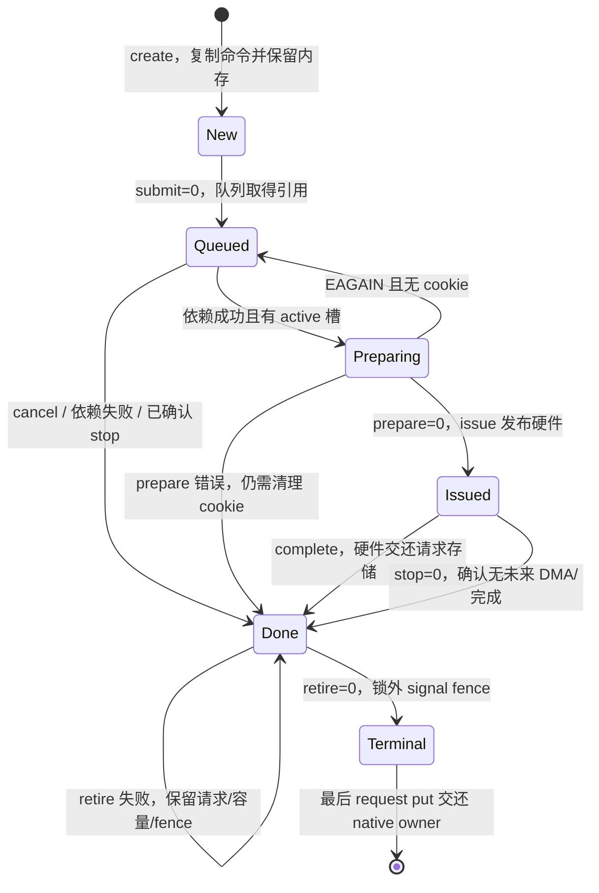

# 原生请求与队列

异步驱动使用 `drivers/core/queue.h` 组合绑定、原生存储、fence 和共享工作队列。硬件描述符、寄存器、DMA 地址转换和设备完成语义仍由后端实现。内核队列不采用 Linux `file`、ioctl 或 DRM 对象作为所有权基础；Native 与 Linux 的用户入口都可以消费同一原生协议。

## 选择执行方式

| 场景 | 接口与进度来源 |
|---|---|
| 有界同步控制、简单字符设备 | 继续使用有明确上下文和错误契约的原生协议方法 |
| 块、GPU、加速器等异步命令 | 每绑定建立 `driver_queue`；请求复制小命令并保留 native memory view，硬件完成后在任务上下文退休 |
| 启动时尚无调度器 | 创建同一队列，由有界 polling 调用 `driver_request_complete` 与 `driver_queue_run`；不创建 worker、不等待 park |
| 调度器初始化后的异步运行 | `driver_queue_start(queue, shared_workqueue)` 为每队列创建一个 work item，共享 worker；IRQ/poll completion 自动调度退休 |
| 网卡等已有批量/SG 热路径 | 使用相应原生协议的批量接口；不要求每个数据包分配 request/fence |

队列在 probe 中、启动硬件之前建立，并自动登记到原生 execution stop 阶段。驱动保存一份 caller 引用，在 remove 中 put；绑定另持一份直到停止、调用排空与 remove 全部成功。请求可以在运行时不断创建，软件上下文身份可以作为命令的一部分；按引擎/硬件队列划分调度域。当前不提供运行期新增受管队列、优先级/抢占、通用主动 abort 或恢复后重新开放旧队列。设备需要这些策略时，以独立版本协议实现；关闭过的队列永久拒绝新请求，重新绑定建立新实例。

## 从提交到退休



submit 的请求链表准入为 O(1)，不分配；共享 workqueue 按 deadline 维护工作顺序，调度成本与其工作项数相关。0 表示队列已接收并持有引用；depth 或总 bytes 不足返回 EAGAIN，不消费请求。创建时复制 command 与 view 描述符，最多 4096 字节 command、64 个 view；depth、max_active、max_command、max_bytes 由 provider 明确限定。bytes 为 command 加各 view 长度，容量持续占用到退休成功。创建但尚未提交的对象不占 admission budget；用户 broker 仍须控制自身对象数量、权限和预算。

队列按 FIFO 发出，允许最多 max_active 个 prepare/issued/retiring 请求。可提供一个原生 dependency fence；头部依赖未完成时暂停后续发出，失败则不进入后端。独立时间线使用独立队列；不承诺完成或通知顺序。worker 对未完成依赖安装一次性 native fence watch，依赖完成时直接调度工作，不按 tick 轮询；排队取消/退休须确认 watch 已撤销或回调已返回。prepare 背压与分配/清理错误使用延迟重试，硬件完成会立即重排工作；不是 GPU 调度器或硬件 polling 的替代。

IRQ 中只调用 complete：它不分配、不释放 backing、不调用 provider 或 fence consumer。该调用必须基于硬件不再访问请求存储的证据；超时、异常 CQ/used id 或“已经请求复位”都不构成证据。后续任务进度调用 retire，确认缓存交接、DMA 失效及 cookie 清理后才发布 fence。retire 出错时保留请求、capacity、code/context 与 pending fence，允许重试。一个清理错误不会阻止同次 pump 尝试其他已完成请求。

cancel 仅精确取消尚未发出的请求，之后仍走任务退休；active 返回 EBUSY。fence wait 超时/中断仅结束等待，不取消请求，不释放 DMA。硬件支持独立 abort 时，由设备协议确认停止该请求后调用 complete；通用接口不伪造成功 abort。

## 后端契约

ops 携带实际 size，创建时复制已知表；回调代码与 context 属于当次绑定。prepare、issue、retire、stop 在队列 spinlock 外执行；同队列通过 dispatch lease 串行化，另一个 pump/stop 返回 EBUSY。队列之间不共享全局执行锁。

| 回调 | 成功条件与错误所有权 |
|---|---|
| prepare（可选，任务上下文） | 建立 mapping/descriptor/cookie，不发布硬件；EAGAIN 且无 cookie 表示稍后重试。其他错误也交给 retire，包括部分初始化 |
| issue（必需，非阻塞） | 唯一的硬件发布点；无模糊的“报错但已接受”返回值。立即失败可 inline complete(error)，正常情况从 IRQ/poll complete |
| retire（可选，任务上下文） | 同时处理未 prepare、prepare 失败和正常完成；0 表示 cookie 已交还，非零必须保留其清理所有权，不启动新 DMA |
| stop（必需，任务上下文） | 关闭生产者并确认没有未来 DMA/完成回调；成功前保留 IRQ、transport 与请求存储。只停止执行，不释放实例或 class 调用仍需的 context |

prepare/issue/retire 都不能获取驱动 lifecycle 串行化；解绑可能持有它并尝试停止队列。stop 不等待持有调用者私有锁的线程，必要时返回 EBUSY 让退出重试。后端发出 complete 后，除非另有 request 引用，不再访问 request/cookie；队列可能立即在其他 CPU 上完成退休。inline complete 的退休则等 issue 返回后才执行。

手动 `driver_queue_run(q, budget)` 的 budget 为 1..4096，限制每次进度转换次数；无工作线程时，驱动负责持续调用它。worker 模式每次最多 64 次转换，然后重新排队。单个 provider 回调仍须遵守其非阻塞/有界约定，budget 不能抢占阻塞回调。共享 workqueue 必须活到所有附着队列成功停止之后。

## 绑定停止与失败重试

原生顺序为：可选 pre-consumer prepare → consumer/child 解绑 → offline → execution stop → quiesce → active call drain → remove → devres。

`device_add_execution_action(dev, stop, release, context)` 是 probe-only 登记接口。它自动选择 managed failed-probe rollback；即使登记元数据 OOM，也保留该失败清理选择，但 context 所有权只在登记成功时转移。stop 在调用排空前执行，因而能够先完成正在被 class 方法等待的请求。每次尝试所有未成功 stop，记录首个错误并 checkpoint 各次成功；任一失败就返回 PREPARING/PROBE_CLEANUP，保留离线绑定、模块代码和资源，不进入无界 call drain。重试跳过成功 stop。release 仅在 remove=0 后执行。

队列自动使用这一阶段：先永久关闭 admission；dispatch 正忙就返回 EBUSY；排空自己的 work item，然后调用后端 stop。停止失败不把仍未完成的请求伪造成 terminal。stop=0 后将尚未完成的请求以 ESHUTDOWN 送入 retire，已观察的完成结果优先。retire 仍可失败，后续重试只继续清理，不重复已成功的硬件 stop。status.stopped 表示硬件停止已确认；outstanding 非零仍表示退休未完成。

成功停止且所有请求退休后清除后端 ops/context。离线 request、queue、fence 可以被消费者继续持有，最后析构只执行核心/native memory 代码；它们不保留可调用的卸载模块指针。provider context 仍须留到核心完成 active-call drain 与 remove，不能因 queue stop=0 就提前释放实例。

pre-consumer `device_add_remove_prepare` 用于 USB 等消费者仍借用硬件可达存储的场合，冻结发生在 consumer 解绑前。execution stop 不能替代该更早的借用解除协议；普通 managed queue 无需额外注册 prepare。

## 存储与用户边界

view 只接受固定 extent 的 resident/contiguous RAM VMO 或 native DMA buffer，并校验 offset/length。请求保留整个 owner，包含原 VMO 的 cgroup charge；设备可以只映射所选视图。原始数据内容并不因引用而不可变；需要快照的命令须自行复制。mapping、IOVA 权限、cache sync 与 owner 引用分别管理，retire 必须检查 mapper 的失效错误。请求最后 put 才交还其 owner；用户仍持 request 时，退休成功也不会提前销毁这些引用。

原生协议方法在 access 内验证实例、权限和请求格式，成功 submit 后可向 consumer 返回独立 fence 引用并结束 access；managed execution owner 会覆盖后续硬件执行。用户 broker 不直接信任内核协议 ID，不接受任意物理地址或伪造 VMO 指针。原生队列没有新增用户 syscall、Linux ioctl 或 DRM 同步 UAPI。

## 接入骨架

下面省略寄存器和硬件协议，仅展示所有权边界。limits 应取设备实际能力与子系统预算的交集；prepare 校验/构建硬件请求，issue 发出命令，retire 交还 mapping/cookie，stop 确认硬件停止。remove 不再承担首次停止请求的责任。

```c
#include "drivers/core/driver_core.h"
#include "drivers/core/queue.h"
#include "drivers/core/fence.h"
#include "mm/slab.h"
#include "core/errno.h"
struct engine { struct driver_queue *queue; /* controller-private state */ };
/* Device-specific callbacks; stop/retire must handle partial initialization. */
extern int engine_prepare(void *, struct driver_request *);
extern void engine_issue(void *, struct driver_request *);
extern int engine_retire(void *, struct driver_request *);
extern int engine_stop(void *);
extern int engine_initialize(struct engine *, device_t *);
extern int engine_validate(const void *, size_t);
static const struct driver_queue_ops engine_ops = {
    .size = sizeof(engine_ops), .prepare = engine_prepare, .issue = engine_issue,
    .retire = engine_retire, .stop = engine_stop,
};
static int example_probe(device_t *dev)
{
    int ret = device_probe_use_remove(dev);
    if (ret) return ret;
    struct engine *engine = kcalloc(1, sizeof(*engine));
    if (!engine) return -ENOMEM;
    dev->drv_priv = engine;
    const struct driver_queue_limits limits = {128, 16, 256, 64ULL * 1024 * 1024};
    ret = driver_queue_create(dev, &limits, &engine_ops, engine, &engine->queue);
    if (ret) return ret; /* core owns failed-probe cleanup */
    return engine_initialize(engine, dev); /* only now enable hardware */
}
static int example_remove(device_t *dev)
{
    struct engine *engine = dev->drv_priv;
    if (!engine) return 0;
    /* execution stop and active-call drain have already succeeded */
    driver_queue_put(engine->queue);
    dev->drv_priv = NULL;
    kfree(engine);
    return 0;
}
/* Called inside a successful protocol access. The broker separately validates
 * user rights. Runtime setup starts queue progress on a shared worker after
 * scheduler initialization; boot polling instead pumps the same queue. */
static int example_submit(device_t *dev, const void *command, size_t bytes,
                          struct vmo *backing, uint64_t offset, uint64_t length,
                          struct driver_fence **out)
{
    if (!out) return -EINVAL;
    *out = NULL;
    int ret = engine_validate(command, bytes);
    if (ret) return ret;
    struct driver_request_memory memory = {.type = DRIVER_REQUEST_VMO,
        .owner.vmo = backing, .offset = offset, .length = length};
    struct driver_request_description description = {.command = command,
        .command_size = bytes, .memory = &memory, .memory_count = 1};
    struct engine *engine = dev->drv_priv;
    struct driver_request *request;
    ret = driver_request_create(engine->queue, &description, &request);
    if (ret) return ret;
    ret = driver_request_submit(request);
    if (!ret) {
        *out = driver_request_fence(request);
        driver_fence_get(*out); /* survives request and protocol access */
    }
    driver_request_put(request); /* accepted owner remains in queue */
    return ret;
}
```

## 实际接入与验证

VirtIO GPU 的小控制命令、大响应、SUBMIT_3D 和 ATTACH_BACKING 共用 native request admission、descriptor 发布和有界 IRQ/poll 等待。现有 wire controlq 保持一个 active chain；这不宣称已实现并行 GPU 调度。请求保留 DMA 实例 owner，未知完成/超时封闭 staging 并保留 pending request；只有确认 reset 且 IRQ 排空后才能退休。boot polling 与 runtime IRQ 唤醒复用同一后端。

主机工作流覆盖多 active 请求、乱序 IRQ complete、容量背压、依赖、排队取消、prepare/retire 失败、共享 worker、inline complete、存储保留、停止重试及 class drain。内核运行时自检使用真实 native workqueue/fence/lifecycle 执行同样的关键链路，以 `DRIVER_QUEUE: PASS parallel=1 worker=1 completion=1 stop_retry=1 drain=1` 作为完成证据；真实 VirtIO transport 另由 GPU stop/rebind 实例验证。执行命令见[构建、测试与提交](../meta/testing-and-submission.md)。
