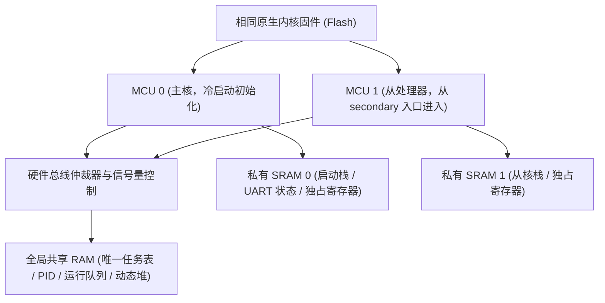

# Multi-Physics MCU Native Shared Memory Kernel Specification

In embedded multi-core environments without an MMU (NOMMU), A20OS supports the execution of the same kernel firmware by multiple physical MCUs in a symmetric manner through a mechanism of “shared RAM + hardware arbitration.” The various microcontrollers share the same global task table, PID namespace, and memory heap, forming a tightly coupled embedded symmetric multiprocessing (SMP) system.

---

## 1. Hardware Topology and Memory Contract

### Memory Layout Division

| Memory Range | Mapping Base Address | Initialization Method | Stored Content |
|---|---|---|---|
| **Local Flash** | `0x08000000` | Static Burn-in | Identical code segments (`.text`), read-only data (`.rodata`), and initialization values |
| **Private SRAM** | `0x20000000` | Each core's Reset Handler | `.private.data`, `.private.bss`, 8 KiB of dedicated startup stack |
| **Shared RAM** | `0x60000000` | The only cold-booting primary core | Global `.data/.bss`, shared dynamic heap, 8 KiB of general task stack |
| **Hardware Arbitration Window** | `0x64000000` | Hardware reset state | Core topology, bus lock status, inter-core IPI interrupt registers |

---

## 2. Cross-Chip Task Scheduling and Migration

1. **Master-Slave Initialization**: The primary MCU (0) is responsible for initializing the shared heap and scheduling the ready queue, then releases the slave cores' reset lines through the arbitration registers; MCU 1 skips the general kernel main function and directly enters `smp_secondary_init()`.
2. **Context Switching and Migration**:
   * Threads execute user programs in non-privileged Thread mode (using the PSP stack);
   * When `svc #0` triggers a system call, the assembly processor saves the register frame and enters privileged Thread mode;
   * When a task is blocked or voluntarily yields, its context is saved in the shared RAM's task control block. Upon awakening, it can be picked up and executed by any available slave or primary core, enabling transparent cross-chip thread migration.

---

## 3. Synchronization Primitives and Bus Arbitration

In physical MCUs without hardware Cache Coherency, mutual exclusion is achieved using the atomic test and set bit (TAS) registers in the hardware arbitration control window or the mutual exclusion gates (`core/shared_fabric.c`). The use of ordinary, non-bus-based lock variables for cross-core synchronization is strictly prohibited.
