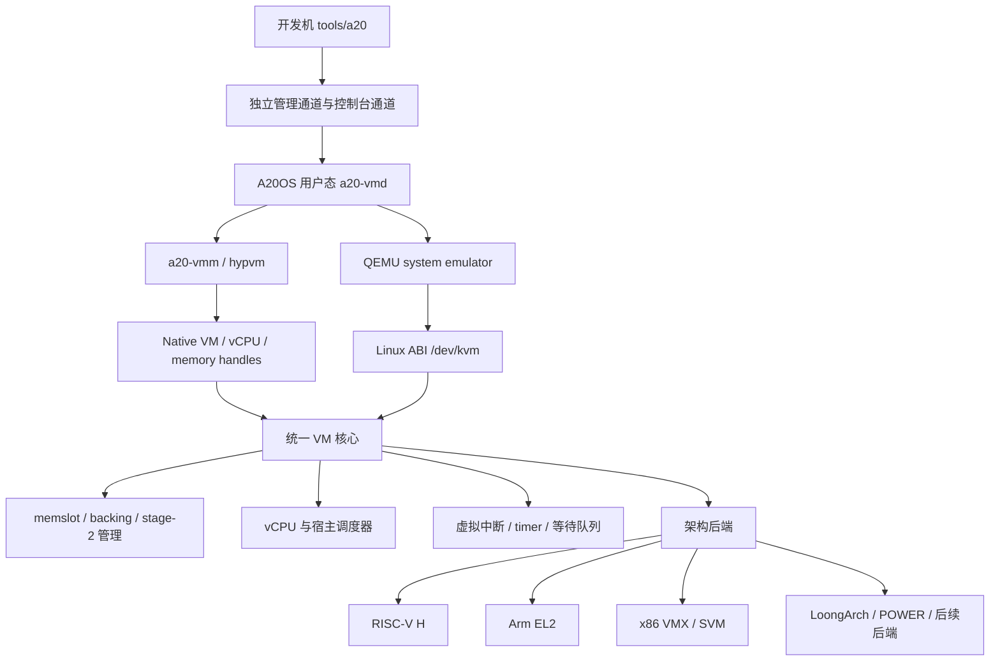

# 多架构虚拟化平台总体设计

1.0 交付范围与验收统一见 [发布计划](../releases/v1.0.md) 的 V1-HYP。本设计的首批平台
目标须完成，后文明确另立项的扩展仍保留其边界。最初编写时的“未实现”不代表所有内容
仍缺失；逐项当前事实见 [实现状态](../status/current/hypervisor-implementation-status.md)，不得以设计替代运行证据。

状态：**目标设计，部分已实现，整体未验收**。最初设计日期：2026-10-13；原检查基线为 `85fa78d2` 加当时工作区修改。

本文定义 A20OS hypervisor 从单 guest 原型走向多架构、多实例平台的目标结构、接口边界和验收顺序。设计中的目录、配置、接口和测试须逐项对照 [实现状态](../status/current/hypervisor-implementation-status.md)；未落地部分仍为目标。当前可用命令以 [使用指南](03-usage.md) 和 [实例文档](../dev/instances.md) 为准。最初设计阶段仅形成方案，后续已有实现与运行记录，不能再将全篇一概标为未实现。

## 1. 目标和使用场景

目标是让 A20OS 成为能够长期管理虚拟机的宿主操作系统：

1. 在具备虚拟化条件的 CPU 上提供对应硬件后端，后端实现共享同一个 VM 核心。
2. 同一宿主可运行多台 VM，每台 VM 可有多个 vCPU；guest 的运行、故障、关机和资源回收相互独立。
3. 开发机通过 `tools/a20` 启动可交互的 A20OS 宿主实例，随后创建、连接、暂停、停止和重启其内部的 guest。
4. A20OS 原生 VMM 和 Linux ABI 下的 QEMU 共享同一虚拟化核心。QEMU 通过 A20OS 提供的 `/dev/kvm` 使用硬件虚拟化。
5. 支持同架构的 A20OS 和 Linux guest；跨指令集运行交给用户态 QEMU TCG，并单独报告为软件模拟。

第一版交付目标是串口交互、虚拟磁盘、网络与正常关机，不把图形桌面、Windows guest、设备直通、热迁移、机密计算或向 guest 暴露嵌套虚拟化作为首批验收条件。这些能力有明确扩展位置，但分别立项验证。

### 1.1 三种角色必须分开

| 角色 | 含义 | 例子 |
|---|---|---|
| 开发机 | 执行仓库中的 `tools/a20`、编译及外层 QEMU | 当前 Linux 工作站 |
| A20OS 宿主 | 提供 VM 核心、硬件后端和 `/dev/kvm` 的系统 | QEMU 内的 A20OS，或物理机上的 A20OS |
| guest | 被 A20OS 宿主管理的虚拟机 | 两台 Linux，或 A20OS RAMFS guest |

开发测试可以是 `开发机 → 外层 QEMU → A20OS 宿主 → 内层 guest`。外层 QEMU 使用 Linux KVM，并不等于内层 guest 使用了 A20OS 的虚拟化后端。每份测试报告必须记录两层各自的架构和 accelerator。

内层硬件虚拟化要求外层提供相应的虚拟化特权和扩展。RISC-V H、Arm EL2、x86 VMX/SVM 的嵌套条件各不相同；外层 TCG 也不能一概当作所有后端的验证环境。x86 后端应准备真实硬件或已验证的外层 nested KVM runner。guest 内继续运行 hypervisor 是另一个功能，首版不暴露。

### 1.2 当前基础与需要改变的边界

当前有 RISC-V 的真实 guest 进入/退出、stage-2 内存、SBI 处理、轮询 UART、ELF/FDT 加载器和交互 shell 测试。现有代码可作为 RISC-V 起点，但以下结构需要调整：

- [公共运行循环](../../kernel/hyp/hyp_vcpu.c) 包含 RISC-V trap、CSR 和指令解码；这些必须移回架构后端。
- [架构接口](../../kernel/include/hyp/hyp_arch.h) 暴露 `vsatp`、`vstimecmp` 等 RISC-V 名称；新公共接口以运行、寄存器组、内存和中断语义表达。
- 全局单运行 guest、宿主 UART 输入转移给 guest、依赖 CPU 初始 CSR 值的进入路径，需要替换为多实例的状态所有权。
- [内存实现](../../kernel/hyp/hyp.c) 的单页根表分配不满足 Sv39x4 根表要求；它是正确性修复项，必须先于多实例开放。
- [Native ABI](../../kernel/abi/native/sys_native_hyp.c) 的私有对象类型尚未接入完整引用回收；Linux bridge 的进程退出清理不能替代 Native 对象模型修复。
- 上轮实跑证明已有产物能完成一次 RAMFS shell 会话，但第二次 guest 启动超时。当前工作区重新构建又受 `task_context_t.sp` 编译错误阻挡。因此实施的第一步必须重新建立源码、产物和测试结果一致的基线。

本提案调整 [旧设计](01-a20os-guest.md) 与 [旧路线图](02-roadmap.md) 中“设备模型留在内核”“不采用用户态 memslot”“vCPU 暂不作为可抢占线程”的取舍。旧文档保留历史语境；本提案中的新能力只有完成对应门禁后才能转写为当前功能。

## 2. 总体结构与职责



| 层 | 负责 | 不能承担的隐含职责 |
|---|---|---|
| `tools/a20` | 构建图、宿主启动、会话发现、资源预检、交互连接、测试与日志 | 不能把开发机 QEMU 的成功冒充内层后端成功 |
| `a20-vmd` | guest 清单、镜像准备、VMM 进程管理、命名和控制协议 | 不在管理进程中模拟 CPU，不拥有每个 vCPU 的运行循环 |
| `a20-vmm` | 小型原生 VMM，加载器与最小机器模型，作为内核验收工具 | 不重复开发 QEMU 的完整设备生态 |
| QEMU | 标准机器模型、固件、virtio、块盘、网络、后续显示设备 | 不绕开 A20OS 的 memslot、隔离和预算检查 |
| Native/KVM 两个入口 | 权限、用户指针、句柄/fd、结构体布局与 ABI 转换 | 不各建一套 VM、页表或调度器 |
| VM 核心 | 对象生命周期、memslot、预算、运行请求、中断路由和可观测性 | 不解析 `scause`、VM-exit reason 或 Arm syndrome 的数值 |
| 架构后端 | 特权进入/退出、寄存器、二级页表格式、TLB、硬件中断与 timer | 不直接读取宿主终端，不创建磁盘文件，不解析 CLI |

内核保留需要与 vCPU 紧密协作的虚拟中断控制器和时间设施；普通 UART、virtio-blk/net 等设备模型放在用户态。现有内核 UART/CLINT 模型作为过渡测试配置，待原生 VMM 接管后退出默认路径。

## 3. 多架构后端契约

### 3.1 支持矩阵

“A20OS 能在该架构启动”与“该机器能成为虚拟化宿主”分别声明。虚拟化能力取决于 CPU、启动特权、固件、内核实现和外层 hypervisor，不能只用 `ARCH` 判断。

| 架构/后端 | 硬件与启动前提 | 主要新增工作 | 路线定位 |
|---|---|---|---|
| riscv64 / H | H 扩展及可用 HS 环境 | Sv39x4、CSR/FP 状态、VMID 回收、SBI、timer/IPI/外部中断 | 首个完整后端 |
| aarch64 / EL2 | 固件交付或可调用的 EL2 | EL2 启动层、stage-2、vGIC、virtual timer、PSCI、FP/SIMD | 第二个后端，用于验证抽象 |
| x86_64 / VMX | Intel VMX 可用且固件允许 | VMXON/VMCS、EPT、VPID、MSR/CPUID、APIC、XSAVE、进入状态校验 | 主线后端 |
| x86_64 / SVM | AMD SVM 可用且固件允许 | VMCB、NPT、ASID、intercept、MSR/CPUID、AVIC 可选 | 与 VMX 共用 x86 层，独立验收 |
| loongarch64 | 具体 CPU 的虚拟化扩展和宿主权限 | guest CSR、GID、TLB、timer/IRQ、对应 KVM UAPI | 后续主线，先定 runner 和 CPU |
| ppc64le | 已退出 1.0；源码和平台研究仅供历史追溯 | 当前不安排后端实现 | 不属于活跃虚拟化目标 |
| arm32 | 带 Virtualization Extensions 的 A-profile CPU，进入 Hyp 模式 | stage-2、GIC、banked registers、timer | Native 实验后端；现代 QEMU 的 32 位 Arm KVM host 路线已移除 |
| riscv32 | 实际提供 H 的 CPU/模拟平台 | Sv32x4、64 位 GPA 表达、RV32 CSR 和寄存器接口 | 实验后端；QEMU/KVM 支持另立 profile 验证 |
| armv7m | 当前 MCU 平台无本方案所需的虚拟化/MMU 环境 | 保留明确的 unavailable 原因 | 不提供硬件 hypervisor；可由开发机模拟为 guest |
| loongarch32 | 已退出 1.0；仓库未建立硬件虚拟化条件与 runner | 当前不安排后端实现 | 不属于活跃虚拟化目标；软件模拟仅作历史研究 |

以上“主线/实验”是工作排序，不是已支持声明。32 位宿主上的新 QEMU 可用性还受 QEMU 自身 host 支持范围限制，不能因为内核后端存在就承诺 QEMU 可用。跨 ISA 使用 TCG；同 ISA 的 32 位 guest on 64 位 host 也必须独立检查 CPU 与后端能力。

每个后端依次取得 `build → probe → microguest → OS boot → multi-VM → SMP guest → QEMU/KVM → hardware soak` 证据。注册表分别记录这些状态，编译成功不提升到运行可用。

### 3.2 公共接口表达语义

拟议 `hyp_backend_ops` 的职责分组如下，具体 C 签名在接口评审后冻结：

| 接口组 | 语义 |
|---|---|
| `probe / query_caps / cpu_online / cpu_offline` | 安全检测硬件与启动权限，报告原因，管理每 CPU 的虚拟化设施 |
| `vm_init / vm_fini` | 分配架构级 VM 状态、虚拟中断设施与 MMU 标识 |
| `vcpu_init / reset / fini` | 显式构造完整 guest 初始状态，包括 FP/SIMD 和 timer |
| `vcpu_load / enter / put` | 装入当前 CPU、运行到退出、完整保存并恢复宿主；进入期间不进行可睡眠分配 |
| `get_regs / set_regs / validate_state` | 通过架构标记的寄存器组访问 opaque state，校验后才能进入 |
| `inject_event / kick / timer_update` | 架构中断注入；kick 保证正在执行或等待的 vCPU 能观察管理请求 |
| `s2_alloc / map / unmap / protect / translate / invalidate` | 架构页表与失效机制，公共层只使用权限和地址语义 |
| `decode_exit / complete_io` | 产生公共 exit，完成用户态模拟结果，维护指令提交边界 |

公共 exit 至少区分 `MMIO`、`PIO`、`HALT/WAIT`、`FIRMWARE_CALL`、`SHUTDOWN`、`RESET`、`DEBUG`、`INVALID_STATE` 和 `INTERNAL_ERROR`。宿主抢占和内部补页通常在内核处理后继续运行，只有 ABI 要求或用户请求才返回 VMM。PIO 对没有端口 I/O 的架构不开放。

公共 `vcpu` 不再暴露固定 `regs[32]`、RISC-V CSR、汇编偏移或宿主 trap-frame 布局；这些放入后端私有状态。通用 `hyp_exit` 与 Linux `struct kvm_run` 是两个结构，由兼容层转换，避免内部设计被一个 ABI 的布局锁定。

能力按“已编译 / 硬件存在 / 固件允许 / 内核可用 / 当前配置启用”分别报告。guest ISA 特性必须是 CPU、后端状态保存和虚拟设备支持的交集；未实现保存恢复的 vector/debug/PMU 特性不能直接透传。

### 3.3 AArch64 的前置工作

当前 [入口](../../kernel/arch/aarch64/boot/entry.S) 按 EL1 启动。增加 Arm 后端必须同时设计 EL2 的取得与保留，不能仅添加 `hyp_arch.c`。

首版选择 **EL1 宿主内核 + 小型 EL2 层（nVHE 形态）**：启动时识别 CurrentEL，在 EL2 建立专用映射、异常向量、每 CPU 栈和调用通道，再进入 EL1；从 EL1 启动且没有受支持的 EL2 入口时明确报告不可用。VHE 作为后续优化，不作为首次启动要求。测试使用明确开放 virtualization 的 QEMU virt 配置，并检查实际进入的异常级。物理固件启动条件独立验收。

## 4. VM/vCPU 对象、并发与生命周期

### 4.1 对象模型

`hyp_vm` 持有 UUID、owner/权限、资源域、memslot 集合、vCPU 集合、IRQ 路由和架构 VM 状态。`hyp_vcpu` 持有 guest CPU ID、状态机、单运行者锁、等待队列、pending requests、架构上下文和 exit/completion 状态。

Native ABI 使用正式 VM、vCPU、guest-memory 对象类型与权限，例如 `RUN`、`MAP_MEMORY`、`SET_STATE`、`INJECT_IRQ`、`CONTROL`；每次查找取得稳定引用。KVM fd 通过 vfile 持有同一对象的引用，保持 Linux 的 fd 与地址空间约束。所有入口进入同一权限/资源检查路径。

对象引用方向为 vCPU → VM、VM → memory backing。VM 的 vCPU 索引不形成无法释放的强引用环；注册/注销与枚举取得临时引用。显式 stop/destroy 用于停止机器；最后一个外部对象引用释放后才完成最终析构。KVM VM fd 关闭时，尚存的 vCPU/device fd 仍可维持 VM 生命周期，不能简单按创建 PID 直接释放全部对象。

`a20-vmd` 的“停止某台 VM”通过 VMM 正常关机/退出完成；超时后终止对应 VMM，并等待内核确认所有 vCPU 离开 guest。其他 VM 不受影响。跨 Native/KVM 前端的同一 VM 共享暂不开放，只共享底层实现，避免出现两个控制者争用同一对象。

### 4.2 状态和销毁协议

VM 状态：`CREATED → CONFIGURED → RUNNING ↔ PAUSED → STOPPING → STOPPED → DEAD`。guest reset 在保留指定 RAM/设备策略下重新初始化 CPU 与设备；guest shutdown 进入停止流程。错误状态可诊断、可销毁，不自动启动新 VM 覆盖旧对象。

vCPU 状态：`STOPPED / RUNNABLE / RUNNING / BLOCKED / DYING`。同一 vCPU 同时只能有一个执行者，重复 RUN 返回明确错误。VM 中不同 vCPU 可以并行执行。

销毁顺序固定为：阻止新操作 → 发布 stop 请求 → kick 正在执行或等待的 vCPU → 等待退出确认 → 排空 IRQ/timer/异步回调 → 失效 stage-2/TLB → 归还页与预算 → 释放后端及对象。最后引用释放和进程崩溃均使用该协议，不能释放仍被硬件或回调使用的上下文。

### 4.3 锁和发布规则

- 全局注册表锁只用于查找/发布并取得引用；不得跨 guest 运行、用户拷贝、分配或等待持有。
- 每 VM 的控制互斥锁串行化配置变更；memslot 使用版本化不可变视图和延迟回收，或等价的 reader-safe 方案。
- 每 vCPU 的 RUN 互斥保证单执行者；每 CPU 的 `loaded_vcpu` 只表示该 CPU 当前装载的状态，替代全局 active 指针。
- 进入 guest 前短暂禁止迁移并装载状态；离开 guest并保存后，允许宿主调度。不要在整个 guest 会话期间禁止抢占。
- 修改 memslot 时先发布请求并退出短锁，再等待 vCPU 确认；不持有退出处理所需的锁等待该 vCPU。
- 初版对配置操作采用停止相关 vCPU 后提交的方式，后续再优化动态更新；外部 mmap 失效路径仍必须具备同步撤销能力。

需先冻结锁序和“谁等谁”的图，再实现多核。`trylock` 去掉一个全局限制并不能单独获得多 VM 安全性。

## 5. 内存模型与 stage-2

### 5.1 memslot 与 backing

统一使用 64 位 `gpa`/长度及溢出检查，不能用宿主指针宽度表示 guest 物理地址。每个 slot 包含 slot ID、GPA 范围、权限、backing 类型/偏移、generation、记账归属和脏页跟踪策略。RAM slot 不重叠，MMIO 区域另建地址路由表。

两条入口映射到同一核心：

- Native：VMO 或 guest-memory handle 加偏移。guest RAM 与用户态 VMM 映射共享同一 backing，以支持用户态设备 DMA。
- KVM：用户地址区间登记为 memslot，关联创建 VM 的 `mm`，通过稳定 pin/引用和 MM 失效通知取得页。登记 HVA 不是一次性 memcpy。

初版优先匿名 RAM 和受控共享 backing，文件映射、hugepage、用户态 pager 等按能力逐步开放。Native 可以明确限制 backing 类型；KVM 入口的接受/拒绝和变化语义必须按 UAPI 与目标 QEMU 验证，不能把 Native 限制偷偷冒充完整 KVM 行为。

MM 变化事务必须覆盖 `munmap/mremap/mprotect`、COW、地址空间退出和 backing 缩小：标记失效 generation → 阻止新 stage-2 安装 → kick 相关 vCPU → 撤销映射 → 等待远端 TLB 确认 → 释放旧页引用。以相同 HVA 重新映射时不能继续使用旧帧。仅 pin 住旧页却继续给 guest 使用，不能算完成 KVM 内存语义。

与 [VMO](../../kernel/include/mm/vmo.h)、[MM 地址空间](../../kernel/include/mm/vm.h) 和 frame accounting 共用页来源、引用与审计。VMO 自身持有页的所有权时，stage-2 只持 backing/borrow 引用，不能沿用当前私有 guest RAM 的销毁方式直接 `frame_put` 掉 VMO 的页。

### 5.2 架构页表和 TLB

内存管理复用公共分配、预算和审计机制，**硬件页表格式交给后端**：RISC-V x4、Arm stage-2、x86 EPT/NPT 不强行使用宿主 PTE 编码。根表描述明确大小、对齐、entry 数、层级和 GPA 宽度；现有固定元数据形状需支持不同根表，或以独立 stage-2 元数据适配。

Sv39x4 首先改为正确的 16 KiB 根表；未使用 entry 清零。低 GPA 限制不代替对齐要求。x86 EPT 和 NPT 也分别编码，不因同属 x86 就共用 PTE 位定义。

VMID/ASID/VPID/GID 等实现为后端管理的有限硬件 tag，加软件 generation 和 CPU residency 集合。每个 CPU 探测实际宽度，支持无硬件 tag 情况；复用前在可能持有旧翻译的 CPU 上完成失效。迁移和页表变更处理 guest stage-1 与 stage-2 各自的失效需求，不把一个本地 fence 当作所有缓存已清空。

guest RAM 可以同时具备 R/W/X，guest 的 stage-1 仍负责其进程权限；安全边界是 GPA 到受授权 backing 的映射。不能将“一律禁止 RAM 同时可写可执行”作为通用 OS guest 的前提。device/MMIO 映射使用独立属性。

### 5.3 预算和隔离

为 VM 建立稳定资源域：RAM、stage-2 页表、固定 pin 页、vCPU 数、队列和 I/O 缓冲均有上限，不能只计入运行 RUN ioctl 的临时线程。共享 backing 的物理页只记一次所有权费用，同时记录各 VM 引用/授权额度。`FRAME_F_GUEST` 单一布尔标志不足以表达多 VM 借用关系，需可审计的引用或映射账本。

首版默认不允许不同 VM 共享可写 RAM；显式授权的共享内存作为单独能力。内存不足使当前 VM 操作失败或产生受控退出，不能触发宿主 panic。设备直通需要 IOMMU 隔离和撤销协议，后续另行设计。

## 6. vCPU 调度、时间与中断

每个 vCPU 由一个宿主可调度线程执行：QEMU 的 vCPU pthread 进入 KVM RUN；原生 VMM 的线程进入 Native RUN。内核不再额外创建一个和它重复运行的 vCPU 线程。

硬件退出后，后端先保存 guest 状态并恢复宿主上下文，再处理调度或用户态退出。宿主 timer、信号、pause、stop、memory invalidation、CPU offline 请求必须能够 kick guest 并在有界时间内生效。宿主抢占发生后，通过 `vcpu_load/put` 处理重新装载，不能带着上一 CPU 的 CSR/VMCS 状态直接迁移。

首批调度功能是正常时间片、可中断等待、亲和性和 CPU 预算。HLT/WFI 等待进入宿主等待队列，由虚拟中断、timer 或控制请求唤醒，避免无输入的 guest 空转占满 CPU。针对 x86、Arm、RISC-V 分别校验 FP/SIMD、扩展状态、debug 和 timer 的隔离；硬件存在但保存路径缺失的特性先关闭。

虚拟中断链为 `用户态设备 → VM 路由 → 指定 vCPU pending → 后端注入`。支持 level/edge 的正确状态及 ACK/EOI，不能只实现一个“置位”接口。SMP guest 的启动、IPI、timer、外部中断必须一起验收；RISC-V SBI HSM、Arm PSCI、x86 AP 启动状态各归后端/机器契约负责。

timer 为每 vCPU 状态，切出时不会遗留到下一 VM。提供硬件优化与软件后备；RISC-V H 存在而 Sstc 缺失时仍需正确处理 timer 或明确拒绝该配置，不能执行不存在的 CSR。VM 时间策略首版固定并可查询，暂停后的时钟行为写入机器 profile；保存恢复时重新计算 deadline，避免时间倒退或重复中断。

KVM 的 RUN 共享区和 I/O 完成时序独立实现：MMIO/PIO 退出后的结果可能需要下一次 RUN 完成指令；信号、immediate-exit 或暂停不能导致同一个 store 重复执行。原生接口也保留显式 completion token，而非任意修改 PC。

## 7. QEMU 与 KVM 兼容路线

### 7.1 兼容目标

目标是 **A20OS 内的 Linux ABI QEMU 使用标准 `/dev/kvm`**。不是把 Linux 内核 KVM 模块加载进 A20OS，也不是只让开发机 QEMU 启动 A20OS。

首条路线采用固定版本、固定依赖的 Linux 用户态 QEMU 包，在 A20OS Linux ABI 上运行；原生 libc 构建可后续推进。以当前测试环境的 QEMU 10.0.13 作为候选基线，实施前冻结源包/发行版补丁、配置选项、依赖、机器类型、固件和镜像哈希。本文检查了上游 v10.0.3 的通用和 Arm KVM 源码作为接口参考，并不把它们等同于本地 10.0.13 的调用清单。

兼容性定义为一个可重放 profile：`QEMU build + host arch + machine + CPU features + firmware + devices + guest image`。支持一个 profile 不代表支持全部 QEMU 设备和版本；profile 之外须报清楚缺少的能力。

### 7.2 两条独立但汇合的工作线

| 工作线 | 前置验收 | 后续验收 |
|---|---|---|
| QEMU 用户态运行 | 动态链接、pthread/TLS、futex、信号、mmap、poll/epoll、eventfd、文件/socket 等实际语义 | 先通过 TCG 启动 Linux，使用块盘/网络并正常退出 |
| KVM 接口与硬件 | 独立小型 KVM 测试程序，逐项验证 fd/mmap/ioctl/exit/并发和失败路径 | 同一 QEMU profile 改为仅允许 `-accel kvm`，证明执行进入 A20OS 后端 |

QEMU TCG 可用是用户态运行能力的证据，不能升级为 KVM 成功。硬件验收显式禁用自动 TCG fallback，同时检查 QMP accelerator 状态和内核的 vCPU entry/exit 计数。只看到 guest shell不足以判断用了哪种后端。

### 7.3 KVM UAPI 工作包

具体 ioctl、寄存器 ID、结构体布局和错误语义以所选 Linux UAPI 及固定 QEMU 源码为依据；下表是工作包，不是完整兼容清单。

| 工作包 | 必须处理的内容 |
|---|---|
| 对象与基本控制 | system/VM/vCPU/device fd、版本与能力查询、创建、dup/close/退出、并发调用约束 |
| 内存与 RUN | memslot 注册/删除/失效、vCPU mmap 共享区、RUN、MMIO/PIO 完成、信号与停止 |
| CPU 状态 | 架构寄存器、CPU 特性协商、状态校验、reset、MP 状态、固件启动约定 |
| 中断设备 | IRQ 路由、架构 irqchip/device 控制、timer、SMP 启动；需要时实现 irqfd |
| 可选性能能力 | ioeventfd、脏页日志/环、coalesced MMIO、hugepage 等逐项实现并开放 |

不支持的 capability 如实返回未支持，数值型 capability 返回真实限额。未知 ioctl 按 UAPI 返回错误；不能对未实现操作返回成功。API version 12 意味着对应架构的 basic 契约可用，因此在基本面尚不完整时只开放开发测试入口，不提前宣称 `/dev/kvm` 兼容。

ioeventfd/irqfd 等可以在固定 QEMU 有正确 fallback 时后置；不能假定所有架构的 irqchip 都可省略。Arm QEMU `virt` 的 vGIC/device API 单独建立必需清单。x86 要覆盖 profile 实际需要的 CPUID/MSR、APIC/IOAPIC/PIT 以及启动内存接口。RISC-V 要覆盖寄存器和 ISA 扩展协商、SBI、timer/IRQ，并明确 PLIC/AIA 的模型选择。其他架构逐个冻结清单，不复用一个“通用七个 ioctl 即兼容”的结论。

清单获取方法：读固定 QEMU 源码的初始化与运行分支，在真实 Linux KVM 上记录同 profile 的调用，再在 A20OS 做结构化 ioctl 日志与结果对比。记录 buffer 布局/长度、顺序和错误码；不只记录 ioctl 名称。

### 7.4 设备与存储交付

原生 VMM 首版提供小机器模型和 console，供后端测试；通用 Linux 的 virtio-blk/net、固件与机器模型优先复用 QEMU。每台 VM 独立磁盘与网络，基础镜像只读；写入使用私有 overlay 或独立副本。多个 VM 打开同一可写 raw 镜像必须拒绝，除非明确采用另行验证的共享存储协议。

首版网络使用 QEMU user networking，先验收 guest 出站和独立端口转发；TAP/bridge 后续以 A20OS `/dev/net/tun`、桥接和权限支持为前置。多 VM 的互联另用经过验证的后端，不能假定两个独立 user network 自动处于同一 LAN。vhost、VFIO、GPU passthrough 不属于基本 QEMU/KVM 兼容要求。

## 8. tools/a20 的实例与交互设计

### 8.1 分离构建配置与运行身份

保留 `instances/*.toml` 描述可构建的 **A20OS 宿主配置**；新增 `vm-profiles/*.toml` 描述运行在 A20OS 内部的 **guest 模板**。一次运行产生独立 session ID/VM UUID，模板名不能充当唯一运行身份。同一个模板可以同时启动多个实例。

拟议接口示例，当前 CLI 尚未实现：

```sh
# 前台启动宿主，保留其 shell；不默认占用宿主 stdin 运行 guest
tools/a20 run hyp-host-riscv64 --name lab-rv

# 也可以后台启动，稍后重新连接宿主终端
tools/a20 run hyp-host-riscv64 --name lab-rv --detach
tools/a20 attach lab-rv

# 创建两个相互独立的 guest；start 默认返回运行身份
tools/a20 vm start a20-ramfs-riscv64 --host lab-rv --name guest-a
tools/a20 vm start a20-ramfs-riscv64 --host lab-rv --name guest-b
tools/a20 vm list --host lab-rv
tools/a20 vm console guest-a --host lab-rv
tools/a20 vm pause guest-b --host lab-rv
tools/a20 vm resume guest-b --host lab-rv
tools/a20 vm stop guest-a --host lab-rv
tools/a20 vm destroy guest-a --host lab-rv

# QEMU/KVM profile 达标后提供 Linux 实例
tools/a20 vm start linux-riscv64-kvm --host lab-rv --name linux-a --console
```

`stop` 请求正常关机，超时返回状态并允许显式 `--force`；`destroy` 要求已停止或显式强制停止，默认保留持久磁盘，删除磁盘另设选项。guest 重启与 stop/start 重建分开。宿主 `stop` 先协调其 guest 收尾，再停止宿主。

宿主内直接操作使用 `hypctl`，例如 `hypctl list` 和 `hypctl console guest-a`；它与开发机 CLI 调用同一管理协议。`hypvm` 保留一次性原生 guest 启动功能，后续通过公共 VMM 库构建。

### 8.2 清单增量示例

以下 TOML **仅展示提案字段**，尚不能交给当前 parser：

```toml
# instances/hyp-host-riscv64.toml（拟议）
name = "hyp-host-riscv64"
arch = "riscv64"
abi = "both"

[machine]
smp = 4
memory = "2G"
accel = "tcg"                    # 新字段：明确外层 accelerator
extra_qemu = ["-cpu", "rv64,h=true"]

[virtualization]                 # 新段：宿主内的虚拟化服务
enabled = true
apis = ["native"]                # KVM profile 达标后增加 "kvm"
required_backend = "riscv-h"
manager = true
bundle = ["a20-ramfs-riscv64"]    # 打包 guest 模板和产物，不自动运行
max_vms = 4                      # 产品配置上限，不代表已测容量
guest_memory_limit_mb = 1024
```

```toml
# vm-profiles/a20-ramfs-riscv64.toml（拟议）
schema = 1
name = "a20-ramfs-riscv64"
arch = "riscv64"
vmm = "native"
accel = "hardware"
machine = "a20-minimal-v1"
vcpus = 1
memory_mb = 128

[boot]
artifact = "a20-riscv64-ramfs"     # 构建图中的产物 ID，包含 hash
mode = "elf"
args = "a20.hypguest=1"

[console]
device = "serial0"
```

QEMU guest 模板增加 `vmm="qemu"`、`accel="kvm"`、固定 machine/CPU model、kernel/initramfs 或 firmware/disk 引用、设备和网络参数；只能选择已验收的 compatibility profile。路径在构建侧解析成产物 ID，再由宿主 bundle/install 映射到 A20OS 路径，避免把开发机 `/home/...` 原样传给 guest loader。

host build → guest build → bundle 的依赖是有向无环图，guest 构建禁止递归再次构建同一 host bundle；优先独立 guest artifact target，替换当前 FAT32 构建隐式触发第二个 RAMFS 内核的方式。模板清单、镜像哈希和实际构建变量写入运行记录。

### 8.3 管理通道与控制台

本地外层 QEMU 使用独立 virtio-serial port，经 Unix socket 连接开发机和 `a20-vmd`。该通道需要先验收 A20OS virtio-console 多端口识别、名字绑定和双向流；目前有 virtio-console 驱动不等于管理 transport 已完成。物理机后续使用有认证的网络 transport；普通串口保留交互救援用途。

管理协议采用版本化帧：长度上限、request ID、操作名、对象 UUID、deadline、结果/错误和 capability handshake。执行白名单操作并传结构化参数，不通过拼接 shell 命令执行管理请求。对 start 等变更使用幂等 key，连接超时先查询结果，避免重试创建重复 VM。

控制流与 console 流分开，每 VM 一个 console endpoint；一个写入者、多个只读观察者，明确断开/重新连接和缓冲溢出行为。控制台 detach 使用工具层转义序列，不向 guest 注入退出命令，不终止 guest，也不改接宿主 stdin。测试分别保存 host console、guest console、管理事件和 QEMU stderr。

管理连接断开不杀 VM。`a20-vmd` 以独立 supervisor 持有运行中的 VMM 子进程和身份，管理 frontend 重连先校验 boot ID/UUID。第一版若 supervisor 自身崩溃，策略为关闭所管理的 VMM 并确认回收；由服务管理器或受验证的进程退出绑定执行该策略，不能依赖已崩溃的进程主动清理，也不能凭磁盘上的旧 PID 文件宣称自动接管成功。故障恢复/不中断接管另设验收。

管理 socket 按宿主用户/会话授权，查询、console 写入、生命周期控制和镜像删除分别检查权限。每个 VMM 以独立资源域运行，只获得其镜像、网络和 VM 对象所需权限。开发机能访问外层 QMP，不自动等于能控制任意 A20OS 内部 VM。

### 8.4 运行目录与资源

运行状态放入用户级 runtime 目录，如 `$XDG_RUNTIME_DIR/a20/<session-id>/`，持久日志和磁盘写层放入配置的 state 目录；构建产物保持只读。每个 session 有独立 PID/boot ID、socket、日志、磁盘写层和端口分配。PID 重用必须通过启动身份校验，不能向同 PID 的无关进程发信号。

预检分两级：开发机预算覆盖外层 A20OS/QEMU，A20OS 内预算覆盖各 guest。不得把内层 RAM 重复计为额外的开发机物理机分配，也不能只看外层剩余而放任内层 OOM。运行时实际限制在 A20OS 内核强制，CLI 预检只是提前报错。

每 VM 分配唯一 MAC、端口和 overlay；多次启动同一模板不会复用可写镜像。已有 `tools/a20 test` 的模板级互斥与固定日志路径，扩展为运行 ID 级隔离，保留防止同一磁盘并发写入的锁。

## 9. 工程落点与兼容迁移

| 现有位置 | 拟议变化 |
|---|---|
| `kernel/hyp/` | 拆出 VM/vCPU、memory slot、请求/事件、预算和统计核心；移走 RISC-V 解码 |
| `kernel/include/hyp/` | 公共语义、capability、opaque backend、对象与生命周期契约 |
| `kernel/arch/<arch>/hyp/` | 后端注册与私有状态；x86 内再分 common/VMX/SVM |
| `kernel/mm/`、`kernel/proc/`、`kernel/ipc/` | backing/失效通知、调度边界、正式对象类型与引用审计 |
| `kernel/abi/native/` | 版本化 Native VM API；旧五个入口用兼容包装迁移，保留编号 |
| `kernel/abi/linux/` 与设备/VFS 层 | `/dev/kvm`、fd 操作、UAPI 转换和诊断；核心逻辑留在 `kernel/hyp/` |
| `user/cmds/core/hyp/` | 将 ELF/FDT 等加载器移为用户态 VMM 公共库，加入独立 console |
| `user/` 与 `packages/` | `a20-vmm`、`a20-vmd`、`hypctl`，固定 QEMU 包及运行依赖 |
| `tools/a20_instance.py`、`a20_validate.py`、`a20_derive.py` | 宿主配置新增 virtualization/accel；guest 模板单独 typed parser |
| `tools/a20` 与新增 runtime/VM 客户端模块 | session 管理、attach、`vm` 子命令与管理 transport |
| `components/` | 后端/构建能力注册；运行时能力仍以内核 probe 为准 |
| `instances/`、拟议 `vm-profiles/` | 可运行宿主、guest 模板、产物依赖和测试组合 |

兼容迁移顺序为先在现有 RISC-V 功能外建立适配层，再逐项替换全局状态、内存和设备路径。旧 CLI 默认参数保留，但 PASS 文本逐步区分 `BOOT_MARKER`、`SHELL_READY` 和完整测试成功；程序退出码按执行结果定义，不能把 guest fault 当作正常成功。

Makefile 继续负责构建，`tools/a20` 负责配置、运行和交互；先新增可重复的 launch plan 数据接口，再逐步替换解析 make 输出的脆弱路径。不要同时在 Makefile、Python 和 guest daemon 中分别推导一份设备拓扑。

## 10. 分阶段实施与验收

| 阶段 | 交付范围 | 完成条件 |
|---|---|---|
| P0 基线修复 | 当前构建、RISC-V 根表/CPU reset、Native 回收、PASS 语义 | 当前源码可重建；同宿主连续创建/运行/销毁至少 100 次；无页/对象/预算净增长；guest fault 不误报成功 |
| P1 公共核心 | 后端契约、per-VM/per-vCPU/per-CPU 状态、可抢占运行、memslot/backing | RISC-V 原功能保持；2 VM × 1 vCPU 同时运行、互不污染；宿主线程持续取得进展；stop/kick 有界 |
| P2 交互产品闭环 | RISC-V host 模板、原生 VMM、daemon、`tools/a20 vm`、独立终端 | 一条命令启动宿主；创建两 VM；分终端交互；detach/reattach；停止一台另一台继续；崩溃后可回收并再创建 |
| P3 SMP 与 I/O 基础 | RISC-V 多 vCPU、timer/IPI/外部 IRQ、用户态设备内存访问 | 2 VM × 2 vCPU；guest SMP 启动、sleep/timer、IPI、读写一致性；VM 级故障注入不影响其他 VM |
| P4 第二架构与 x86 | Arm EL2 后端；x86 common、VMX 与 SVM 各自落地 | 每个后端通过相同核心验收；FP/寄存器隔离、跨 CPU 迁移、明确的硬件 runner；在此阶段冻结公共接口 v1 |
| P5 QEMU/KVM 闭环 | QEMU 用户态运行与 KVM UAPI 两条工作线汇合 | 固定 profile 的 Linux guest，在硬件 accelerator 下双 VM + SMP + disk + network + console 正常运行；无 TCG fallback |
| P6 扩架构与实用化 | LoongArch64、具备 runner 的其他后端；长稳与性能 | 每架构真实 runner；故障隔离、预算耗尽、重复重启、长时 I/O；公开支持矩阵及限制 |

阶段存在部分独立工作：QEMU 用户态 ABI 审计和 TCG 运行可以从 P1 开始；Arm EL2 启动研究也可提前。RISC-V KVM 验收不必等所有后端完工。依赖底线是多 VM 状态与内存正确性先于开放 QEMU/KVM，第二架构验证先于宣称公共接口稳定。

P2 是第一个可以交互试用的里程碑；P5 才是 QEMU/KVM 兼容里程碑。不能把所有架构放进同一个“全部完成”任务，也不能用某一架构的通过替代其他架构的验收。不预估统一工期，先根据 P0/P1 工作量和可用硬件给每个后端单独估算。

### 10.1 必需回归矩阵

| 测试组 | 必须证明的行为 |
|---|---|
| 构建/probe | 各架构构建；无扩展、固件拒绝、错误 CPU 参数均安全失败；真实支持配置不能 SKIP 冒充 PASS |
| 生命周期 | 正常退出、guest panic、VMM 被杀、控制断线、重复 start/stop、关闭不同 fd 顺序；统计回到基线 |
| CPU 隔离 | 两 VM 写不同 GPR/FP/CSR/MSR 值，强制抢占和迁移后互不污染；无宿主状态泄漏 |
| MM 隔离 | 相同 GPA 在不同 VM 映射不同帧；越界访问、保护变更、slot 删除、COW/unmap 与 RUN 竞争；tag 复用可在测试中强制触发 |
| 调度与中断 | guest 自旋时宿主仍可交互；HLT/WFI 不忙等；timer、IPI、level IRQ ACK/EOI；pause/kill 不丢唤醒 |
| 设备/存储 | 磁盘写入后重启可读、校验和一致；网络跨包长与并发；不同 VM 的 MAC/端口/磁盘写层无冲突 |
| KVM ABI | 与 Linux 参考的结构布局、capability、返回码和 I/O 重入结果对比；未知操作失败；共享区不能越界访问内核 |
| 交互 | 双 console 无串字；attach/detach 不停止 VM；主控制连接断开后恢复；UTF-8 和控制字符透明传送 |
| 资源/异常 | memslot/VM/vCPU/queue 上限、OOM、timer 风暴；只影响受限 VM，宿主及另一 VM 持续进展 |

每次结果记录源码提交和 dirty 状态、构建选项、artifact hash、CPU/固件、两层 accelerator、VM/vCPU 数、镜像版本、完整命令、退出码、耗时及每个 VM 的日志。timeout、guest panic、宿主 panic 或未完成清理均不能由横幅 marker 抵消。

性能先建立可重复基线：启动时间、VM-exit 成本、宿主交互延迟、guest timer 偏差、空闲 CPU 消耗、磁盘和网络吞吐。嵌套 TCG 的耗时单列，不能外推为真机性能；目标阈值由 P0 测量后写入 profile。正式部署前增加每架构至少 24 小时的混合负载与反复重启测试，长稳通过仍需声明覆盖的硬件和配置。

## 11. 需要在详细设计时冻结的事项

以下事项已有推荐路线，实施时按证据补齐规格，不阻挡总体设计成立：

1. **硬件 runner**：确认 x86 Intel/AMD、Arm EL2、LoongArch 的可用平台；缺少 runner 的后端保持实验状态。
2. **KVM profile**：锁定 QEMU 源包、UAPI 版本、机器/固件、CPU 特性及 ioctl 清单；不承诺兼容任意 QEMU。
3. **MM 失效接口**：先完成锁序、CPU acknowledgement 和页回收证明，再接 KVM 用户内存。
4. **Native API v1**：冻结对象类型、权限、状态机与 exit/completion 布局，保留旧编号兼容包装。
5. **Arm 与 x86 中断模型**：确定初始 vGIC 版本、x86 irqchip 模式及 RISC-V PLIC/AIA profile，避免设备和内核各自猜测。
6. **管理 transport**：先验证 virtio-serial 多端口，再冻结协议；物理机网络连接的认证与部署另列交付项。
7. **镜像生命周期**：首版支持 raw/overlay、停止后导出；快照/热迁移必须覆盖 CPU、设备、pending I/O、timer 和 RAM 后再开放。

## 12. 依据

仓库依据：

- [当前 VM/stage-2](../../kernel/hyp/hyp.c)、[运行循环](../../kernel/hyp/hyp_vcpu.c)、[设备模型](../../kernel/hyp/hyp_dev.c)。
- [RISC-V 后端](../../kernel/arch/riscv64/hyp/hyp_arch.c)、[Arm 启动](../../kernel/arch/aarch64/boot/entry.S)。
- [Native 入口](../../kernel/abi/native/sys_native_hyp.c)、[Linux bridge](../../kernel/abi/linux/sys_a20_bridge.c)、[对象回收](../../kernel/ipc/a20_object.c)。
- [实例模型](../../tools/a20_instance.py)、[CLI](../../tools/a20)、[测试运行器](../../tools/a20_test.py)、[资源预检](../../tools/a20_resource.py)。

外部规范与上游实现（2026-10-13 查阅；实施时固定版本）：

- [Linux KVM API](https://www.kernel.org/doc/html/latest/virt/kvm/api.html)：fd 对象、能力查询、API version、用户内存与 RUN 契约的依据；本设计的分层和里程碑是 A20OS 方案。
- [QEMU 通用 KVM 路径 v10.0.3](https://github.com/qemu/qemu/blob/v10.0.3/accel/kvm/kvm-all.c)、[Arm KVM 路径 v10.0.3](https://github.com/qemu/qemu/blob/v10.0.3/target/arm/kvm.c)：用于冻结实际调用清单的上游参考。
- [QEMU 支持的构建平台](https://www.qemu.org/docs/master/about/build-platforms.html)、[已移除功能](https://www.qemu.org/docs/master/about/removed-features.html)：QEMU 用户态移植边界及 32 位 Arm KVM host 的限制。
- [RISC-V H 规范](https://docs.riscv.org/reference/isa/v20260120/priv/hypervisor.html)：Sv39x4/Sv32x4 根表及硬件 tag 的约束。
- [Arm64 启动条件](https://www.kernel.org/doc/html/latest/arch/arm64/booting.html)、[QEMU Arm virt](https://www.qemu.org/docs/master/system/arm/virt.html)、[KVM vGICv3](https://docs.kernel.org/virt/kvm/devices/arm-vgic-v3.html)：EL2、测试机器和中断设备参考。
- [LoongArch KVM 接口](https://docs.kernel.org/virt/kvm/loongarch/hypercalls.html)、[POWER 嵌套 KVM](https://cdn.kernel.org/doc/html/latest/arch/powerpc/kvm-nested.html)：后续平台研究入口，不代表 A20OS 已具备对应实现。
