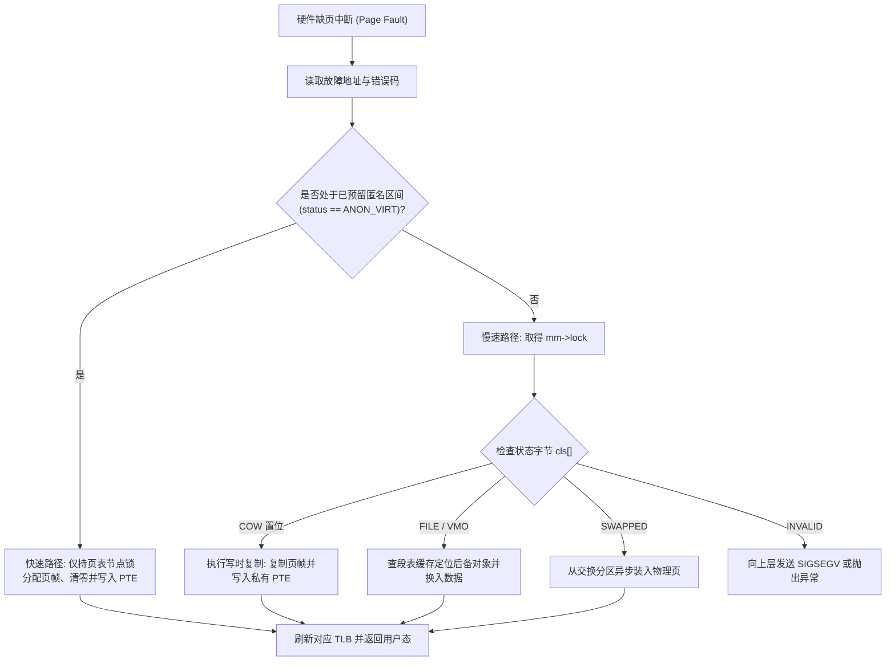

# 单级页表内存模型（CortenMM 架构规范）

A20OS 采用基于 CortenMM 思想的单级页表内存模型（`MM_AS_MODEL`）。该架构移除了传统内核中将软件级虚存区间抽象（如 Linux `vm_area_struct` / 早期 A20OS `vm_area_t`）作为“唯一映射真相”的设计，改由硬件页表及其挂载的元数据数组作为虚存页状态的唯一权威来源。

代码位置：[`kernel/include/mm/pt.h`](../../../kernel/include/mm/pt.h)、[`kernel/include/mm/vm.h`](../../../kernel/include/mm/vm.h)、[`kernel/mm/pt.c`](../../../kernel/mm/pt.c)、[`kernel/mm/fault.c`](../../../kernel/mm/fault.c)。

---

## 1. 架构动机与设计取舍

### 1.1 传统双级模型的结构性缺陷

传统的虚拟内存系统同时维护两套映射状态表示：
1. **软件级区间树/链表（VMA）**：按区间管理地址空间范围、权限和后备对象；
2. **硬件多级页表（PTE）**：由 MMU 遍历以完成地址翻译。

这两套表示必须在每次 `mmap`、`munmap`、`mprotect`、`fork` 及缺页异常中严格保持同步。在多核并发环境下，两者的锁同步粒度存在结构性冲突：
- VMA 操作需要持大粒度锁（如 `mm->lock`），且部分操作（如 VFS 回写或内存释放）必须允许睡眠；
- 页表修改需要保护底层硬件条目与页表结构分配，通常受轻量自旋锁保护；
- 早期 A20OS 为协调两者而引入的延迟释放机制（如 `mm_vma_defer()`）极易诱发死锁与复杂竞态。

### 1.2 单级模型的核心洞察

现代主流架构（x86-64、RISC-V、ARM64）均使用基于基数树（Radix Tree）的多级页表结构。CortenMM 式单级模型将硬件页表直接提升为状态管理的基座：
- **页状态的唯一真相**：每页的映射类型与保护位直接记录在覆盖该页的页表页元数据（`pt_meta_t`）中，不再由 VMA 区间树代理；
- **并发细粒度化**：互斥单位下沉到单个页表页级别（MCS 队列锁），无交集的虚拟地址区间操作天然并行；
- **单一映射凭据**：地址空间保留扁平的 `struct mm_seg` 链表，仅作为后备对象（VFS `vnode` / VMO）的所有权凭证与区间策略边界，不承担逐页映射状态的真值。

---

## 2. 核心数据结构

### 2.1 页表页元数据：`pt_meta_t`

每一个分配给用户地址空间的页表页均在分配时绑定一个 `pt_meta_t` 结构体（位于该页对应的页帧描述符中）：

```c
typedef struct pt_meta {
    mcs_lock_t  lock;              /* 页表页级别的写者互斥锁 */
    uint16_t    live_entries;      /* 当前有效的子节点/叶条目计数 */
    uint8_t     cls[PT_ENTRIES];   /* 逐 PTE 状态字节数组 (每项 1 字节) */
} pt_meta_t;
```

#### 逐 PTE 状态字节编码（Status Byte）

每个 PTE 对应 1 字节元数据，编码格式如下：

| 位域 | 字段 | 含义说明 |
|:---|:---|:---|
| `[7:4]` | **状态类别 (Class)** | `INVALID` (0x0)、`ANON_VIRT` (0x1，未建映射的预留匿名区间)、`ANON_MAPPED` (0x2，已映射私有物理页)、`ANON_SHARED` (0x3，共享匿名页)、`FILE_PRIVATE` (0x4)、`FILE_SHARED` (0x5)、`VMO` (0x6)、`SWAPPED` (0x7)、`PT_NODE` (0x8，中间层分支节点) |
| `[3]` | **COW 共享位 (Shared)** | 置位表示多个映射可能引用该物理页，写入需触发写时复制 |
| `[2:0]` | **访问权限 (Prot)** | 标准读写执行标志位：`R` (bit 0)、`W` (bit 1)、`X` (bit 2) |

> **为什么采用独立状态字节，而非 PTE 软件保留位？** 1. RISC-V 32 和 ARMv7-A 在根级页表项中没有多余的软件保留位； 2. LoongArch64 的硬件实现将软件标志位与内存属性位（Memory Attributes）重叠映射； 3. 独立的状态字节使得体系结构无关层能够以完全统一的契约处理缺页异常，无需针对各架构进行 bit-twiddling 碎片化适配。 4. 唯一的硬件位例外为 `PTE_SWAP`：因换出槽位需要 44 位有效载荷，无法容纳于 1 字节状态中，因此保留架构 PTE 字编码。

### 2.2 统一映射段表记录：`struct mm_seg`

地址空间中的每一个连续映射区间由唯一的 `struct mm_seg`（定义于 [`kernel/include/mm/vm.h`](../../../kernel/include/mm/vm.h)）承载：

```c
struct mm_seg {
    uint32_t         magic;
    refcount_t       refcount;       /* 统合计数：页表槽位、游标遍历与地址空间列表共同持有 */
    vaddr_t          start;          /* 起始虚地址（闭区间） */
    vaddr_t          end;            /* 结束虚地址（开区间） */
    uint64_t         backing_offset; /* 映射在后备对象中的起始偏移（VFS vnode 或 VMO） */
    uint64_t         vm_flags;       /* VM_* 保护与行为标志 */
    pte_t            pte_flags;      /* 架构底层页表标志快照 */
    uint32_t         vmar_cap;       /* Native VMAR 权限天花板 */
    struct vmar     *vmar_owner;     /* 所属 VMAR 层次域 */
    struct vfile    *file;           /* 映射源打开文件描述符引用 */
    struct vnode    *file_vnode;     /* 映射目标 VFS 节点 */
    struct vmo      *vmo;            /* 映射目标 VMO 对象 */
    void           (*release)(mm_seg_t *s); /* 延迟回收回调（安全上下文执行） */
    uint8_t          released;
    struct mm_seg   *prev;           /* mm->mmap 有序双向链表 */
    struct mm_seg   *next;
    struct mm_seg   *deferred_next;  /* 延迟回收队列链表 */
};
```

**设计关键点**：
- **单一真实来源**：旧版内核中并存的 `vm_area_t` 与 `mm_seg_t` 已合二为一，彻底消除了“双重表示、手动同步”所导致的状态漂移。
- **引用计数生命周期**：`refcount` 同时管辖页表项索引引用与游标读取引用。映射被卸载（`munmap`）后，底层后备对象的注销延后至最后一个页表项解除引用且释放动作投递至工作队列完成。

---

## 3. 事务式游标接口（`mm_cursor_t`）

在 `MM_AS_MODEL` 体系下，**禁止任何内核路径随意遍历修改底层页表项**。所有的页表编程与遍历必须通过事务式游标接口执行：

```c
mm_cursor_t cur;
if (mm_addrspace_lock(mm, va_start, len, MM_CURSOR_WRITE, &cur) == 0) {
    mm_cursor_map(&cur, ...);
    mm_cursor_unlock(&cur);
}
```

### 3.1 核心操作集

| 接口函数 | 语义与不变量 |
|:---|:---|
| `mm_addrspace_lock()` | 初始化游标上下文，按页表树前序（Preorder）获取覆盖目标区间的所有页表页 MCS 锁 |
| `mm_cursor_query()` | 检查目标虚拟地址的状态字节与对应 PTE 项 |
| `mm_cursor_map()` | 在持锁区间内装载新物理页、设置 PTE 并原子写入状态字节 |
| `mm_cursor_mark()` | 原地更新已有页状态（如写时复制标记清空、权限收紧/放宽） |
| `mm_cursor_unmap()` | 解除物理映射、递减引用计数并退役空闲的页表中间节点 |
| `mm_cursor_unlock()` | 提交事务，以严格的逆序（Postorder/Reverse）逐级释放已持有的页表页 MCS 锁 |

### 3.2 严格访问契约（`MM_AS_CURSOR_ONLY_ENTRY`）

1. **禁止裸指针逃逸**：任何内核代码不得使用 `pt_walk()` 或 `pt_lookup_leaf()` 获取裸 `pte_t*` 并在锁外、阻塞调用后或返回用户态时保留该指针。
2. **中间节点元数据保证**：游标创建中间页表页时，必须同步初始化并绑定 `pt_meta_t`，确保整棵基数树所有分支节点均处于互斥锁覆盖之下。
3. **内核空间隔离**：内核页表由所有地址空间共享（`pt_map_kernel()` 复制）。游标拒绝接受任何与内核空间相交的虚拟地址区间，内核映射绝不通过游标变更。
4. **受控的临时绕过名单（Bypasses）**：对于极少数因性能或特殊执行上下文无法构建完整区间游标的操作（如 `pt_unmap_leaf`、COW 重写、`mprotect` 快速刷新），代码强制采用 `mm_pt_node_lock` 直接锁定目标叶节点，并通过 `check-mm-pt-lock-order` 门禁严格钉死，防止产生未受保护的并发读写。

---

## 4. 并发控制模型（Locking Model）

A20OS 内存管理并发控制遵循清晰的分层策略：

```
                      [ 宏观区间层 ]
                       mm->lock (读写信号量/互斥体)
                       保护 mm->mmap 链表拓扑变化、区间拆分与合并
                             │
                             ▼
                      [ 微观页表层 ]
                       pt_meta_t.lock (MCS 队列自旋锁)
                       保护单页表页内部 PTE 与 cls[] 状态字节的读写
```

### 4.1 锁获取原则
- **写者排他**：修改映射区间结构（`mm_mmap`、`mm_munmap`、`mm_mremap`、`fork` 建立 COW）必须持有 `mm->lock`。
- **无交集区间并行**：两个不同 CPU 同时在不同页表页所覆盖的虚地址区间上发生缺页异常或更新元数据时，分别持有各自页表页的 MCS 锁，互不自旋串行。
- **加锁次序**：必须先获取 `mm->lock`，再通过游标或叶节点锁获取 `pt_meta_t.lock`。严禁逆向持锁。

### 4.2 状态驱动快速路径（Status-driven Fast Path）
对于已预留但尚未装载物理页的匿名区间（状态为 `ANON_VIRT`），缺页异常分派路径 `mm_fault_from_status()` 可在**不获取 `mm->lock`** 的情况下，直接通过游标申请物理页帧、清零并安装到 PTE，仅受底层节点锁保护。这消除了高并发内存分配下的全局地址空间锁争用。

---

## 5. 缺页异常与分派机制

当硬件发生 Page Fault 时，内核分派流程如下：



---

## 6. 验证与回归门禁

单级页表模型的正确性由以下严格的工程门禁保障：

1. **锁序与绕过契约静态检查**：运行 `tools/check-mm-pt-lock-order`，断言源码中的页表锁获取顺序及游标绕过清单（`MM_AS_CURSOR_ONLY_ENTRY_BYPASSES`）与设计规范逐项一致。
2. **端到端内存压力测试**：运行 `tools/a20 test smoke-mm-stress`，在高负载多线程并发分配、大页升降级及换页场景下，验证物理页与状态无泄漏。
3. **系统关机全量一致性审计**：在系统停机钩子中调用 `mm_pt_audit_addrspace()`，遍历所有活动地址空间，验证硬件 PTE、状态字节与段表区间记录 100% 吻合。
