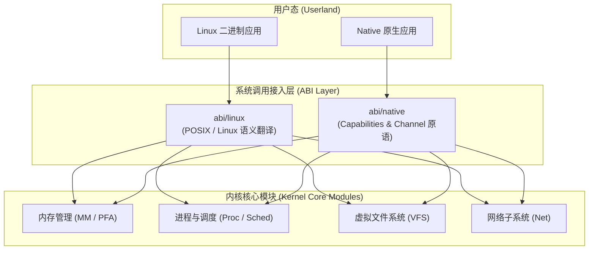

# A20 Native ABI 设计

外部 Native ABI 尚未正式冻结。1.0 按 [发布计划](../releases/v1.0.md) 完成语义、运行时和 C/Rust 绑定后冻结 v1；内部 Rust 类型与函数不承诺稳定二进制布局。已有正确行为须通过[新旧实现对照](../releases/v1.0-validation.md)，有意变更须记录版本、迁移方式并同步调用者。

A20OS 的混合内核设计动机、双 ABI 与 Linux 兼容层的关系，以及整体架构决策，请阅读 [architecture.md](../architecture.md)。本页定义 Native ABI 的设计定位与系统调用编号分区，详细规范见各子文档。当前 Native 运行时机制、版本迁移与兼容边界见[运行时扩展规范](10-runtime-extensions.md)。

## 设计定位

`abi/linux` 承担 Linux 用户态兼容职责，`abi/native` 面向原生用户态设计，不直接复制 POSIX 或 Linux syscall 编号。Native ABI 提供统一基于对象句柄（Handle）的调用接口，活跃用户态组件包括 `liba20rt`、最小库 `liba20c`，以及完整 libc 路线 `user/external/mlibc/sysdeps/a20/`。

系统架构分层如下：

```text
kernel/abi/linux/    Linux-compatible ABI subset（Linux 用户态兼容层）
kernel/abi/native/   A20OS native ABI（内核原生对象能力接口）
user/external/mlibc/sysdeps/a20/  Native 完整 libc 移植（RISC-V64/AArch64 静态与动态运行库）
```

Debug 分区（0x0900）具备完整的停止/恢复/观察语义：`debug_attach/traceme/detach/resume`、`debug_wait/event` 停止报告、`debug_read/write` 地址空间访问与寄存器读写，复用内核通用调试状态机。

## 核心原则

### 1. 一切资源都是 handle

Native ABI 不区分 Linux 风格的 fd、pid、tid、timerid、shmid 等编号。所有可操作资源由进程本地 handle table 引用。

```c
typedef uint32_t a20_handle_t;
```

为什么采用 handle？

> 我看 Windows NT 搞得不错，内核对象极大丰富，各类资源的调用差异基本消灭，面向对象，安全权能机制也受重视，如果再加上开源，Windows NT 就是我们理想中的操作系统内核。  ——fQwQf

14 种对象类型（含 `ext_prog` 内核扩展程序，详见 [handle.md](03-handle.md)）：

| 类型 | 说明 |
|------|------|
| task | 进程（地址空间 + handle table 容器） |
| thread | 线程（执行上下文） |
| file | 打开的文件 |
| dir | 打开的目录 |
| socket | 网络套接字 |
| pipe | 管道端点 |
| channel | IPC 通道端点 |
| eventq | 事件队列 |
| timer | 定时器 |
| memory | 共享内存对象（VMO） |
| device | 设备 |
| ns | 命名空间 |
| debug | 调试对象 |
| ext_prog | 内核扩展程序 |

handle 是进程本地编号，不是全局对象 ID。不同进程中的同一个数字不代表同一个对象。

### 2. handle 带 capability rights

每个 handle 都携带权限位。操作对象时不仅检查对象本身权限，也检查当前 handle 是否具备对应 capability。

权限只能降级，不能通过 `dup` 或 `transfer` 升级：

```text
new_rights 必须是 old_rights 的子集
```

14 个权限位的完整定义和 rights 代数见 [security.md](06-security.md)。

### 3. syscall 使用稳定结构体

复杂 syscall 不直接传一串裸参数，而是传结构体指针。所有结构体以 `size` 和 `version` 开头。详见 [types.md](01-types.md)。

规则：

1. 用户传入的 `size` 必须覆盖所声明 version 的完整必需前缀（version 1 即完整结构体）。
2. 用户传入的 `size` 大于内核支持结构体大小时，内核只读取已知字段。
3. 新字段只能追加并提高 `version`，不能改变已有字段含义。
4. 目标契约要求未知 flag 保留位为 0 并返回 `A20_ERR_INVALID_ARGUMENT`；当前只在部分 syscall 落地，不能视为统一保证。

### 4. ABI 必须可版本协商

第一个核心 syscall 是 ABI 查询：

```c
int64_t a20_abi_info(a20_abi_info_t *out);
```

版本规则：

- `abi_major` 改变表示不兼容变更。
- `abi_minor` 增加表示向后兼容新增功能。
- `abi_patch` 只表示 bugfix，不改变 ABI 表面。
- feature bits 用于检测可选能力。

结构体定义见 [types.md](01-types.md)，返回约定见 [errors.md](02-errors.md)。

### 5. syscall 编号分区

Native ABI syscall 编号按子系统分区：

```text
0x0000 - 0x00ff  core / abi / system
0x0100 - 0x01ff  handle
0x0200 - 0x02ff  task / thread
0x0300 - 0x03ff  memory
0x0400 - 0x04ff  path / filesystem
0x0500 - 0x05ff  ipc / event
0x0600 - 0x06ff  net
0x0700 - 0x07ff  time
0x0800 - 0x08ff  security / namespace
0x0900 - 0x09ff  debug / trace
0x0a00 - 0x0aff  system info / random / power
0x0b00 - 0x0bff  sync (futex)
0x0c00 - 0x0cff  device / user-space drivers
0x0e00 - 0x0eff  kernel extension points
0x1000 - 0x1fff  experimental, not stable
```

稳定 syscall 不允许随意改号。实验 syscall 只能在 `0x1000+` 范围内。完整的 178 个系统调用速查矩阵、跨架构寄存器陷入约定与 C 代码调用示例详见专门手册：[系统调用手册与调用指南](syscalls.md)（历史编号表亦保留在 [handle.md](03-handle.md) §6）。

## 文档索引

| 文档 | 内容 |
|------|------|
| [quickstart.md](quickstart.md) | **快速上手指南**：极简 Channel IPC 消息收发实战（C / Rust 示例与时序图） |
| [syscalls.md](syscalls.md) | **系统调用速查与调用指南**：全量 178 个系统调用矩阵、跨架构陷入指令与调用代码示例 |
| [types.md](01-types.md) | 基础类型定义、ABI 头约定、所有 syscall 参数结构体 |
| [errors.md](02-errors.md) | 错误码定义、返回值约定、错误处理策略 |
| [handle.md](03-handle.md) | Handle 生命周期状态机、handle table 规范、14 种对象类型映射 |
| [memory.md](04-memory.md) | VMO/VMAR 内存模型、内存操作语义、共享内存与映射 |
| [ipc.md](05-ipc.md) | Channel IPC 协议、Event Queue 机制、partial delivery 状态机 |
| [security.md](06-security.md) | Rights 代数、handle transfer 语义、安全标签格、capability 安全模型 |
| [startup.md](07-startup.md) | 用户态启动协议、start_info 结构、初始 handle、libc 分层设计 |
| [09-native-abi-deepening.md](09-native-abi-deepening.md) | Native ABI 机制深化、异步事件与能力演进 |
| [10-runtime-extensions.md](10-runtime-extensions.md) | 运行时扩展契约与高级系统调用实现 |

## 与 Linux ABI 的关系

设计原则：

1. 内核内部模块只实现核心语义。
2. `abi/linux` 把 Linux syscall 转成核心模块 API。
3. `abi/native` 把 native syscall 转成同一批核心模块 API。
4. 不允许 `abi/native` 调用 `abi/linux` 的 syscall 实现。
5. 不允许核心模块依赖 `abi/linux` 或 `abi/native` 的用户结构体。

双 ABI 调用解耦拓扑：



双 ABI 形式化隔离的完整证明见研究笔记 `docs/zh/research/05-capability-envelopes.md`（语义级能力边界）与 `docs/zh/research/06-formal-foundations.md §9`（模块依赖级隔离）。

## libc / runtime 设计

Native ABI 同时保留薄 SDK/最小 libc 和 mlibc 完整 libc 路线；不再维护活跃的 Native-musl 分支。

当前结构：

```text
Linux ABI 主用户态：musl

Native ABI：
  应用 -> mlibc sysdeps/a20 -> Native syscall
  小型程序 -> liba20c -> liba20rt -> Native syscall
```

- `liba20rt`：当前活跃的 Native SDK，提供 syscall wrapper、启动汇编、handle I/O 和 ABI 类型头。
- `liba20c`：最小 C 库，覆盖 malloc、stdio、string、time、errno 等 ISO C 子集。
- `user/external/mlibc/sysdeps/a20/`：当前活跃的较完整 libc 适配，支持静态链接、线程、pipe/poll/socketpair、`posix_spawn` 等已接入子集；静态/动态运行已覆盖 RISC-V64、AArch64；具体范围见本次验收记录。
- `user/archive/`：保存历史上的 musl 移植参考代码和旧版 coreutils，不参与当前构建。

POSIX 兼容层通过用户态 mlibc 逐步映射提供，内核原生接口保持精简对象模型，详见 [startup.md](07-startup.md)。

## 信号与通知边界

Native 普通通知在运行时规定的检查点执行用户处理器；内核抢占和强制终止独立生效。Linux ABI 保留异步信号兼容语义。完整 Native 异步处理器不属于 1.0 必须项，也不是默认下一版本待办，详见 [Native 信号与通知的设计边界](checkpoint-signals.md)。

## 兼容策略

Native ABI 一旦稳定，需要遵守：

1. syscall 编号不重用。
2. 结构体字段只追加。
3. 逐步补齐 flag 保留位检查；当前部分入口仍忽略或保存未知位，这是兼容性收口项。
4. 默认行为不能随意改变。
5. 不兼容变更只能增加 `abi_major`。
6. 实验 syscall 必须留在 experimental 编号区。

## 代码结构

```text
kernel/abi/native/syscall_table.c      syscall 分发表
syscall_table.def                      syscall 编号宏定义（178 条）
sys_core.c                             核心 syscall 实现
sys_native_{handle,task,mm,fs,ipc,net,time,security,debug,system,sync,device,ext}.c  分区 syscall
sys_native_debug.c                     Debug (0x0900) syscall（包装 proc_debug_*）
handle_table.c                         Handle table 实现（状态机 + 查找/安装/移除）
registry.c                             服务注册表（0x0A03）
startup.c                              用户态启动协议
a20_graceful.c                         错误降级处理

kernel/ipc/a20_channel.c               Channel IPC 实现
a20_event.c                            Event Queue 实现
a20_object.c                           类型化对象引用计数与销毁

kernel/include/abi/native/types.h      用户可见类型定义
errno.h                                错误码常量
rights.h                               权限位定义
syscall_nr.h                           syscall 编号常量
syscall_entry.h                        syscall 入口约定
startup.h                              启动信息结构
kernel/include/mm/vmo.h                核心 VMO 对象
kernel/include/abi/native/vmar.h       Native VMAR 薄包装声明
ipc_internal.h                         Channel/Event 内部接口
fastpath.h                             Syscall 快速路径（inline handle/rights/iov/bitmap）
ring_spsc.h                            Lock-free SPSC ring buffer
resource.h                             资源限制常量和检查函数

user/liba20rt/         当前活跃的 Native SDK
a20_types.h            ABI 类型定义（与 kernel/include/abi/native/types.h 对应）
a20_syscall.h          syscall wrapper 和编号常量
a20_handle.h / a20_fs.h / a20_task.h / ...  高层封装头
a20_simple_io.c        简化 I/O 实现
crt0_*.S               多架构启动汇编

user/liba20c/          最小原生 C 库
malloc.c / stdio.c / unistd.c / string.c / ...
include/               ISO C 头文件子集
fdtable.c              fd↔handle 映射

user/archive/          历史参考代码，不参与构建
a20coreutils/          旧版原生 coreutils 示例
src/                   旧版 musl 桥接实现
build_sysroot.sh       旧版 sysroot 脚本（引用路径已过期）
arch/a20/              旧版 musl arch 适配头
tests/                 旧版测试程序
```

## 明确不做的事

Native ABI 不应该：

- 完整复刻 POSIX。
- 复制 Linux syscall 编号。
- 复制 Linux `ioctl` 大杂烩。
- 复制 Linux `clone` 的 flag 组合复杂度。
- 强制使用 uid/gid 作为唯一安全模型。
- 让内核核心模块依赖 native 用户结构体。
- 为了短期兼容测试牺牲接口清晰度。

## Syscall 完整性

Native ABI 当前登记 178 个 syscall，Linux ABI 表登记 366 个。这个数字只说明接口表规模，不能推出 Native ABI 已语义等价覆盖全部 Linux syscall。统一机制承担了其中的合并工作：`handle_set_meta` 一次调用修改 chmod/chown/utimes/truncate 等元数据；`handle_transfer` 统一 splice/sendfile/copy_file_range/tee 风格接口，当前实现使用 4 KiB 内核缓冲拷贝，不是零拷贝；`task_set_sched`/`task_get_sched` 统一 sched/priority/nice/affinity；`security_get_context`/`security_set_context` 统一 uid/gid/cap。

`event_queue` 为 channel/timer/task 等对象提供统一等待模型，但 file/socket readiness 与 `event_watch_fs` 事件源尚未完整接入，不能视为已覆盖 epoll/signalfd/inotify 全语义。

完整分类对比、未覆盖 Linux 功能（由兼容层模拟）以及形式化讨论，见 [architecture.md](../architecture.md) §4 与 `docs/zh/research/05-capability-envelopes.md`。
