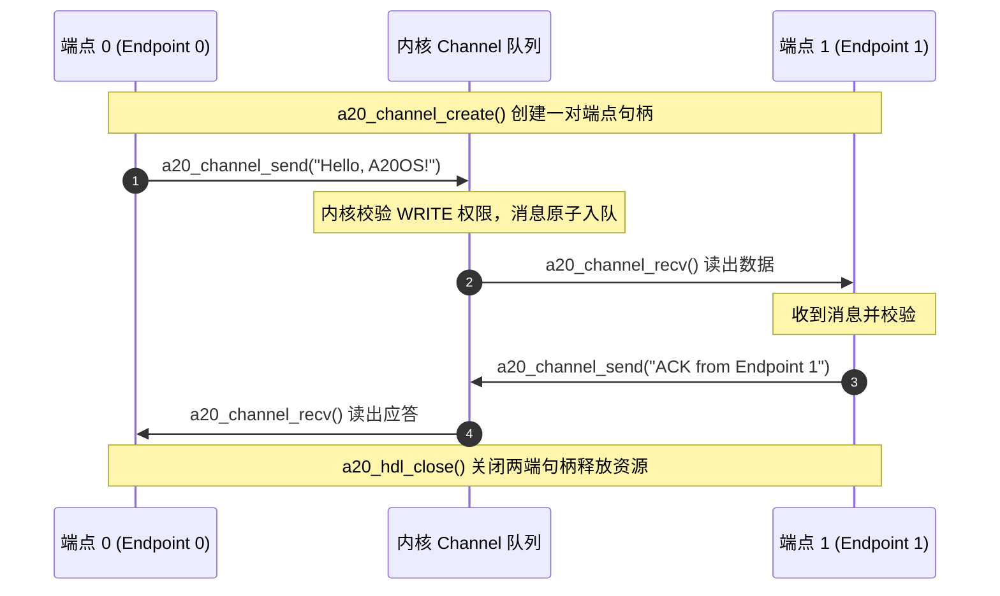

# Native ABI 快速上手：你的第一个 Channel 程序

本教程手把手带你通过 Native ABI 编写一个完整的进程内双向消息通信程序。通过本教程，你将直观理解 A20OS 面向能力（Capability-based）的句柄模型与双向通道（Channel）机制。

---

## 为什么选择 Native ABI？

在传统 UNIX/Linux 系统中，进程间通信通常使用 `pipe`、`socketpair` 或共享内存。这些机制通常是无类型的纯字节流，缺乏细粒度的权能检查。

A20OS 的 **Native ABI** 提供了新一代的原生操作系统接口：
* **面向能力（Capability）**：所有资源（进程、内存、通道、外设）均表示为受内核保护的句柄（Handle），句柄自带权限位（Rights，如 `READ`、`WRITE`、`TRANSFER`）。
* **类型化双向通道（Channel）**：一次系统调用生成一对互指的端点句柄（Endpoints）。
* **能力传递（Handle Passing）**：Channel 不仅能传递纯数据字节，还支持在消息中直接传递其他对象的句柄（权限安全转移）。



---

## C 语言实战：创建通道并收发消息

以下是一个完整的独立 C 程序，演示了 Channel 的创建、单向发送、对端接收与资源释放：

```c
#include <stdio.h>
#include <string.h>
#include <a20_channel.h>
#include <a20_handle.h>

int main(void) {
    a20_status_t status;
    a20_channel_pair_t pair;

    // 1. 创建双向消息通道
    // 成功后，pair.endpoints[0] 和 pair.endpoints[1] 分别代表通道的两端
    status = a20_channel_create(&pair);
    if (!a20_status_is_ok(status)) {
        fprintf(stderr, "创建 Channel 失败，错误码: %d\n", status);
        return 1;
    }
    printf("[Init] 成功创建通道: ep0 = %u, ep1 = %u\n",
           pair.endpoints[0], pair.endpoints[1]);

    // 2. 从端点 0 向端点 1 发送一条问候消息
    const char *send_text = "Hello, A20OS Native IPC!";
    uint32_t send_len = (uint32_t)strlen(send_text) + 1; // 包含字符串结束符 \0

    status = a20_channel_send(pair.endpoints[0], send_text, send_len, NULL, 0);
    if (!a20_status_is_ok(status)) {
        fprintf(stderr, "发送消息失败，错误码: %d\n", status);
        goto cleanup;
    }
    printf("[Send] 从 ep0 发送消息: \"%s\" (%u 字节)\n", send_text, send_len);

    // 3. 从端点 1 接收消息
    char recv_buf[128];
    uint32_t recv_len = sizeof(recv_buf);
    uint32_t recv_handles = 0;

    status = a20_channel_recv(pair.endpoints[1], recv_buf, &recv_len, NULL, &recv_handles);
    if (!a20_status_is_ok(status)) {
        fprintf(stderr, "接收消息失败，错误码: %d\n", status);
        goto cleanup;
    }
    printf("[Recv] 从 ep1 收到消息: \"%s\" (实际读取 %u 字节)\n", recv_buf, recv_len);

    // 4. 双向通信：端点 1 同样可以向端点 0 回复消息
    const char *reply_text = "Echo from Endpoint 1: Message received!";
    uint32_t reply_len = (uint32_t)strlen(reply_text) + 1;
    a20_channel_send(pair.endpoints[1], reply_text, reply_len, NULL, 0);

    recv_len = sizeof(recv_buf);
    a20_channel_recv(pair.endpoints[0], recv_buf, &recv_len, NULL, &recv_handles);
    printf("[Echo] 从 ep0 收到应答: \"%s\"\n", recv_buf);

cleanup:
    // 5. 显式关闭两个端点句柄，内核将自动回收通道内存与缓冲区
    a20_hdl_close(pair.endpoints[0]);
    a20_hdl_close(pair.endpoints[1]);
    printf("[Done] 通道句柄已正常关闭\n");

    return 0;
}
```

### 代码关键点解析

1. **`a20_channel_create(&pair)`**：在内核中分配一个无锁/自旋锁保护的通道结构，并在当前进程的句柄表（Handle Table）中注册两个端点，赋予初始的 `READ | WRITE | STAT | TRANSFER` 权能。
2. **`a20_channel_send(ep, data, len, handles, num_handles)`**：将数据和随行句柄原子拷贝进对端的接收队列。第四和第五个参数用于附带传递其他 Handle（如打开的磁盘文件句柄或共享内存 VMO）。若无需传递 Handle，传入 `NULL, 0` 即可。
3. **`a20_channel_recv(ep, buf, &len, handles, &num_handles)`**：从端点自己的接收队列中弹出最早的一条消息。若队列为空，线程会以非繁忙轮询的方式挂起等待，直到消息到达。
4. **`a20_hdl_close(ep)`**：关闭句柄。当对端句柄关闭后，若继续向该端点发送，内核会返回 `A20_ERR_PEER_CLOSED` 错误，避免死锁或资源挂起。

---

## Rust 语言实战：利用所有权自动管理 Channel

在 Rust 下，我们可以利用 RAII（Resource Acquisition Is Initialization）特性，在端点离开作用域时自动关闭句柄：

```rust
use core::mem::size_of;

pub type Handle = u32;
pub type Status = i64;

pub const A20_OK: Status = 0;
pub const A20_HANDLE_NULL: Handle = 0;
pub const A20_SYS_CHANNEL_CREATE: u64 = 0x0504;

#[repr(C)]
struct ChannelCreateArgs {
    size: u32,
    version: u32,
    msg_capacity: u32,
    flags: u32,
    type_: u64,
    out_endpoints: [Handle; 2],
}

/// 封装 RAII 端点对象，离开作用域时自动释放句柄
pub struct ChannelEndpoint(pub Handle);

impl Drop for ChannelEndpoint {
    fn drop(&mut self) {
        if self.0 != A20_HANDLE_NULL {
            unsafe {
                // 调用 a20_hdl_close 系统调用
                sys_hdl_close(self.0);
            }
        }
    }
}

/// 创建一对通道端点
pub fn channel_create() -> Result<(ChannelEndpoint, ChannelEndpoint), Status> {
    let mut args = ChannelCreateArgs {
        size: size_of::<ChannelCreateArgs>() as u32,
        version: 1,
        msg_capacity: 0,
        flags: 0,
        type_: 0,
        out_endpoints: [A20_HANDLE_NULL; 2],
    };

    let st = unsafe {
        sys_syscall6(A20_SYS_CHANNEL_CREATE, &mut args as *mut _ as u64, 0, 0, 0, 0, 0)
    };

    if st == A20_OK {
        Ok((
            ChannelEndpoint(args.out_endpoints[0]),
            ChannelEndpoint(args.out_endpoints[1]),
        ))
    } else {
        Err(st)
    }
}
```

---

## 跨进程服务通信模型

在真实的系统服务（如用户态驱动、文件系统服务 `ufsd` 或服务管理器 `svcmgr`）中，通常的使用模式是：

1. **父进程创建通道**：主控进程创建 `(ep_server, ep_client)`；
2. **传递端点**：主控进程通过 `task_spawn` 启动子进程服务，把 `ep_client` 通过初始句柄表（`start_info`）注入到子进程；
3. **RPC 请求与回复**：客户端可以使用快速系统调用 **`a20_channel_call()`**：该调用在一次 Trap 中同时完成“发送请求数据 + 挂起等待 + 收集回复”，避免两次进入内核的上下文切换开销。

---

## 常见错误与排查提示 (FAQ)

| 返回错误码 | 典型原因 | 解决方法 |
|---|---|---|
| `A20_ERR_BAD_HANDLE` (-2) | 传入了 `A20_HANDLE_NULL` 或该 Handle 已经被 `a20_hdl_close` 关闭 | 检查 Handle 生命周期，确保未发生重复关闭（double-close）。 |
| `A20_ERR_ACCESS_DENIED` (-4) | 句柄权限不足（如试图从仅有 WRITE 权限的句柄进行 recv） | 检查创建通道或权限缩小（rights restrict）时的权限掩码位。 |
| `A20_ERR_PEER_CLOSED` (-8) | 通道对端的进程已退出或已主动关闭对应 Endpoint | 服务端或客户端已终止。在网络/RPC 客户端中应当当作连接断开进行优雅清理。 |
| `A20_ERR_BUFFER_TOO_SMALL` (-9) | 接收缓冲区的 `recv_len` 小于对端单条消息的实际长度 | 传入足够大的缓冲区，或将缓冲区调整为最大消息尺寸（`A20_CH_MAX_DATA = 64KB`）。 |

---

## 下一步

走通了第一个 Channel 程序后，建议继续阅读以下进阶内容：
* [Native ABI 系统调用参考手册](syscalls.md)：查阅 175 个原生系统调用的完整参数与返回值。
* [IPC 与事件通知子系统](05-ipc.md)：深入学习 `event_queue` 统一事件轮询与类型化 Channel 约束。
* [内存对象与映射模型](04-memory.md)：掌握 VMO 共享内存与零拷贝 IPC 的配合使用。
