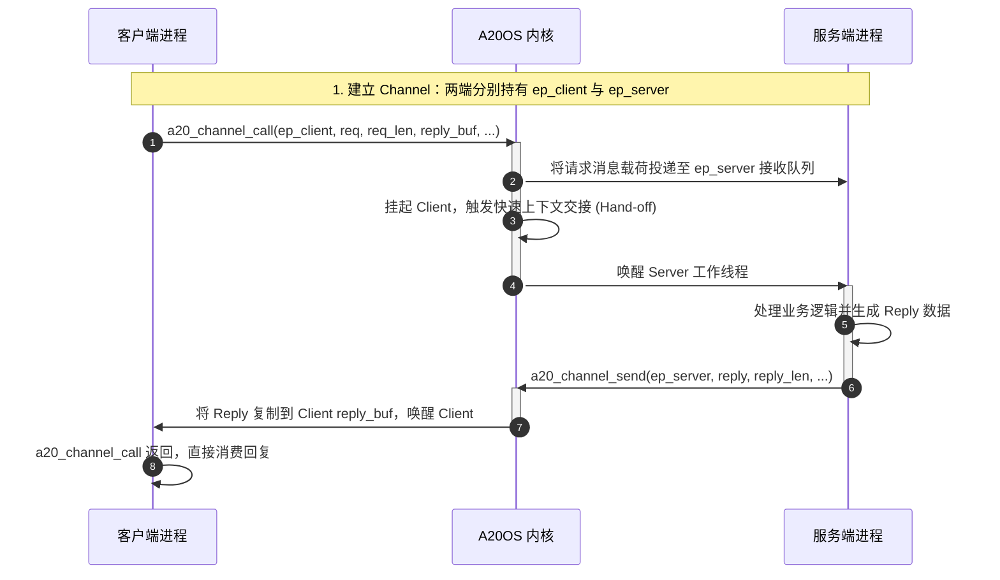
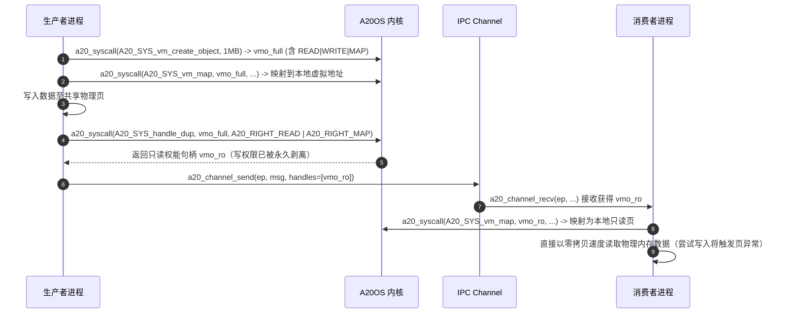
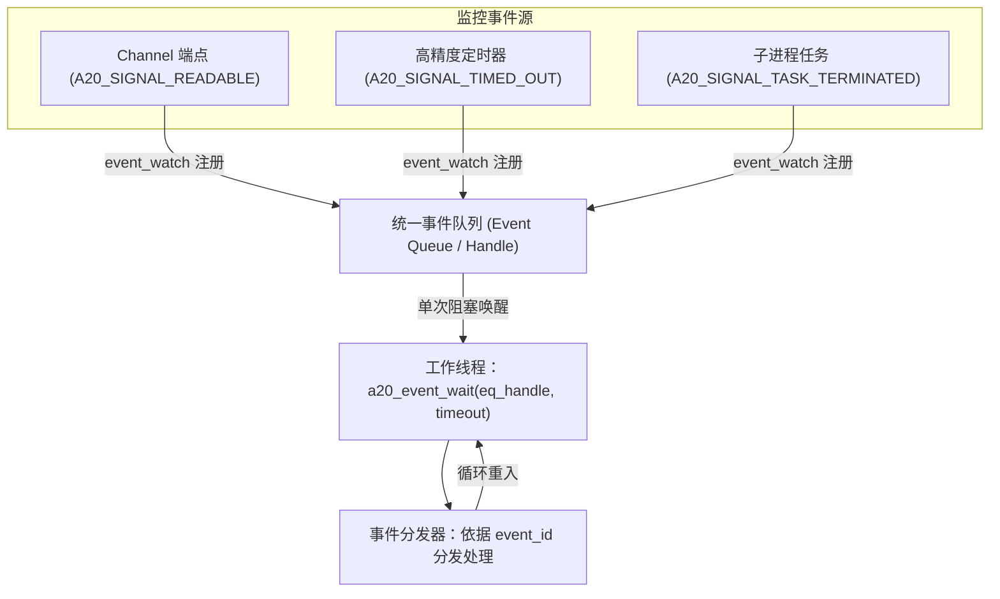

# A20OS Native ABI：系统调用手册与调用指南

A20OS Native ABI 是面向对象能力、统一句柄与异步事件驱动的新一代原生系统调用接口。与 Linux 兼容层（`abi/linux`）不同，Native ABI 基于面向对象权能模型（Capability-based Handle）、结构体版本协商（`a20_abi_header_t`）与显式异步事件分发机制构建。

本文档是 Native ABI 的**总览参考手册与系统调用速查矩阵**，涵盖全架构调用约定、硬件陷入指令、参数传递规范、C 语言调用代码示例以及全量 178 个系统调用的详细说明。

---

## 1. 快速导航

- [2. 跨架构调用约定与硬件陷入指令](#2-跨架构调用约定与硬件陷入指令)
- [3. 如何发起系统调用](#3-如何发起系统调用)
  - [3.1 底层陷入包装 a20_syscall6](#31-底层陷入包装-a20_syscall6)
  - [3.2 用户态 SDK 强类型函数](#32-用户态-sdk-强类型函数)
  - [3.3 参数传递形式：标量与结构体](#33-参数传递形式标量与结构体)
  - [3.4 返回值与错误处理约定](#34-返回值与错误处理约定)
- [4. 核心系统调用模式与交互时序](#4-核心系统调用模式与交互时序)
  - [4.1 基础调用：标量与结构体协商](#41-基础调用标量与结构体协商)
  - [4.2 模式一：双向 Channel 与 Fused RPC（同步微内核调用）](#42-模式一双向-channel-与-fused-rpc同步微内核调用)
  - [4.3 模式二：零拷贝共享内存传递（VMO 与权能衰减）](#43-模式二零拷贝共享内存传递vmo-与权能衰减)
  - [4.4 模式三：统一多路异步事件循环（Event Queue）](#44-模式三统一多路异步事件循环-event-queue)
  - [4.5 模式四：权能屏蔽与不可逃逸沙箱（Rights Attenuation）](#45-模式四权能屏蔽与不可逃逸沙箱rights-attenuation)
- [5. 头文件与 SDK 组织](#5-头文件与-sdk-组织)
- [6. 系统调用分区概览](#6-系统调用分区概览)
- [7. 全量 178 个系统调用速查矩阵](#7-全量-178-个系统调用速查矩阵)

---

## 2. 跨架构调用约定与硬件陷入指令

Native ABI 用户态程序发起系统调用时，通过各个架构约定的通用寄存器传递调用号与最多 6 个参数，并通过指定的 CPU 硬件指令陷入内核。内核处理完成后，将 `a20_status_t` 状态值写回返回值寄存器。

| 架构 (Arch) | 陷入指令 (Trap Instruction) | 系统调用号寄存器 (Syscall Nr) | 参数寄存器 (Arg 0 ~ Arg 5) | 返回值寄存器 (Return Val) | 破坏/临时寄存器 (Clobbered) |
|---|---|---|---|---|---|
| **x86_64** | `int $0x80` | `rax` | `rdi`, `rsi`, `rdx`, `r10`, `r8`, `r9` | `rax` | `memory` |
| **AArch64** | `svc #0` | `x8` | `x0`, `x1`, `x2`, `x3`, `x4`, `x5` | `x0` | `memory` |
| **RISC-V 64** | `ecall` | `a7` | `a0`, `a1`, `a2`, `a3`, `a4`, `a5` | `a0` | `memory` |
| **RISC-V 32** | `ecall` | `a7` | `a0`, `a1`, `a2`, `a3`, `a4`, `a5` | `a0` | `memory` |
| **LoongArch 64** | `syscall 0` | `a7` | `a0`, `a1`, `a2`, `a3`, `a4`, `a5` | `a0` | `memory` |
| **ARM32** | `svc #0` | `r7` | `r0`, `r1`, `r2`, `r3`, `r4`, `r5` | `r0` | `memory` |
| **PowerPC 64** | `sc` | `r0` | `r3`, `r4`, `r5`, `r6`, `r7`, `r8` | `r3` | `memory`, `cr0` |

> [!NOTE]
> 1. 特殊系统调用（如 `A20_SYS_execve` 和 `A20_SYS_task_restore`）在成功时会替换整个用户态上下文，不会将返回值写回 `a0`/`x0`/`rax`。\
> 2. x86_64 在 Linux ABI 下使用 `syscall` 指令，但在 Native ABI 下为区分 ABI 人格并保持架构清晰，约定使用 `int $0x80` 快速门陷入内核。

---

## 3. 如何发起系统调用

### 3.1 底层陷入包装 a20_syscall6

原生用户态运行时在 [user/liba20rt/a20_syscall.h](../../../user/liba20rt/a20_syscall.h) 中提供了全架构统一的内联汇编辅助函数 `a20_syscall6`：

```c
static inline int64_t a20_syscall6(uint64_t nr, uint64_t a0, uint64_t a1,
                                   uint64_t a2, uint64_t a3, uint64_t a4,
                                   uint64_t a5);
```

对于参数不足 6 个的系统调用，多余的参数传 `0` 即可。

### 3.2 用户态 SDK 强类型函数

在常规应用开发中，推荐使用 `user/liba20rt` 提供的强类型 SDK 函数（如 `a20_handle_close`、`a20_channel_create` 等），其内部会自动完成类型检查、参数封包并调用底层 `a20_syscall6`。只需引入 `#include <a20_sdk.h>` 即可获得全部接口。

### 3.3 参数传递形式：标量与结构体

Native ABI 严格区分标量与结构体传参：

1. **纯标量传参**：简单资源操作（如 `handle_close(h)`、`thread_sleep(ns)`、`thread_yield()`）直接将数值或句柄放入通用寄存器（`a0`~`a5`）传递。
2. **结构体指针传参**：复杂或可扩展的系统调用统一通过通用寄存器传递**用户态结构体指针**。所有传给内核的请求结构体必须在首部包含版本头 `a20_abi_header_t`：
   ```c
   typedef struct a20_abi_header {
       uint32_t size;      /* 结构体总大小，通常为 sizeof(结构体类型) */
       uint32_t version;   /* 结构体版本号，当前规范固定从 1 开始 */
   } a20_abi_header_t;
   ```
   * **校验规则**：内核严格校验 `size >= sizeof(expected_prefix)`。若调用方传入的 `size` 偏小，内核返回 `-A20_ERR_INVALID_ARGUMENT`；若传入的 `size` 大于内核已知字段，内核只读取已知字段，实现前向兼容。
   * **清零要求**：用户态在初始化结构体时必须全量清零（如 `memset(&args, 0, sizeof(args))`），未知 flag 或保留字段必须为 0。

### 3.4 返回值与错误处理约定

* 系统调用的返回值类型统一为 `a20_status_t`（`int64_t`）。
* **成功**：返回值 `>= 0`。成功时通常返回 `A20_OK`（0），或返回分配的句柄编号（`a20_handle_t`）、传输的字节数等。
* **失败**：返回值 `< 0`。返回值为正数错误码的相反数，即 `-A20_ERR_*`（例如参数错误返回 `-A20_ERR_INVALID_ARGUMENT`）。
* 错误码判定辅助宏（定义在 [02-errors.md](02-errors.md) 与 `a20_types.h`）：
  ```c
  #define a20_status_is_ok(st)   ((st) >= 0)
  #define a20_status_is_err(st)  ((st) < 0)
  ```
* 详细错误码列表与语义参见 [02-errors.md](02-errors.md)。

---

## 4. 核心系统调用模式与交互时序

A20OS Native ABI 的设计核心在于**对象句柄（Handle）**、**权能约束（Capability Rights）**与**零拷贝快速路径（Fused RPC / VMO）**。以下通过 Mermaid 时序交互图与完整的 C 语言端到端代码，展示四大核心系统级调用模式。

---

### 4.1 基础调用：标量与结构体协商

标量调用直接通过通用寄存器传递整型/句柄参数；复杂系统调用通过 `a20_abi_header_t` 结构体进行版本协商与双向传参：

#### 示例 A：标量系统调用（句柄关闭与纳秒级休眠）

```c
#include <stdint.h>
#include <a20_syscall.h>

void close_and_sleep(a20_handle_t handle) {
    /* 1. 关闭指定句柄（标量入参：a0 = handle，其余寄存器置 0） */
    a20_status_t st = a20_syscall6(A20_SYS_handle_close, handle, 0, 0, 0, 0, 0);
    if (a20_status_is_err(st)) {
        /* 处理错误：-st 即为具体错误码，如 A20_ERR_BAD_HANDLE */
        return;
    }

    /* 2. 线程休眠 50 毫秒（标量入参：a0 = 纳秒数） */
    uint64_t duration_ns = 50 * 1000 * 1000ULL;
    a20_syscall6(A20_SYS_thread_sleep, duration_ns, 0, 0, 0, 0, 0);
}
```

#### 示例 B：结构体协商系统调用（查询 ABI 版本与特性）

```c
#include <string.h>
#include <a20_syscall.h>
#include <a20_types.h>

int check_native_abi(void) {
    a20_abi_info_t abi_info;

    /* 1. 结构体置零并显式指定 ABI 版本头 */
    memset(&abi_info, 0, sizeof(abi_info));
    abi_info.header.size = sizeof(abi_info);
    abi_info.header.version = 1;

    /* 2. 发起系统调用：a0 传入结构体指针 */
    a20_status_t st = a20_syscall6(A20_SYS_abi_info, (uint64_t)(uintptr_t)&abi_info,
                                   0, 0, 0, 0, 0);
    if (a20_status_is_err(st)) {
        return -1;
    }

    /* 3. 使用返回的数据 */
    uint32_t major = abi_info.abi_major;
    uint32_t minor = abi_info.abi_minor;
    (void)major;
    (void)minor;
    return 0;
}
```

---

### 4.2 模式一：双向 Channel 与 Fused RPC（同步微内核调用）

在微内核与混合内核架构中，跨进程 IPC 的往返延迟是性能瓶颈。A20OS 提供了 **Fused RPC** 调用 `A20_SYS_channel_call`（`0x0508`）：将“发送请求载荷”与“等待服务端回复”合并为**单次系统调用硬件陷入**。内核在同一次陷入内完成数据转移、将客户端加入等待队列并直接将 CPU 调度至服务端线程，消除冗余上下文切换。



#### C 代码实现：客户端 Fused RPC 与 服务端事件处理

```c
#include <a20_sdk.h>
#include <string.h>

/* --- 客户端：发起同步 Fused RPC --- */
a20_status_t rpc_client_echo(a20_handle_t ep_client, const char *msg, char *reply_out, uint32_t max_reply) {
    uint32_t reply_len = max_reply;
    uint32_t reply_handles = 0;

    /* A20_SYS_channel_call 一次陷入完成发送与应答等待 */
    a20_status_t st = a20_channel_call(
        ep_client,
        msg, (uint32_t)strlen(msg) + 1,
        NULL, 0,                  /* 无附加 handle */
        reply_out, &reply_len,    /* 接收应答的缓冲区与实际长度 */
        NULL, &reply_handles      /* 无接收 handle */
    );
    return st;
}

/* --- 服务端：接收并应答 --- */
void rpc_server_worker(a20_handle_t ep_server) {
    char req_buf[256];
    uint32_t req_len = sizeof(req_buf);
    
    /* 阻塞接收请求 */
    a20_status_t st = a20_channel_recv(ep_server, req_buf, &req_len, NULL, NULL);
    if (a20_status_is_ok(st)) {
        /* 处理业务并构造回复 */
        char reply[256] = "ACK: ";
        strncat(reply, req_buf, sizeof(reply) - 6);
        
        /* 发回应答 */
        a20_channel_send(ep_server, reply, (uint32_t)strlen(reply) + 1, NULL, 0, 0);
    }
}
```

---

### 4.3 模式二：零拷贝共享内存传递（VMO 与权能衰减）

对于视频帧、网络大包、文件缓存等大块数据，跨进程值拷贝（IPC 缓冲区复制）开销过大。A20OS 通过 **虚拟内存对象（VMO）** 配合 **句柄权能衰减（Rights Attenuation）** 实现安全的零拷贝共享：生产者创建 VMO、写入数据，随后复制一个**只具有只读权限**的受限句柄并经由 Channel 发送给消费者。



#### C 代码实现：零拷贝 VMO 创建、衰减与映射

```c
#include <a20_sdk.h>
#include <a20_syscall.h>

/* 生产者：创建 VMO、写数据、衰减权限后随 Channel 交付 */
a20_status_t producer_send_shm(a20_handle_t ep, const void *payload, size_t size) {
    /* 1. 创建 64KB 的物理内存对象（VMO） */
    a20_handle_t vmo_master = 0;
    a20_status_t st = a20_syscall6(A20_SYS_vm_create_object, size, 0, (uint64_t)&vmo_master, 0, 0, 0);
    if (a20_status_is_err(st)) return st;

    /* 2. 映射到本进程地址空间并写入数据 */
    void *local_ptr = NULL;
    st = a20_syscall6(A20_SYS_vm_map, vmo_master, 0, size, A20_PROT_READ | A20_PROT_WRITE, (uint64_t)&local_ptr, 0);
    if (a20_status_is_err(st)) goto cleanup;
    memcpy(local_ptr, payload, size);

    /* 3. 关键安全步骤：衰减权限，派生只读句柄（剥离 WRITE 权能） */
    a20_handle_t vmo_readonly = 0;
    st = a20_syscall6(A20_SYS_handle_dup, vmo_master, A20_RIGHT_READ | A20_RIGHT_MAP | A20_RIGHT_TRANSFER, (uint64_t)&vmo_readonly, 0, 0, 0);
    if (a20_status_is_err(st)) goto cleanup;

    /* 4. 将只读句柄放入 Channel 消息传递给对端 */
    a20_handle_t handles_to_send[1] = { vmo_readonly };
    st = a20_channel_send(ep, "SHM_READY", 10, handles_to_send, 1, 0);

    /* 句柄转移后关闭本地的只读引用副本 */
    a20_handle_close(vmo_readonly);

cleanup:
    a20_handle_close(vmo_master);
    return st;
}

/* 消费者：接收 VMO 句柄并直接映射读取 */
a20_status_t consumer_read_shm(a20_handle_t ep, void **out_buf, size_t size) {
    char ctrl_msg[32];
    uint32_t msg_len = sizeof(ctrl_msg);
    a20_handle_t received_handles[2];
    uint32_t handle_count = 2;

    /* 接收消息及附带的 VMO 句柄 */
    a20_status_t st = a20_channel_recv(ep, ctrl_msg, &msg_len, received_handles, &handle_count);
    if (a20_status_is_err(st) || handle_count < 1) return st;

    a20_handle_t vmo_in = received_handles[0];

    /* 映射为只读内存页（零拷贝直接访问物理页） */
    st = a20_syscall6(A20_SYS_vm_map, vmo_in, 0, size, A20_PROT_READ, (uint64_t)out_buf, 0);
    a20_handle_close(vmo_in);
    return st;
}
```

---

### 4.4 模式三：统一多路异步事件循环 (Event Queue)

A20OS 原生提供了统一事件队列原语 `A20_SYS_event_queue_create`（`0x0500`），将文件、套接字、定时器、Channel 可读状态及子进程退出通知统一收拢到一个事件队列中，取代传统的 `epoll + signalfd + timerfd` 复杂组合。



#### C 代码实现：统一异步事件循环

```c
#include <a20_sdk.h>
#include <a20_syscall.h>

void run_event_loop(a20_handle_t ch_endpoint, a20_handle_t timer_handle) {
    /* 1. 创建事件队列对象 */
    a20_handle_t eq = 0;
    a20_syscall6(A20_SYS_event_queue_create, 0, (uint64_t)&eq, 0, 0, 0, 0);

    /* 2. 挂载 Channel 可读监控（自定义标识符 ID=1001） */
    a20_syscall6(A20_SYS_event_watch, eq, ch_endpoint, A20_SIGNAL_READABLE, 1001, 0, 0);

    /* 3. 挂载定时器监控（自定义标识符 ID=1002） */
    a20_syscall6(A20_SYS_event_watch, eq, timer_handle, A20_SIGNAL_TIMED_OUT, 1002, 0, 0);

    /* 4. 统一事件调度循环 */
    while (1) {
        a20_event_t ev;
        /* 等待事件发生，超时时间 1000ms（-1 为永久阻塞） */
        a20_status_t st = a20_syscall6(A20_SYS_event_wait, eq, (uint64_t)&ev, 1000 * 1000 * 1000ULL, 0, 0, 0);
        if (a20_status_is_err(st)) {
            if (-st == A20_ERR_TIMED_OUT) continue;
            break; /* 其他异常错误 */
        }

        /* 依据注册的 ID 分发处理 */
        if (ev.user_id == 1001) {
            /* 处理 Channel 数据 */
        } else if (ev.user_id == 1002) {
            /* 处理定时心跳 */
        }
    }

    a20_handle_close(eq);
}
```

---

### 4.5 模式四：权能屏蔽与不可逃逸沙箱（Rights Attenuation）

在 Native ABI 安全模型中，**权限只能单调递减，绝不可凭空提升**。任何进程派生新句柄时，指定的权限掩码必须严格满足：

$$\text{Requested Rights} \subseteq \text{Source Handle Rights}$$

若请求超出源句柄拥有的权能位，内核将立即阻断并返回 `-A20_ERR_ACCESS_DENIED`。

```c
#include <a20_sdk.h>
#include <a20_syscall.h>

/* 为不可信第三方沙箱组件准备受限的文件句柄 */
a20_handle_t sandbox_restrict_handle(a20_handle_t full_file_handle) {
    a20_handle_t restricted_handle = 0;

    /*
     * 仅授予读权限（A20_RIGHT_READ），
     * 明确剥离：A20_RIGHT_WRITE（禁止修改）、
     *          A20_RIGHT_TRANSFER（禁止向其他进程泄漏该句柄）、
     *          A20_RIGHT_ADMIN（禁止修改元数据与扩展属性）。
     */
    uint64_t safe_rights = A20_RIGHT_READ;

    a20_status_t st = a20_syscall6(
        A20_SYS_handle_dup,
        full_file_handle,
        safe_rights,
        (uint64_t)&restricted_handle,
        0, 0, 0
    );

    if (a20_status_is_err(st)) {
        return A20_INVALID_HANDLE;
    }

    /* 此时 restricted_handle 传递给沙箱代码后，任何尝试以其写盘或再次外传的行为都会被内核硬件级拦截 */
    return restricted_handle;
}
```

---

## 5. 头文件与 SDK 组织

A20OS 在内核与用户态提供了分层的头文件支持：

| 头文件路径 | 层次与说明 |
|---|---|
| [kernel/include/abi/native/syscall_nr.h](../../../kernel/include/abi/native/syscall_nr.h) | 内核系统调用号宏定义（`A20_SYS_*`，共 178 个） |
| [kernel/abi/native/syscall_table.def](../../../kernel/abi/native/syscall_table.def) | 内核系统调用 X-Macro 派发表 |
| [user/liba20rt/a20_syscall.h](../../../user/liba20rt/a20_syscall.h) | 用户态全架构陷入指令与底层 `a20_syscall6` 辅助宏 |
| [user/liba20rt/a20_types.h](../../../user/liba20rt/a20_types.h) | 用户态原生数据结构、参数结构体、错误码与状态宏定义 |
| [user/liba20rt/a20_sdk.h](../../../user/liba20rt/a20_sdk.h) | 用户态统一聚合 SDK 头文件，包含所有高层子系统 API 封装 |

---

## 6. 系统调用分区概览

A20 Native ABI 采用十六进制高位分区（Class），稳定系统调用严格处于 `0x0000 ~ 0x0FFF` 区间：

| 分区号段 | 子系统类别 | 说明 | 数量 |
|---|---|---|---|
| `0x0000 - 0x00FF` | **Core** | 内核核心 ABI 查询、特性测试与实例绑定 | 6 |
| `0x0100 - 0x01FF` | **Handle** | 句柄生命周期、权限控制、元数据与扩展属性 | 14 |
| `0x0200 - 0x02FF` | **Task / Thread** | 进程/线程生命周期、调度策略、内存读写与信号检查 | 24 |
| `0x0300 - 0x03FF` | **Memory** | VMO 虚拟内存对象、VMAR 映射区间与共享内存 | 12 |
| `0x0400 - 0x04FF` | **Path / Filesystem** | VFS 路径操作、文件读写、目录遍历与文件系统挂载 | 24 |
| `0x0500 - 0x051F` | **Event / IPC** | Channel 消息通道、Event Queue 异步事件监听 | 9 |
| `0x0520 - 0x05FF` | **Cluster** | 集群节点自省、能力导出、互联路由与状态快照 | 7 |
| `0x0600 - 0x06FF` | **Network** | 原生网络套接字创建、绑定、连接与数据报收发 | 10 |
| `0x0700 - 0x07FF` | **Time** | 高精度单调时钟、挂钟与定时器管理 | 6 |
| `0x0800 - 0x08FF` | **Security** | 命名空间沙箱创建、应用与安全上下文设置 | 4 |
| `0x0900 - 0x09FF` | **Debug** | 调试附着、断点暂停、寄存器与内存观测 | 12 |
| `0x0A00 - 0x0AFF` | **System** | 系统信息、硬件随机数、电源控制、注册表与 Kexec | 5 |
| `0x0B00 - 0x0BFF` | **Sync** | 快速用户态互斥锁（Futex）与原子操作 | 3 |
| `0x0C00 - 0x0CFF` | **Device** | 用户态驱动框架（MMIO 映射、IRQ 订阅、DMA 申请） | 12 |
| `0x0D00 - 0x0DFF` | **Pager / Monitor** | 用户态分页异常代理与内核度量监控 | 5 |
| `0x0E00 - 0x0EFF` | **Kernel Extension** | 内核 eBPF 风格原生扩展程序加载与拦截点挂载 | 5 |
| `0x0F00 - 0x0FFF` | **Hypervisor / vCPU** | 原生轻量硬件虚拟机（RISC-V H / 虚拟化扩展）生命周期与 vCPU 控制 | 15 |
| **总计** | | **共 17 个子系统分类** | **178** |

---

## 7. 全量 178 个系统调用速查矩阵

### Core (0x0000)

> 详细设计规范：[00-overview.md](00-overview.md) / [01-types.md](01-types.md)

| 编号 | 宏定义 | 签名 | 传参形式 | 说明 |
|---|---|---|---|---|
| 0x0000 | `A20_SYS_abi_info` | `int64_t abi_info(a20_abi_info_t *out)` | 结构体/指针 | 查询 ABI 版本和能力 |
| 0x0001 | `A20_SYS_feature_test` | `int64_t feature_test(uint64_t feature_id)` | 纯标量 | 测试 feature 可用性 |
| 0x0003 | `A20_SYS_execution_domain_info` | `int64_t execution_domain_info(a20_execution_domain_info_t *out, uint32_t capacity)` | 标量+指针 | 当前原生执行域状态，见 [契约](../cluster/runtime-ssi.md) |
| 0x0002 | `A20_SYS_execution_info` | `int64_t execution_info(a20_execution_info_t *out, uint32_t capacity)` | 标量+指针 | MCU/服务器统一镜像执行信息，见 [契约](../cluster/runtime-ssi.md) |
| 0x0004 | `A20_SYS_runtime_info` | `int64_t runtime_info(a20_runtime_info_t *out, uint32_t capacity)` | 标量+指针 | 不可变运行实例命名空间，见 [契约](../cluster/runtime-ssi.md) |
| 0x0005 | `A20_SYS_runtime_bind` | `int64_t runtime_bind(const a20_runtime_binding_t *in, uint32_t capacity)` | 标量+指针 | 管理员显式绑定；完全相同的重试幂等 |

### Handle (0x0100)

> 详细设计规范：[03-handle.md](03-handle.md)

| 编号 | 宏定义 | 签名 | 传参形式 | 说明 |
|---|---|---|---|---|
| 0x0100 | `A20_SYS_handle_close` | `int64_t handle_close(a20_handle_t h)` | 纯标量 | 关闭 handle |
| 0x0101 | `A20_SYS_handle_dup` | `int64_t handle_dup(a20_handle_dup_args_t *args)` | 结构体/指针 | 复制 handle（可降级 rights） |
| 0x0102 | `A20_SYS_handle_query` | `int64_t handle_query(a20_handle_t h, a20_handle_info_t *out)` | 标量+指针 | 查询 handle 信息 |
| 0x0103 | `A20_SYS_handle_replace` | `int64_t handle_replace(a20_handle_t h, a20_rights_t rights, a20_handle_t *out)` | 标量+指针 | 原子替换 handle |
| 0x0104 | `A20_SYS_handle_close_many` | `int64_t handle_close_many(const a20_handle_t *hs, uint32_t count)` | 标量+指针 | 批量关闭 |
| 0x0105 | `A20_SYS_handle_seek` | `int64_t handle_seek(a20_handle_t h, a20_off_t *offset, uint32_t whence)` | 标量+指针 | 设置/查询流偏移 |
| 0x0106 | `A20_SYS_handle_transfer` | `int64_t handle_transfer(a20_transfer_args_t *args)` | 结构体/指针 | 内核缓冲拷贝传输（splice/sendfile/copy_file_range 语义统一；当前为 4 KiB 栈缓冲拷贝，非零拷贝） |
| 0x0107 | `A20_SYS_handle_set_meta` | `int64_t handle_set_meta(a20_handle_t h, uint32_t flags, uint64_t val0, uint64_t val1)` | 纯标量 | 修改文件元数据（chmod/chown/utimes/ftruncate）。要求 `WRITE \| STAT`；`flags` 必须非零且只含已定义位，否则 `A20_ERR_INVALID_ARGUMENT`。`val0` = `MODE`→mode、`OWNER`→uid、`ATIME`→atime_ns、`TRUNCATE`→长度 —— 这四个 flag 共用同一个字，因此一次调用最多只能带其中一个；`val1` = `OWNER`→gid、`MTIME`→mtime_ns，所以唯一的合法组合是 `TRUNCATE`+`MTIME`。`CTIME` 与 `ALLOCATE` 无内核实现，返回 `A20_ERR_NOT_SUPPORTED`。全部字段都走 VFS（`vfs_ftruncate`/`vfs_futimens`/`vfs_fchmod`/`vfs_fchown`），`MODE`/`OWNER` 因此需要属主身份或相应能力，只读挂载一律被拒。执行顺序是 truncate → 时间戳 → mode → owner：前两步失败时 mode/owner 不会被改动，但一次调用内部不是原子的，被拒的 chmod 不会回滚同一次调用里已写入的 truncate/时间戳。每次调用都要从进程 fd 表借一个临时 fd（表满返回 `A20_ERR_BAD_HANDLE`），`TRUNCATE` 还要求该文件当初以写方式打开；只读挂载上 `ATIME`/`MTIME`/`TRUNCATE` 返回 `A20_ERR_ACCESS` |
| 0x0108 | `A20_SYS_handle_xattr_set` | `int64_t handle_xattr_set(a20_handle_t h, const char *name, const void *value, uint64_t size)` | 标量+指针 | 设置扩展属性（要求 `WRITE`；目录句柄的 rights 上限不含 `WRITE`，故对目录句柄恒返回 `A20_ERR_ACCESS`） |
| 0x0109 | `A20_SYS_handle_xattr_get` | `int64_t handle_xattr_get(a20_handle_t h, const char *name, void *value, uint64_t size)` | 标量+指针 | 获取扩展属性（要求 `STAT`） |
| 0x010A | `A20_SYS_handle_xattr_list` | `int64_t handle_xattr_list(a20_handle_t h, void *list, uint64_t size)` | 标量+指针 | 列出扩展属性名（要求 `STAT`） |
| 0x010B | `A20_SYS_handle_xattr_remove` | `int64_t handle_xattr_remove(a20_handle_t h, const char *name)` | 标量+指针 | 删除扩展属性（要求 `WRITE`；同 0x0108，目录句柄不可用） |
| 0x010C | `A20_SYS_handle_poll` | `int64_t handle_poll(a20_handle_t h, uint32_t events, uint64_t timeout_ns)` | 纯标量 | 非阻塞就绪查询（复用 `vfs_poll_events`，见 ../status/current/native-abi-runtime-status.md §5a） |
| 0x010D | `A20_SYS_handle_identity` | `int64_t handle_identity(a20_handle_t h, a20_handle_identity_t *out, uint32_t capacity)` | 标量+指针 | TASK/THREAD/DEBUG 统一对象名；要求 STAT，未绑定返回 WOULD_BLOCK |

### Task / Thread (0x0200)

> 详细设计规范：[07-startup.md](07-startup.md) / [01-types.md](01-types.md)

| 编号 | 宏定义 | 签名 | 传参形式 | 说明 |
|---|---|---|---|---|
| 0x0200 | `A20_SYS_task_exit` | `void task_exit(int32_t code)` | 纯标量 | 退出当前 task |
| 0x0201 | `A20_SYS_task_spawn` | `int64_t task_spawn(a20_task_spawn_args_t *args)` | 结构体/指针 | 创建新 task |
| 0x0202 | `A20_SYS_task_wait` | `int64_t task_wait(a20_handle_t task, a20_flags_t flags, a20_task_status_t *out)` | 标量+指针 | 等待 task 退出 |
| 0x0203 | `A20_SYS_task_kill` | `int64_t task_kill(a20_handle_t task, int32_t signal, uint64_t flags)` | 纯标量 | 信号/强制退出；flags=0 保留原调用 |
| 0x0204 | `A20_SYS_task_info` | `int64_t task_info(a20_handle_t task, a20_task_info_t *out)` | 标量+指针 | 查询 task 信息 |
| 0x0205 | `A20_SYS_thread_create` | `int64_t thread_create(a20_thread_create_args_t *args)` | 结构体/指针 | 创建线程；返回 `A20_OBJ_THREAD` handle，发布前完成句柄和结果安装 |
| 0x0206 | `A20_SYS_thread_exit` | `void thread_exit(int32_t code)` | 纯标量 | 退出当前线程 |
| 0x0207 | `A20_SYS_thread_sleep` | `int64_t thread_sleep(a20_time_ns_t duration_ns)` | 纯标量 | 线程睡眠指定纳秒数（相对当前时间） |
| 0x0208 | `A20_SYS_thread_yield` | `int64_t thread_yield(void)` | 无参数 | 主动让出 CPU |
| 0x0209 | `A20_SYS_task_set_sched` | `int64_t task_set_sched(a20_handle_t task, a20_sched_args_t *args)` | 标量+指针 | 设置调度参数（优先级/策略/亲和性） |
| 0x020A | `A20_SYS_task_get_sched` | `int64_t task_get_sched(a20_handle_t task, a20_sched_args_t *out)` | 标量+指针 | 查询调度参数 |
| 0x020B | `A20_SYS_task_get_limits` | `int64_t task_get_limits(a20_handle_t task, a20_resource_limits_t *out)` | 标量+指针 | 查询聚合资源限制 |
| 0x020C | `A20_SYS_task_set_limits` | `int64_t task_set_limits(a20_handle_t task, a20_resource_limits_t *args)` | 标量+指针 | 设置聚合资源限制 |
| 0x020D | `A20_SYS_task_get_usage` | `int64_t task_get_usage(a20_handle_t task, a20_rusage_t *out)` | 标量+指针 | 查询资源使用量 |
| 0x020E | `A20_SYS_thread_get_cpu` | `int64_t thread_get_cpu(uint32_t *out)` | 结构体/指针 | 查询当前线程所在 CPU |
| 0x020F | `A20_SYS_signal_check` | `int64_t signal_check(uint64_t flags, uint64_t selected_or_control)` | 纯标量 | flags=0 消费原进程级未屏蔽 bitmap；STRUCT 固定宽度形式及 THREAD/PEEK/SELECT 见 [01-types.md](01-types.md) 与 [09-native-abi-deepening.md](09-native-abi-deepening.md) |
| 0x0210 | `A20_SYS_signal_mask` | `int64_t signal_mask(uint64_t set, uint64_t *old, uint64_t flags)` | 标量+指针 | flags=0 保留进程级 mask；THREAD/QUERY 见 [01-types.md](01-types.md) 与 [09-native-abi-deepening.md](09-native-abi-deepening.md) |
| 0x0211 | `A20_SYS_task_mem_read` | `int64_t task_mem_read(a20_task_mem_args_t *args)` | 结构体/指针 | 按 iovec 从目标 task 的地址空间读入本地 |
| 0x0212 | `A20_SYS_task_mem_write` | `int64_t task_mem_write(a20_task_mem_args_t *args)` | 结构体/指针 | 按 iovec 把本地数据写入目标 task 的地址空间 |
| 0x0213 | `A20_SYS_task_clone` | `int64_t task_clone(a20_clone_args_t *args)` | 结构体/指针 | 按 handle manifest 克隆当前 task 并安装句柄 |
| 0x0214 | `A20_SYS_execve` | `int64_t execve(const char *path, char **argv, char **envp)` | 结构体/指针 | 原地替换当前 task 的映像，成功不返回 |
| 0x0219 | `A20_SYS_sched_lock` | `int64_t sched_lock(int32_t mode, int32_t depth)` | 纯标量 | per-task 调度器锁（osKernelLock）：0 获取/1 释放/2 恢复深度；返回操作前深度；需要 `CAP_SYS_NICE` |
| 0x021A | `A20_SYS_task_self` | `int64_t task_self(void)` | 无参数 | 在当前 task 的句柄表中安装并返回自己的 THREAD handle；用于初始线程的 PI/优先级查询 |
| 0x021B | `A20_SYS_task_suspend` | `int64_t task_suspend(a20_handle_t task)` | 纯标量 | 跨线程挂起；目标在 syscall/IRQ 返回安全点进入 STOPPED，`A20_HANDLE_NULL` 表示调用者 |
| 0x021C | `A20_SYS_task_resume` | `int64_t task_resume(a20_handle_t task)` | 纯标量 | 恢复 CMSIS 挂起任务并重新入 RT 队列 |
| 0x0706 | `A20_SYS_kernel_idle` | `int64_t kernel_idle(void)` | 无参数 | 单核 MCU tickless idle：调度器锁 + one-shot timer + WFI，返回实际经过 tick；SMP 返回 NOT_SUPPORTED |
| 0x0216 | `A20_SYS_task_adopt` | `int64_t task_adopt(const a20_handle_t handles[6])` | 纯标量 | 接管当前 task 的 stdio/root/cwd/self 句柄，顺序固定 |
| 0x0217 | `A20_SYS_task_checkpoint` | `int64_t task_checkpoint(int pid, const char *path, uint32_t path_len, uint32_t flags)` | 标量+指针 | 冻结单线程 task 并序列化寄存器/地址空间/fd 表为 A20CKPT1 镜像（见 docs/zh/kernel/kexec-hot-update.md） |
| 0x0218 | `A20_SYS_task_restore` | `int64_t task_restore(const char *path, uint32_t path_len)` | 标量+指针 | restore-as-exec：以检查点镜像替换当前 task，成功不返回 |

### Memory (0x0300)

> 详细设计规范：[04-memory.md](04-memory.md)

| 编号 | 宏定义 | 签名 | 传参形式 | 说明 |
|---|---|---|---|---|
| 0x0300 | `A20_SYS_vm_alloc` | `int64_t vm_alloc(a20_vm_alloc_args_t *args)` | 结构体/指针 | 分配匿名内存 |
| 0x0301 | `A20_SYS_vm_unmap` | `int64_t vm_unmap(uint64_t addr, uint64_t len)` | 纯标量 | 解除映射 |
| 0x0302 | `A20_SYS_vm_protect` | `int64_t vm_protect(uint64_t addr, uint64_t len, uint32_t prot)` | 纯标量 | 修改保护 |
| 0x0303 | `A20_SYS_vm_map` | `int64_t vm_map(a20_vm_map_args_t *args)` | 结构体/指针 | 映射对象到地址空间 |
| 0x0304 | `A20_SYS_vm_share` | `int64_t vm_share(a20_handle_t vmo, a20_handle_t target_task, a20_rights_t rights)` | 纯标量 | 向当前或目标 Native task HT 安装共享 VMO handle |
| 0x0305 | `A20_SYS_vm_flush` | `int64_t vm_flush(uint64_t addr, uint64_t len, uint32_t flags)` | 纯标量 | 刷新内存 |
| 0x0306 | `A20_SYS_vm_advise` | `int64_t vm_advise(uint64_t addr, uint64_t len, uint32_t advice)` | 纯标量 | 内存使用建议（madvise） |
| 0x0307 | `A20_SYS_vm_remap` | `int64_t vm_remap(a20_vm_remap_args_t *args)` | 结构体/指针 | 重映射虚拟内存（mremap） |
| 0x0308 | `A20_SYS_vm_lock` | `int64_t vm_lock(uint64_t addr, uint64_t len, uint32_t flags)` | 纯标量 | 设置/清除区间的 VMA 预留标记。地址向下、长度向上页对齐，`flags` bit0 为置位（其余位忽略）。当前实现**只翻转 `VM_NATIVE_LOCKED` 一个 `vm_flags` 位**（`mm_vma_set_lock`），全树无读者：不锁定页面、不参与 `mlock` 记账、也不影响 OOM 驱逐。Linux 侧 `mlock`/`mlockall` 走 `VM_LOCKED` 与 `mm->locked_vm`（`kernel/abi/linux/sys_mm.c`），两者不共用该位 |
| 0x0309 | `A20_SYS_vm_create_object` | `int64_t vm_create_object(a20_vm_object_args_t *args)` | 结构体/指针 | 创建匿名内存对象（memfd） |
| 0x030A | `A20_SYS_vm_share_region` | `int64_t vm_share_region(a20_vm_share_args_t *args)` | 结构体/指针 | 建立共享区域描述并把目标 task 接入 |
| 0x030B | `A20_SYS_vm_create_vmar` | `int64_t vm_create_vmar(a20_vm_create_vmar_args_t *args)` | 结构体/指针 | 创建带权限与长度的虚拟地址区间 |

### Path / Filesystem (0x0400)

> 详细设计规范：[03-handle.md](03-handle.md) §2.7 / [01-types.md](01-types.md)

| 编号 | 宏定义 | 签名 | 传参形式 | 说明 |
|---|---|---|---|---|
| 0x0400 | `A20_SYS_path_open` | `int64_t path_open(a20_path_open_args_t *args)` | 结构体/指针 | 打开路径 |
| 0x0401 | `A20_SYS_handle_read` | `int64_t handle_read(a20_io_args_t *args)` | 结构体/指针 | 读取 |
| 0x0402 | `A20_SYS_handle_write` | `int64_t handle_write(a20_io_args_t *args)` | 结构体/指针 | 写入 |
| 0x0403 | `A20_SYS_handle_stat` | `int64_t handle_stat(a20_handle_t h, a20_stat_t *out)` | 标量+指针 | 查询属性 |
| 0x0404 | `A20_SYS_path_create` | `int64_t path_create(a20_path_create_args_t *args)` | 结构体/指针 | 创建节点 |
| 0x0405 | `A20_SYS_path_unlink` | `int64_t path_unlink(const char *path, uint32_t path_len)` | 标量+指针 | 删除节点（当前按 cwd 解析相对路径） |
| 0x0406 | `A20_SYS_path_rename` | `int64_t path_rename(const char *old_path, uint32_t old_len, const char *new_path, uint32_t new_len)` | 标量+指针 | 重命名 |
| 0x0407 | `A20_SYS_handle_control` | `int64_t handle_control(a20_handle_t h, uint32_t op, uint64_t arg0, uint64_t arg1)` | 纯标量 | 类型化对象控制（见 §2.7，无通用 ioctl）：op 2/3 `SET_TEMPORAL`/`GET_TEMPORAL`（arg0 = `a20_handle_temporal_args_t*`，§2.6）；op 4 `SET_LABEL`（arg0 = `a20_ctl_int_args_t*`，仅可上调）；op 5 `CHDIR`（handle 即目录）；op 6/7 `GET_WINSIZE`/`SET_WINSIZE`（arg0 = `a20_winsize_args_t*`）；op 8 `TCFLUSH`（arg0 = `a20_ctl_int_args_t*`）；op 9 `SET_FLAGS`（arg0 = `a20_ctl_flags_args_t*`）。所有携带数据的 op 用版本化结构体 |
| 0x0408 | `A20_SYS_path_readdir` | `int64_t path_readdir(a20_handle_t dir, a20_dirent_t *entries, uint32_t buf_len)` | 标量+指针 | 目录列举（`buf_len` 为字节数） |
| 0x0409 | `A20_SYS_path_link` | `int64_t path_link(const char *old_path, uint32_t old_len, const char *new_path, uint32_t new_len)` | 标量+指针 | 创建硬链接 |
| 0x040A | `A20_SYS_path_symlink` | `int64_t path_symlink(const char *target, uint32_t target_len, const char *linkpath, uint32_t linkpath_len)` | 标量+指针 | 创建符号链接 |
| 0x040B | `A20_SYS_path_readlink` | `int64_t path_readlink(const char *path, uint32_t path_len, char *buf, uint64_t buf_len)` | 标量+指针 | 读取符号链接目标 |
| 0x040C | `A20_SYS_path_resolve` | `int64_t path_resolve(a20_path_resolve_args_t *args)` | 结构体/指针 | 解析路径（access/test/readlink 统一） |
| 0x040D | `A20_SYS_fs_stat` | `int64_t fs_stat(a20_handle_t h, a20_fs_stat_t *out)` | 标量+指针 | 文件系统统计（statfs） |
| 0x040E | `A20_SYS_fs_mount` | `int64_t fs_mount(a20_fs_mount_args_t *args)` | 结构体/指针 | 挂载文件系统 |
| 0x040F | `A20_SYS_fs_umount` | `int64_t fs_umount(const char *target, uint32_t target_len, uint32_t flags)` | 标量+指针 | 卸载文件系统 |
| 0x0410 | `A20_SYS_fs_sync` | `int64_t fs_sync(void)` | 无参数 | 同步文件系统到磁盘 |
| 0x0411 | `A20_SYS_path_unlink_at` | `int64_t path_unlink_at(a20_handle_t dir, const char *name, uint32_t len)` | 标量+指针 | 相对目录 handle 删除节点 |
| 0x0412 | `A20_SYS_path_rename_at` | `int64_t path_rename_at(a20_handle_t old_dir, const char *old_name, uint32_t old_len, a20_handle_t new_dir, const char *new_name, uint32_t new_len)` | 标量+指针 | 相对目录 handle 重命名 |
| 0x0413 | `A20_SYS_path_link_at` | `int64_t path_link_at(a20_handle_t dir, const char *name, uint32_t len, a20_handle_t target_dir, const char *target, uint32_t target_len)` | 标量+指针 | 相对目录 handle 创建硬链接 |
| 0x0414 | `A20_SYS_path_symlink_at` | `int64_t path_symlink_at(a20_handle_t dir, const char *name, uint32_t len, const char *target, uint32_t target_len)` | 标量+指针 | 相对目录 handle 创建符号链接 |
| 0x0415 | `A20_SYS_path_readlink_at` | `int64_t path_readlink_at(a20_handle_t dir, const char *name, uint32_t len, char *buf, uint64_t buf_len)` | 标量+指针 | 相对目录 handle 读取符号链接目标 |
| 0x0416 | `A20_SYS_fs_serve` | `int64_t fs_serve(a20_fs_serve_args_t *args)` | 结构体/指针 | 注册 uxfs 服务：把 channel 端点（需 `READ\|WRITE`）的所有权转交给挂载作为请求队列；注册是异步完成的，调用方就是服务自身（见 [../hybrid-kernel/06-user-fs.md](../hybrid-kernel/06-user-fs.md)） |
| 0x0417 | `A20_SYS_fs_block_io` | `int64_t fs_block_io(a20_fs_block_io_args_t *args)` | 结构体/指针 | 受控块 IO；`count == 0` 是容量查询（`buf` 收到 u64 扇区数），否则单次上限 4096 扇区 / 1 MiB；只有注册该挂载的服务任务可以发起 |

### Event / IPC (0x0500)

> 详细设计规范：[05-ipc.md](05-ipc.md)

| 编号 | 宏定义 | 签名 | 传参形式 | 说明 |
|---|---|---|---|---|
| 0x0500 | `A20_SYS_event_queue_create` | `int64_t event_queue_create(a20_event_queue_create_args_t *args)` | 结构体/指针 | 创建事件队列 |
| 0x0501 | `A20_SYS_event_watch` | `int64_t event_watch(a20_event_watch_args_t *args)` | 结构体/指针 | 注册事件关注 |
| 0x0502 | `A20_SYS_event_wait` | `int64_t event_wait(a20_event_wait_args_t *args)` | 结构体/指针 | 等待事件 |
| 0x0503 | `A20_SYS_event_cancel` | `int64_t event_cancel(a20_handle_t queue, a20_handle_t target)` | 纯标量 | 取消关注 |
| 0x0504 | `A20_SYS_channel_create` | `int64_t channel_create(a20_channel_create_args_t *args)` | 结构体/指针 | 创建消息通道 |
| 0x0505 | `A20_SYS_channel_send` | `int64_t channel_send(a20_msg_send_args_t *args)` | 结构体/指针 | 发送消息 |
| 0x0506 | `A20_SYS_channel_recv` | `int64_t channel_recv(a20_msg_recv_args_t *args)` | 结构体/指针 | 接收消息 |
| 0x0507 | `A20_SYS_event_watch_fs` | `int64_t event_watch_fs(a20_handle_t dir, a20_handle_t queue, uint32_t mask, uint64_t user_data)` | 纯标量 | 当前为目录普通 watch 占位；路径过滤/VFS 事件源未实现 |
| 0x0508 | `A20_SYS_channel_call` | `int64_t channel_call(a20_channel_call_args_t *args)` | 结构体/指针 | 融合 RPC：一次陷入完成发送请求 + 等待回复 |

### Cluster (0x0520)

> 详细设计规范：[../cluster/01-abi.md](../cluster/01-abi.md)

| 编号 | 宏定义 | 签名 | 传参形式 | 说明 |
|---|---|---|---|---|
| 0x0520 | `A20_SYS_cluster_set_self` | `int64_t cluster_set_self(a20_cluster_set_self_args_t *args)` | 结构体/指针 | 注入本节点 ID 与能力位，仅一次，需 `A20_RIGHT_CLUSTER_ADMIN` |
| 0x0521 | `A20_SYS_cluster_export` | `int64_t cluster_export(a20_cluster_export_args_t *args)` | 结构体/指针 | 把本机 channel 端点导出为集群可寻址，返回 32 位 slot |
| 0x0522 | `A20_SYS_cluster_connect` | `int64_t cluster_connect(a20_cluster_connect_args_t *args)` | 结构体/指针 | 建立指向远端（`(LOCAL, slot)` 即本机）的代理端点，返回 channel 句柄 |
| 0x0523 | `A20_SYS_cluster_route` | `int64_t cluster_route(a20_cluster_route_args_t *args)` | 结构体/指针 | 注入/更新/删除路由表项，需 `A20_RIGHT_CLUSTER_ADMIN` |
| 0x0524 | `A20_SYS_cluster_event_subscribe` | `int64_t cluster_event_subscribe(a20_cluster_event_subscribe_args_t *args)` | 结构体/指针 | 订阅链路/路由/导出事件，返回 EventQ 句柄 |
| 0x0525 | `A20_SYS_cluster_link_status` | `int64_t cluster_link_status(a20_cluster_link_status_args_t *args)` | 结构体/指针 | 查询链路状态、RTT 与收发计数器 |
| 0x0526 | `A20_SYS_cluster_snapshot` | `int64_t cluster_snapshot(a20_cluster_snapshot_args_t *args)` | 结构体/指针 | 只读枚举当前身份、资源档、路由和导出服务；代数变化时重新枚举，支持控制面重启恢复 |

### Network (0x0600)

> 详细设计规范：[03-handle.md](03-handle.md) / [../net/backend-policy.md](../net/backend-policy.md)

| 编号 | 宏定义 | 签名 | 传参形式 | 说明 |
|---|---|---|---|---|
| 0x0600 | `A20_SYS_net_socket` | `int64_t net_socket(int domain, int type, int protocol)` | 纯标量 | 创建 socket，成功直接返回 handle |
| 0x0601 | `A20_SYS_net_bind` | `int64_t net_bind(a20_handle_t sock, const a20_net_addr_t *addr)` | 标量+指针 | 绑定 |
| 0x0602 | `A20_SYS_net_connect` | `int64_t net_connect(a20_handle_t sock, const a20_net_addr_t *addr)` | 标量+指针 | 连接 |
| 0x0603 | `A20_SYS_net_accept` | `int64_t net_accept(a20_handle_t listener, a20_flags_t flags, a20_handle_t *out)` | 标量+指针 | 接受连接 |
| 0x0604 | `A20_SYS_net_listen` | `int64_t net_listen(a20_handle_t sock, uint32_t backlog)` | 纯标量 | 监听 |
| 0x0605 | `A20_SYS_net_sendmsg` | `int64_t net_sendmsg(a20_net_sendmsg_args_t *args)` | 结构体/指针 | 发送消息 |
| 0x0606 | `A20_SYS_net_recvmsg` | `int64_t net_recvmsg(a20_net_recvmsg_args_t *args)` | 结构体/指针 | 接收消息 |
| 0x0607 | `A20_SYS_net_socketpair` | `int64_t net_socketpair(int domain, int type, int protocol, a20_handle_t out[2])` | 纯标量 | 创建已连接的套接字对 |
| 0x0608 | `A20_SYS_net_getname` | `int64_t net_getname(a20_handle_t sock, uint32_t flags, a20_net_addr_t *out)` | 标量+指针 | 获取套接字本地/对端地址 |
| 0x0609 | `A20_SYS_net_shutdown` | `int64_t net_shutdown(a20_handle_t sock, uint32_t how)` | 纯标量 | 关闭套接字读写方向 |

### Time (0x0700)

> 详细设计规范：[01-types.md](01-types.md)

| 编号 | 宏定义 | 签名 | 传参形式 | 说明 |
|---|---|---|---|---|
| 0x0700 | `A20_SYS_clock_get` | `int64_t clock_get(uint32_t clock_id, a20_time_ns_t *out)` | 标量+指针 | 获取时钟；id 7 返回 raw cycle counter，id 8 返回其 Hz（MCU 用 `rdcycle`，AArch64 用 `CNTPCT`）；AArch64 的 id 9/10/11/12 返回 timer IRQ 入口时延的 min/avg/max/count（cycles），其它架构返回 `NOT_SUPPORTED` |
| 0x0701 | `A20_SYS_timer_create` | `int64_t timer_create(a20_timer_create_args_t *args)` | 结构体/指针 | 创建定时器 |
| 0x0702 | `A20_SYS_timer_set` | `int64_t timer_set(a20_handle_t timer, uint64_t deadline_ns, uint64_t interval_ns)` | 纯标量 | 设置定时器 |
| 0x0703 | `A20_SYS_timer_cancel` | `int64_t timer_cancel(a20_handle_t timer)` | 纯标量 | 取消定时器 |
| 0x0704 | `A20_SYS_clock_set` | `int64_t clock_set(uint32_t clock_id, a20_time_ns_t value)` | 纯标量 | 设置时钟（需 CAP_CLOCK_SET） |
| 0x0705 | `A20_SYS_clock_resolution` | `int64_t clock_resolution(uint32_t clock_id, a20_time_ns_t *out)` | 标量+指针 | 查询时钟分辨率 |

### Security (0x0800)

> 详细设计规范：[06-security.md](06-security.md)

| 编号 | 宏定义 | 签名 | 传参形式 | 说明 |
|---|---|---|---|---|
| 0x0800 | `A20_SYS_ns_create` | `int64_t ns_create(uint32_t ns_type, a20_flags_t flags)` | 纯标量 | 创建 namespace；namespace handle 由返回值交付（无输出参数）。只有 filesystem 类型可被 `ns_apply` 应用 |
| 0x0801 | `A20_SYS_ns_apply` | `int64_t ns_apply(a20_handle_t ns, a20_handle_t target)` | 纯标量 | 应用 namespace；network/PID/device 返回 `A20_ERR_NOT_SUPPORTED`（见 [06-security.md](06-security.md) §7） |
| 0x0802 | `A20_SYS_security_get_context` | `int64_t security_get_context(a20_security_context_t *out)` | 结构体/指针 | 查询安全上下文（身份/能力） |
| 0x0803 | `A20_SYS_security_set_context` | `int64_t security_set_context(const a20_security_context_t *in)` | 结构体/指针 | 修改安全上下文 |

### Debug (0x0900)

> 详细设计规范：[00-overview.md](00-overview.md) / [09-native-abi-deepening.md](09-native-abi-deepening.md)

| 编号 | 宏定义 | 签名 | 传参形式 | 说明 |
|---|---|---|---|---|
| 0x0900 | `A20_SYS_debug_attach` | `int64_t debug_attach(a20_handle_t task)` | 纯标量 | 附加调试（需要目标 task handle 的 ADMIN），返回 debug handle；目标在下个信号边界停止 |
| 0x0901 | `A20_SYS_debug_read_regs` | `int64_t debug_read_regs(a20_handle_t dbg, a20_regs_t *out)` | 标量+指针 | 读寄存器（目标须已停止） |
| 0x0902 | `A20_SYS_debug_write_regs` | `int64_t debug_write_regs(a20_handle_t dbg, const a20_regs_t *in)` | 标量+指针 | 写寄存器（目标须已停止） |
| 0x0903 | `A20_SYS_debug_map_memory` | `int64_t debug_map_memory(a20_handle_t dbg, uint64_t addr, uint64_t len, uint32_t prot)` | 纯标量 | 映射目标内存到本进程匿名映射 |
| 0x0904 | `A20_SYS_debug_traceme` | `int64_t debug_traceme(void)` | 无参数 | 声明本任务可被父任务调试（与 attach 互斥） |
| 0x0905 | `A20_SYS_debug_wait` | `int64_t debug_wait(a20_handle_t dbg, uint64_t timeout_us, a20_debug_event_info_t *out)` | 标量+指针 | 阻塞等待停止/退出事件（0=非阻塞，A20_TIMEOUT_INFINITE=无限） |
| 0x0906 | `A20_SYS_debug_resume` | `int64_t debug_resume(a20_handle_t dbg, uint32_t mode)` | 纯标量 | 恢复运行（CONT/SYSCALL） |
| 0x0907 | `A20_SYS_debug_detach` | `int64_t debug_detach(a20_handle_t dbg)` | 纯标量 | 结束会话并恢复目标 |
| 0x0908 | `A20_SYS_debug_event` | `int64_t debug_event(a20_handle_t dbg, a20_debug_event_info_t *out)` | 标量+指针 | 非阻塞查询停止原因 |
| 0x0909 | `A20_SYS_debug_read` | `int64_t debug_read(a20_handle_t dbg, uint64_t addr, void *buf, uint64_t len)` | 标量+指针 | 读目标地址空间 |
| 0x090A | `A20_SYS_debug_write` | `int64_t debug_write(a20_handle_t dbg, uint64_t addr, const void *buf, uint64_t len)` | 标量+指针 | 写目标地址空间（忽略只读、先破 COW） |
| 0x090B | `A20_SYS_debug_kill` | `int64_t debug_kill(a20_handle_t dbg)` | 纯标量 | 终止目标 |

### System (0x0A00)

> 详细设计规范：[00-overview.md](00-overview.md)

| 编号 | 宏定义 | 签名 | 传参形式 | 说明 |
|---|---|---|---|---|
| 0x0A00 | `A20_SYS_system_info` | `int64_t system_info(a20_system_info_t *out)` | 结构体/指针 | 系统信息（uname + sysinfo 统一） |
| 0x0A01 | `A20_SYS_system_random` | `int64_t system_random(void *buf, uint64_t len, uint32_t flags)` | 标量+指针 | 获取密码学安全随机字节 |
| 0x0A02 | `A20_SYS_system_reboot` | `int64_t system_reboot(uint32_t cmd, uint64_t arg)` | 纯标量 | 重启/关机/电源控制 |
| 0x0A03 | `A20_SYS_registry_claim` | `int64_t registry_claim(a20_handle_t *out)` | 结构体/指针 | 服务注册表：服务 claim 名字/端点，客户端按名解析（见 [../hybrid-kernel/01-mechanisms.md](../hybrid-kernel/01-mechanisms.md)） |
| 0x0A04 | `A20_SYS_system_kexec` | `int64_t system_kexec(uint32_t op, void *arg)` | 标量+指针 | 查询 kexec 状态与执行控制 |

### Sync (0x0B00)

> 详细设计规范：[01-types.md](01-types.md) / [05-ipc.md](05-ipc.md)

| 编号 | 宏定义 | 签名 | 传参形式 | 说明 |
|---|---|---|---|---|
| 0x0B00 | `A20_SYS_futex_wait` | `int64_t futex_wait(a20_futex_wait_args_t *args)` | 结构体/指针 | futex 等待（复用内核 futex 核心，见 01-types.md §22） |
| 0x0B01 | `A20_SYS_futex_wake` | `int64_t futex_wake(a20_futex_wake_args_t *args)` | 结构体/指针 | futex 唤醒 |
| 0x0B02 | `A20_SYS_atomic32` | `int64_t atomic32(a20_atomic32_args_t *args)` | 结构体/指针 | 顺序一致的 load/store/exchange/CAS，MCU 与服务器共享实现 |

### Device / user-space drivers (0x0C00)

> 详细设计规范：[09-native-abi-deepening.md](09-native-abi-deepening.md)

| 编号 | 宏定义 | 签名 | 传参形式 | 说明 |
|---|---|---|---|---|
| 0x0C00 | `A20_SYS_device_map_mmio` | `int64_t device_map_mmio(a20_device_map_mmio_args_t *args)` | 结构体/指针 | 映射白名单内的完整页跨度（PFNMAP），仅支持读/写；输出拷贝失败撤销映射，范围与所有权拒绝不修改 out_addr |
| 0x0C01 | `A20_SYS_device_irq_listen` | `int64_t device_irq_listen(uint32_t irq, a20_handle_t queue, uint64_t user_data)` | 纯标量 | 绑定物理 IRQ 到 EventQ（电平协议：先屏蔽再投递） |
| 0x0C02 | `A20_SYS_device_irq_ack` | `int64_t device_irq_ack(uint32_t irq)` | 纯标量 | 重新武装 IRQ（`irq_enable`） |
| 0x0C03 | `A20_SYS_device_irq_unlisten` | `int64_t device_irq_unlisten(uint32_t irq)` | 纯标量 | 解绑 IRQ 并释放队列引用 |
| 0x0C04 | `A20_SYS_device_vmo_phys` | `int64_t device_vmo_phys(a20_handle_t vmo, uint64_t *phys, uint64_t count)` | 标量+指针 | 查询 VMO 页物理地址（peek 语义，未物化页报 0） |
| 0x0C05 | `A20_SYS_device_block_attach` | `int64_t device_block_attach(a20_handle_t ring_vmo, uint64_t capacity, a20_handle_t *out_doorbell)` | 标量+指针 | 内核块代理：附着共享环，返回门铃 channel 端点 |
| 0x0C06 | `A20_SYS_device_block_complete` | `int64_t device_block_complete(uint32_t n_done)` | 纯标量 | 通知内核块代理完成请求数 |
| 0x0C07 | `A20_SYS_device_claim` | `int64_t device_claim(uint64_t phys)` | 纯标量 | 声明设备窗口所有权（user-owned 窗口映射前必须 claim） |
| 0x0C08 | `A20_SYS_device_release` | `int64_t device_release(uint64_t phys)` | 纯标量 | 释放设备窗口所有权 |
| 0x0C09 | `A20_SYS_device_alloc_dma` | `int64_t device_alloc_dma(uint32_t npages, a20_handle_t *out)` | 标量+指针 | 分配预物化连续 DMA heap（上限 64 页，帧清零） |
| 0x0C0A | `A20_SYS_device_free_dma` | `int64_t device_free_dma(a20_handle_t h)` | 纯标量 | 释放 `device_alloc_dma` 分配的 DMA heap（需 `CONTROL`；先解 IOMMU 映射再释放 VMO） |
| 0x0C0B | `A20_SYS_device_get_info` | `int64_t device_get_info(a20_device_info_args_t *args)` | 结构体/指针 | 按 bus/vendor/device/index 查设备：flags、devid、irq、MMIO 窗口与 IOMMU fault 计数；fault 记录由此拉取，不经中断投递 |

### Pager / monitor (0x0D00)

> 详细设计规范：[09-native-abi-deepening.md](09-native-abi-deepening.md)

| 编号 | 宏定义 | 签名 | 传参形式 | 说明 |
|---|---|---|---|---|
| 0x0D00 | `A20_SYS_pager_create` | `int64_t pager_create(a20_pager_create_args_t *args)` | 结构体/指针 | 创建 pager 对象与页请求 channel，输出 pager 与请求端点两个 handle |
| 0x0D01 | `A20_SYS_pager_vmo_attach` | `int64_t pager_vmo_attach(a20_pager_vmo_args_t *args)` | 结构体/指针 | 把 PAGED VMO 关联到 pager（pager 需 `CONTROL`，vmo 需 `CONTROL`）；未关联的 PAGED VMO 缺页退回填零 |
| 0x0D02 | `A20_SYS_pager_supply_pages` | `int64_t pager_supply_pages(a20_pager_supply_args_t *args)` | 结构体/指针 | 回填页：把 source VMO 的区间拷入 paged VMO，两个句柄都需 `WRITE`，长度必须页对齐 |
| 0x0D10 | `A20_SYS_monitor_create` | `int64_t monitor_create(a20_monitor_create_args_t *args)` | 结构体/指针 | 创建计数器对象（`kind` 取 `A20_MONITOR_*`；给出 `queue` 时按 `period_ns` 周期投递 `A20_EVENT_SIGNALED`） |
| 0x0D11 | `A20_SYS_monitor_query` | `int64_t monitor_query(a20_handle_t mon, a20_monitor_value_t *out)` | 标量+指针 | 采样并返回计数与 `time_active_ns`/上次采样值（需 `READ`）；`period_ns` 非零的 monitor 另按周期向 EventQ 投递 |

### Kernel extension (0x0E00)

> 详细设计规范：[03-handle.md](03-handle.md) / [09-native-abi-deepening.md](09-native-abi-deepening.md)

| 编号 | 宏定义 | 签名 | 传参形式 | 说明 |
|---|---|---|---|---|
| 0x0E00 | `A20_SYS_ext_prog_load` | `int64_t ext_prog_load(const uint32_t *insns, uint32_t len)` | 标量+指针 | 验证并加载程序，返回 handle |
| 0x0E01 | `A20_SYS_ext_prog_attach` | `int64_t ext_prog_attach(a20_handle_t prog, uint32_t point)` | 纯标量 | 附着到扩展点 |
| 0x0E02 | `A20_SYS_ext_prog_detach` | `int64_t ext_prog_detach(a20_handle_t prog, uint32_t point)` | 纯标量 | 分离 |
| 0x0E03 | `A20_SYS_ext_prog_release` | `int64_t ext_prog_release(a20_handle_t prog)` | 纯标量 | 分离并释放 |
| 0x0E04 | `A20_SYS_ext_point_info` | `int64_t ext_point_info(uint32_t point, a20_ext_point_info_t *out)` | 标量+指针 | 查询扩展点信息 |

### Hypervisor / vCPU (0x0F00)

> 详细设计规范：[../hypervisor/overview.md](../hypervisor/overview.md) / [../hypervisor/03-usage.md](../hypervisor/03-usage.md)

| 编号 | 宏定义 | 签名 | 传参形式 | 说明 |
|---|---|---|---|---|
| 0x0F00 | `A20_SYS_hyp_vm_create` | `int64_t hyp_vm_create(uint64_t mem_size)` | 纯标量 | 创建 guest 地址空间，返回 VM handle |
| 0x0F01 | `A20_SYS_hyp_vm_load` | `int64_t hyp_vm_load(a20_handle_t vm, uint64_t gpa, const void *buf, uint64_t len)` | 标量+指针 | 将用户缓冲区复制到 guest GPA；GPA 页对齐，单次最多 16 MiB |
| 0x0F02 | `A20_SYS_hyp_vcpu_create` | `int64_t hyp_vcpu_create(a20_handle_t vm, uint64_t entry_gpa)` | 纯标量 | 创建从指定 GPA 启动的 vCPU，返回 vCPU handle |
| 0x0F03 | `A20_SYS_hyp_vcpu_run` | `int64_t hyp_vcpu_run(a20_handle_t vcpu)` | 纯标量 | 运行 guest 至退出并返回退出原因；负值表示接口错误 |
| 0x0F04 | `A20_SYS_hyp_vm_destroy` | `int64_t hyp_vm_destroy(a20_handle_t vm)` | 纯标量 | 释放 VM handle；仍存活的 vCPU 会持有 VM 引用 |
| 0x0F05 | `A20_SYS_hyp_vcpu_destroy` | `int64_t hyp_vcpu_destroy(a20_handle_t vcpu)` | 纯标量 | 释放 vCPU handle |
| 0x0F06 | `A20_SYS_hyp_console` | `int64_t hyp_console(a20_handle_t vm, uint64_t op, void *buf_or_enable, uint64_t len)` | 标量+指针 | 配置或读写 guest 控制台；单次读写最多 256 字节 |
| 0x0F07 | `A20_SYS_hyp_vm_set_ram` | `int64_t hyp_vm_set_ram(a20_handle_t vm, uint64_t base, uint64_t size)` | 纯标量 | 配置 guest RAM 映射 |
| 0x0F08 | `A20_SYS_hyp_vcpu_set_boot` | `int64_t hyp_vcpu_set_boot(a20_handle_t vcpu, uint64_t hartid, uint64_t dtb_gpa)` | 纯标量 | 配置 guest 启动参数 |
| 0x0F09 | `A20_SYS_hyp_vm_set_marker` | `int64_t hyp_vm_set_marker(a20_handle_t vm, const char *marker)` | 标量+指针 | 配置 guest 控制台完成标记 |
| 0x0F0A | `A20_SYS_hyp_vm_status` | `int64_t hyp_vm_status(a20_handle_t vm, struct hyp_vm_status *out)` | 标量+指针 | 读取 guest 退出状态和控制台统计 |
| 0x0F0B | `A20_SYS_hyp_vcpu_control` | `int64_t hyp_vcpu_control(a20_handle_t vcpu, uint64_t op)` | 纯标量 | 控制 vCPU 生命周期 |
| 0x0F0C | `A20_SYS_hyp_vcpu_irq` | `int64_t hyp_vcpu_irq(a20_handle_t vcpu, uint64_t irq, uint64_t asserted)` | 纯标量 | 置位或清除虚拟中断 |
| 0x0F0D | `A20_SYS_hyp_stats` | `int64_t hyp_stats(struct hyp_stats *out)` | 结构体/指针 | 读取 hypervisor 统计快照 |
| 0x0F0E | `A20_SYS_hyp_vm_smp` | `int64_t hyp_vm_smp(a20_handle_t vm, uint64_t count)` | 纯标量 | 配置有上限的 guest vCPU 数量 |
